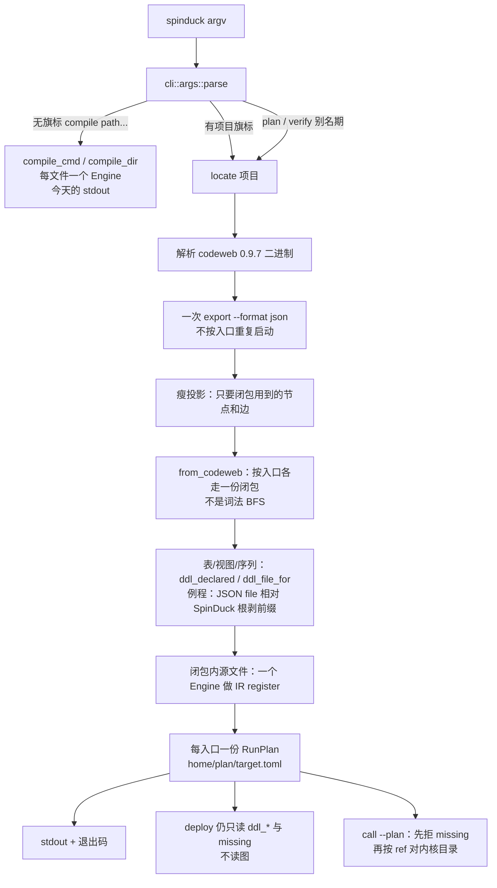

# 设计：把 `compile` / `verify` 链路核验 / `plan` 收成一条静态 `compile`，关系消费 codeweb 0.9.7

| 项 | 值 |
|---|---|
| 作者 | c2j |
| 日期 | 2026-11-11 |
| 状态 | 已批准 |
| 读者 | 熟悉 SpinDuck 与 codeweb 的工程师 |
| 取代关系 | 不改写 `docs/design-production-gaussdb.md` 的结论；本文是静态闭包的规格，文件即 `docs/design-compile.md`。该文档 §6.1 的 generator 与闭包来源两句已随 PR 4 行为更新（PR #32） |
| 被取代部分 | 本文五处 deploy 契约改由 `docs/design-deploy.md`（Draft，尚未落地）规定：Goals「`deploy` 下发顺序不改」、Non-Goals「不改 `deploy` 的装配语义」、IR 节「失败仍会装到 `register_routine_files` 再失败」、衔接节「判定顺序不改、视图仍靠 `views/` 目录分流」、决策记录 9 里重复的「`deploy` 下发顺序不改」。各处已就地标注；该文落地前 deploy 的当前行为仍以本文为准。codeweb 闭包正文、`[[ref]]` / `[[dynamic]]` 的生成与 `call` 的产品边界不受影响；决策 9 的「不升 `schema_version`」继续有效 |

> 环境快照已过期：下文写作时核对的 codeweb 二进制 `/Users/c2j/dev/tools_bin/codeweb` 现为断链，
> codeweb 仓库头也已到 0.9.8。产品仍硬校验 `0.9.7`（`plan/codeweb/export.rs` 的 `VERSION_WORD`）。
> 当前可用的二进制来源与等价性论证见 `docs/validation.md` V43.1。

本文里的行号都按工作区与本机 codeweb 源码当场读到的版本，不是提示里的约数。SpinDuck 工作区：`/Users/c2j/Projects/Desktop_Projects/DOTA/SpinDuck__worktrees/tuning-subcommand-integrate`。codeweb 源码：`/Users/c2j/Projects/Desktop_Projects/CODE/codeweb`，`Cargo.toml` 的 `version = "0.9.7"`。已核对的二进制位置是 `/Users/c2j/dev/tools_bin/codeweb`；产品代码不把这条绝对路径写死。

行号基线：本文的行号与文件位置按 `663e182`（PR #32 合并前）核对。`2653c68` 起已有漂移：`closure.rs` 的 `build` / `walk_chain` / `kernel_gaps` 行号移动，`expand_view_bodies`、`register_routines`、`ddl_file_for` 已删除；阅读代码请以当前树为准。

实现偏差（PR #1–#4 已落地；与本文设计口径的差异在此列出，读代码时以此为准）：`expand_view_bodies`、`register_routines`、`ddl_file_for` 已删除；`CodewebExport::export_json` 返回 `Box<dyn std::io::Read + Send>`；`closure_from_graph` 多一个 `&ClosureContext<'_>` 参数；`plan/codeweb.rs` 实际拆成 `plan/codeweb/` 目录；计划里的相对路径保留 codeweb `file` 的 `./` 段（如 `./sql/routines/...`）。

别名期取消（issue #38 已落地，V44）：维护者以「项目早期，不顾虑向后兼容」豁免了本文的两条硬前提（别名随 v0.1.21 发布、留一个发布周期的兼容窗口），`plan` / `verify` 子命令**直接删除**，不留别名、不留旧快照名读取回退。下文凡涉及「别名期」「`plan_cmd` / `verify_cmd`」「`tests/cli/plan.rs` / `tests/cli/verify.rs`」的段落均为历史设计口径：现状是项目态 `compile --dir`（`--entry` 可给裸名）、`compile --sync-manifest` 写 `conf/spinduck.runtime.toml`（写入成功后删除旧名 `conf/spinduck.toml`），人类测试经逐条批准后改写为 compile 等价（清单见 V44 与 PR 说明）。`verify_project` 库级能力保留，由 `tests/verify_chain.rs` 消费。

---

## Overview

SpinDuck 今天用三套静态入口描述同一件事：`compile` 逐文件做 IR 体检，`verify` 从 `[[entry]]` 做链路核验（并额外把整库装进内存 DuckDB、按场景 `call`），`plan` 从目标例程做闭包并落盘 `RunPlan`。关系发现全在进程内：`plan::closure::walk_chain` 与 `verify::run::walk_chain` 各写一份 BFS，边来自 `verify::chain` 的词法/IR 扫描。这套扫描看不见游标 SQL 里的用户标量函数，于是「函数不存在」要到 DuckDB 执行时才出现，又经常被 `WHEN OTHERS` 收进 OUT 参数。

本设计把**静态**管线收成一条项目态 `compile`。调用、读、写、类型锚、序列、视图依赖、缺件都改消费本机 codeweb 0.9.7 已经建好的图，经 `codeweb export --format json` 读取。SpinDuck 不把 codeweb 链成 crate，不读 `store.bincode`，不解析 `trace` 的树形文本，也不再为关系重走全量 AST。codeweb 绿只说明图里有这条边；闭包内例程源仍由 SpinDuck 自己的 IR 编译器验收，因为两边解析器不是同一个版本。`deploy` 与 `call` 继续独立。`call` 上已有的 `kernel_gaps` 缺件门保留，但项目计划面上它只核对内核里有没有计划已经列出的对象，不再自己发现一套关系。

---

## Background & Motivation

### 现在三条命令各自做什么

| 命令 | 入口 | 关系从哪来 | 还做了什么本设计不收的事 |
|---|---|---|---|
| `compile <path>...` | `spinduck/src/cli/args/mod.rs` 的 `parse`（约 140–155 行）拒绝一切 `--` 旗标；`cli/run/compile.rs::compile_cmd` | 不求闭包 | 每个文件一个 `Engine`（`cli/mod.rs::compile_dir`，101–136 行）。这是 README 的路径体检：`spinduck compile ../lib/fastaas/exam/清算拆分优化考题/基线代码` |
| `plan [--dir] [--schema] <routine>` | `cli/args/project.rs::parse_plan`；壳在 `cli/plan.rs::plan_cmd` | `plan/closure.rs::build` → `walk_chain` | 只落盘计划，不下内核 |
| `verify [项目目录]` | `cli/verify.rs::verify_cmd` | `verify/run.rs::verify_entry` → 同文件的 `walk_chain`（137 行） | `verify_project` 在 `native` 下把语料装进**内存** DuckDB，再跑场景 `call`。`sync_manifest` 写运行态 `conf/` |

派发在 `cli/run/mod.rs::exec`：`Compile` → `compile_cmd`，`Verify` → `verify_cmd`，`Plan` → `plan_cmd`。

`RunPlan`（`spinduck/src/plan/mod.rs`）`SCHEMA_VERSION = 1`。落盘承诺是：清单排序去重、段序固定、无日期、无绝对路径、同输入同字节。`[[missing]]` 非空时 `plan` 与 `deploy` 都是退出码 1，`deploy` 不开库（`cli/deploy.rs` 19–30 行）。`ddl_routines` / `ddl_tables` 是 `deploy` 的下发顺序输入，本设计保留这两份文件清单，不改 `plan/deploy.rs` 的「表/序列 → 视图 → `sys_dummy` → 例程」。

### 失败样本：闭包看不见 `fnc_get_fund_data_mode`

项目 `golden/case_corpus_purchase` 的入口（`spinduck.toml` 23–25 行）：

```text
pkg_split_trade_step3_sh.prc_trd_deal_purchase
```

同包过程 `prc_trd_hz_byfund`（声明在 `golden/case_corpus_purchase/sql/routines/PKG_SPLIT_TRADE_STEP3_SH.sql` 第 6 与第 13 行）的游标 `c_get_data` 从第 51 行开始，第 104 行是：

```sql
AND (select fnc_get_fund_data_mode(a.bcrq, a.gddm, a.sub_gddm, a.xwdm)) = '1'
```

入口过程 `prc_trd_deal_purchase` 没有静态调用 `prc_trd_hz_byfund`：全文件只有第 6、13 行的声明和第 138 行它自己的 `v_proc_name` 赋值（见 V43.2）。因此默认入口的闭包到不了这段游标，本次调用只有在把入口改成该过程时才出现（V43.3）。项目内没有这个函数。`OPEN c_get_data` 在第 180 行，不在第 149 行和第 175 行那两个 `WHEN OTHERS` 里面。循环体第 372 行的 `WHEN OTHERS` 把本行错误交给 `pkg_split_trade_log.inst_log(..., p_o_succeed)`，不 `RAISE`。同文件还有多处同样把错误写进 `p_o_succeed` 或日志桩的处理器（149、175、205、251、274、294、428、452、581 行）。`call` 成功时只打印 `OUT` / `RETURN`（`cli/run/call.rs` 113–122 行）。函数不存在若被处理器收进 OUT，终端上看不到 Catalog Error。

现有管线在四个点上丢掉这次调用：

1. `spinduck/src/sql/sqlfn/plan.rs` 的 `plan_sites`（20 行）与 `call_candidate`（179–202 行）只承认 **已经在 `routine_names` 里** 的名字。目录没有 `fnc_get_fund_data_mode`，标量子查询不会变成 `FnSite`，SQL 原样进 DuckDB。
2. `spinduck/src/verify/chain/mod.rs` 的 `routine_refs`（49–56 行）只收「确定是例程」的名字：语句级 `CallRoutine`（119–123 行）、带点的 `FuncCall`（152–157 行）、已下沉的 `FnSite`（131–136 行）。裸名函数不进 `refs`。
3. `expr_func_names`（64–66 行）把裸名交给 `plan/closure.rs` 的 `walk_chain`（125–134 行）。那里只在 `catalog.lookup` 命中时入队，**未命中不报 `routine:` 缺件**。这是 V34 的刻意口径，用来不把 `coalesce` / `now` / `round` / `substring` 打成假缺件。副作用是「目录里没有的用户函数」和「内建函数」被当成同一种丢弃。
4. 编译器 `spinduck/src/ir/expr.rs` 86 行匹配 `Expr::FunctionCall { name, args, .. }`，`builtin` 字段被 `..` 丢掉。IR 里的 `FuncCall` 因此无法区分内建与用户函数。闭包不能靠补上这个字段来判缺件：SQL 文本里的调用根本没有进 PL 表达式 IR。

codeweb 已经用解析器的 `Expr::FunctionCall.builtin` / `BuiltinFuncMeta` 建图。回归 `codeweb/tests/regress/function_call_edges/` 覆盖了本样本的形态：`select_target_and_where`、`where_subquery` 对 SQL 表达式里的用户函数建 `direct` 边；`builtin_not_captured`、`dbe_xmldom_builtin` 保证内建不建 call 边、也不留 `Unresolved`。节点与边的类型在 `codeweb/src/graph/mod.rs`：`Node::Unresolved`（481 行）、`Node::BuiltinFunction`（649 行）、`Edge::UsesBuiltinFunction`（788 行）、`Edge::DirectCall`（768 行）。`Table.explicit` / `Table.system`（530–535 行）、`View.explicit` / `View.system`（559–564 行）、`Sequence.explicit`（593–596 行，**没有 `system` 字段**）同文件。`Edge::AnchorsOn`（840 行）是 `%TYPE` / `%ROWTYPE`（issue #158）。

### 为什么不在 SpinDuck 里补第三遍 AST

`docs/design-production-gaussdb.md` §5 D4 的四条阻塞仍然成立，本设计不重新打开：

1. codeweb 没有可链接的库目标（只有 `src/main.rs` 这一条 bin）。
2. 仓库无 LICENSE，`Cargo.toml` 也无 `license` 字段。
3. codeweb pin `ogsql-parser` git tag `v0.10.0`（`Cargo.toml` 23 行）。SpinDuck 锁本地 path `../lib/ogsql-parser`，AGENTS.md §1 要求 v0.11.x。同一进程两份解析器会撕裂规则探针。
4. 默认 feature 切不干净：`cargo build --no-default-features --features cli` 编不过（`Edge::ContainsSql` 被 `jsp` feature 门控，消费点没有）。默认 feature 含 tui/jsp，依赖面大于 SpinDuck。

因此 codeweb 只作为外部进程。图的规模（design §4，`codeweb stats`）：交付件 14,611 个 `.sql`、43,432 节点、286,311 边，`analyze` 22.2 s。SpinDuck 不该为了关系再解析这一遍。

### 不要当成事实的「4 张缺表」

`docs/design-production-gaussdb.md` §8 曾把 `par_oper_close_date`、`par_sys_marketrate`、`split_log_info`、`sys_dummy` 写成真实闭包 14 表里的 4 张缺失。`docs/validation.md` V31.5 在 `golden/case_corpus_purchase` 上否掉了这手数：`plan` 实跑 `ddl_tables=1 missing=0`，前三个名字在该夹具 `sql/` 里一次都不出现（例程是简化版），`sys_dummy` 是引擎自建（`verify/deploy.rs` 的 `ENGINE_PROVIDED_TABLES`）。本设计的缺件判定不得把这四个名字写进夹具期望，也不得用它们验收 codeweb 接入。

---

## Goals & Non-Goals

### Goals

- 项目模式的一条命令完成：按入口取闭包、写 `RunPlan`、对闭包内例程源做 SpinDuck IR 编译、缺件则退出码 1。
- 关系只来自 codeweb 0.9.7 的导出图。`plan::closure::walk_chain` 与 `verify::run::walk_chain` 在切换之后不再是项目命令的关系真源。
- 保留 `ddl_routines` / `ddl_tables`，`deploy` 下发顺序不改。**〔deploy 侧已改判〕** 下发顺序与装配语义改由 `docs/design-deploy.md`（Draft，尚未落地）规定；落地前仍以本条为准，只保留「`ddl_routines` / `ddl_tables` 两个键仍在」这半句。
- 计划字节可复现：排序、无绝对路径、无日期。`schema_version` 保持 1。
- 无项目、只给路径的 `compile <path>...` 行为与 stdout 形状保持今天的逐文件体检。
- `plan` 与 `verify` 先变成这条管线的别名，用法里写明替换关系，保留一个发布周期。
- 错误码沿用 `ENG-` / `BIZ-` / `ENV-` / `KERNEL-`。codeweb 不可用、版本不符、导出失败都是 `ENV-0030`，不新造错误类。

### Non-Goals

- 不把 `verify` 的「整库装进内存 DuckDB」和「按场景真的 call」并进 `compile`。这两件事继续不属于静态命令。别名切换之后它们不再由 `verify` 触发；要执行仍走 `call`。
- 不改 `deploy` 的装配语义（非幂等、例程不落盘、`plan.schema` 不下发、不跑种子）。见 architecture §13.6。**〔deploy 侧已改判〕** `docs/design-deploy.md`（Draft，尚未落地）会改装配语义：无标记计划在 deploy 预检就被拒绝，IR 失败不再指望 `register_routine_files` 再失败一次。落地前本条括号里的四项仍是 deploy 的当前行为。
- 不改 `call` 的产品边界。`kernel_gaps` 这个门还在。裸 `call --file` 在切换 PR 里仍走现有门；它不是项目关系真源，见 Rollout。
- 不改循环内 `COMMIT` 语义，不改 sqlfn 物化，不把包函数放进宏。交付件上的运行时慢不在本设计范围内。范围内的加速只是：关系扫描交给已经跑完的 codeweb 图，SpinDuck 只对闭包内源文件做 IR 编译。
- 不新增 runtime 依赖、不新增 Cargo feature、不新增 `[[bin]]`、不改 `SqlExecutor` / `TraceSink` 签名。
- 不把 codeweb 写进 `spinduck/Cargo.toml`。不读、不写 `store.bincode`（design 已记 schema 不稳定；体量约 456 MB）。
- 不自动执行 `codeweb analyze` / `init`。图是前置条件，不是 `compile` 的副作用。
- 不修改 `lib/ogsql-parser`，不把它升到与 codeweb 相同的 tag。
- 不改 golden 夹具、不改 `config/rewrite-rules.toml`。

---

## Proposed Design

### 两条模式



无旗标的路径模式继续拒绝把 `--` 当路径（`should_reject_compile_with_flag_argument` 锁的是未知旗标，不是「将来也不能有合法旗标」）。合法项目旗标是加法；`--help`、`--rules` 这类未知旗标仍返回 `compile 不接受旗标，未知参数: …`，`ENG-0010`，退出码 2。单独的 `compile`（零参数）仍是 `usage: compile <path>...`，从而 `should_reject_compile_without_path` 与 `tests/cli/usage.rs::should_exit_2_with_eng_0010_on_missing_compile_path` 不用改断言。

### 项目模式命令行

```text
spinduck compile --dir <项目目录> [--schema <名>] [--entry <routine>]...
                 [--codeweb-bin <path>] [--codeweb-project <dir>]
```

| 旗标 | 规则 |
|---|---|
| `--dir` | 缺省为 cwd。与 `plan` 一样，由 `cli/verify.rs::locate` 找 `spinduck.toml` 或 `conf/spinduck.toml`。找不到 = 今天的 `ENV-0030` 文案（「未在 … 找到项目声明」），不提子命令名。（issue #38 后：定位收口为 `ProjectConfig::locate`，快照名改 `conf/spinduck.runtime.toml`，V44） |
| `--entry` | 可重复。缺省 = 该项目全部 `[[entry]]`（`ProjectConfig.entries`，`project/entry.rs` 要求 `package.procedure`）。给出时**只**用给出的名字，不要求它事先写在 `[[entry]]` 里——与今天 `plan` 不拿 `[[entry]]` 限制目标的口径一致（design §6.2）。每个入口各写一份 `<home>/plan/<target>.toml` |
| `--schema` | 只写入 `plan.schema`（归一小写）。不参与匹配，不参与 `deploy`。与 `closure.rs::build` 24–25 行的注释一致 |
| `--codeweb-bin` | 见下方解析顺序 |
| `--codeweb-project` | codeweb 项目根（含 `codeweb.toml` 与 `.codeweb/`）。不是 SpinDuck 项目根 |
| 裸路径与任一项目旗标同时出现 | `ENG-0010`，退出码 2。一条命令不能既体检又求闭包 |

零个 `--entry` 且项目没有 `[[entry]]`：`ENV-0030`，消息说明项目模式需要至少一个入口。不退回逐文件体检，也不退回词法闭包。

`plan` 在别名期的 argv 不变：`plan [--dir <项目目录>] [--schema <名>] <routine>`，等价于 `compile --dir <dir> --schema <名> --entry <routine>`。`verify [项目目录]` 在别名期等价于「`sync_manifest`（保留）+ 对该目录全部 `[[entry]]` 跑项目态 compile」。它不再调用 `verify::verify_project`。这一步会改 `tests/cli/verify.rs` 与 `tests/cli/plan.rs` 的可观察结果，见 PR Plan，不在实现里静默改断言。（**本段已被 issue #38 取代**：别名期取消，两条命令直接删除，测试改写经逐条批准，见文首「别名期取消」与 V44。）

用法文本（`cli/args/mod.rs::usage`）在接线 PR 增加一行项目模式，并在 `plan` / `verify` 两行末尾注明「本发布周期的兼容入口，由项目态 `compile` 替换」。`usage_snapshot_should_mention_rules_in_plan_form` 依赖的 `call --plan` 与「内置种子 < 项目发现 < --rules」子串保持不动。

### 实际调用的 codeweb 命令

全图 286,311 边不能按入口各导出一次，也不能用 `--filter`。`main.rs` 的 `Export.filter` 注释写的是「seed + 直接邻居」，`build_filtered_subgraph`（1465–1528 行）只收 1-hop。`prc_trd_deal_purchase` → `prc_trd_hz_byfund` → 游标里的 `fnc_get_fund_data_mode` 至少两跳，1-hop 滤掉的正是本设计要抓的那一跳。

`codeweb query --spec` 也不用。`QuerySpec::execute` 的 `QueryResult` 只有 `NodeResult { index, key, type_tag }`（`graph/query/spec.rs` 74–86 行）。`CollectMode::Subgraph` 在 `execute_traversal` 里没有单独的边载荷（255–274 行，只区分 `Paths` 与节点列表）。没有 `explicit`、`modes`、`write_kinds`、行号，缺件规则无法落地。

`trace` 的 tree/path 文本不是契约。`store.bincode` 不读。

每次项目态 `compile` 按这个顺序各启动**一次**，全体入口共用，不按入口重复：

```text
<codeweb-bin> --version
<codeweb-bin> diff --project <codeweb-project>
<codeweb-bin> export --format json --project <codeweb-project>
```

短旗标同等：`diff -p <dir>`、`export -f json -p <dir>`。不传 `--filter`，不传 `-o`（避免再落一份大文件）。`export` 的 stdout 是 JSON，父进程用管道读。成功时 codeweb 的 stderr 不转发，保证 SpinDuck 自己的 stderr 仍为空（`tests/cli/usage.rs` 与 `tests/cli/plan.rs` 的通道契约）。`export` 子进程退出码非 0：`ENV-0030`，前缀 `codeweb export 失败:`，消息带退出码和截断后的 stderr（上限 2 KiB），不把 JSON 正文打进 stdout。

不调用 `codeweb analyze`。`compile` 不修改 codeweb 的 store。操作前提是：对盖住本 SpinDuck 项目 `ddl`、`routines`、`stubs` 的 codeweb 根，先有一次新的 `codeweb analyze`。分析根没扫到 `sql/stubs` 时，那些被调方在图上是 `unresolved`，会变成假的 `MISS routine`。SpinDuck 不去补扫。

`export` 退出码 0 只表示 `Project::load_store` 读到了一份 store（`project/mod.rs` 509–525 行）。`cmd_export` 只调用它（`main.rs` 1433–1434 行）。store 文件不存在会失败，消息含 `no store found at … — run codeweb analyze first`，归入 `codeweb export 失败:`。`load_store` 不调用 `stale_store_version`（563–573 行）或 `store_is_current`（579–588 行）。那两个只探测**布局版本**，而且 `stale_store_version` 只用在 `cmd_analyze`（`main.rs` 1386 行）。当前布局、但输入已经变过的 store，`export` 仍是退出码 0。布局版本对不上时，失败发生在 `load_bincode` / `load_json` 内部，已经由导出失败前缀覆盖。不把「export 能发现源码漂移」写进实现。

失败关闭不靠 mtime，靠已有的 `codeweb diff`，在 `export` 之前跑。`cmd_diff`（`main.rs` 1401–1424 行）在有变化和没有变化时都返回 `Ok(())`，**退出码都是 0**。信号是 stderr 文本。`FileChangeSet::is_empty`（`parser/fingerprint.rs` 99–101 行）为真当且仅当 modified、added、deleted 都空；`unchanged` 不参与。

- diff 无法 spawn，或退出码非 0：`ENV-0030`，前缀 `codeweb diff 失败:`，带退出码和 stderr 尾部（≤ 2 KiB）。
- 去掉末尾换行后，stderr 恰好是 `Up to date. No changes detected.`：继续 `export`。核对用过的这段 stderr 随后丢弃。
- 其它任何 stderr，包括 `{n} modified, {n} added, {n} deleted, {n} unchanged` 以及后面的 `  M ` / `  + ` / `  - ` 行：`ENV-0030`，前缀 `codeweb 图与源码不一致:`，附同一上限的 stderr 尾部。不解析这些路径，不据此改图。
- 清单 sidecar 缺失时 `load_manifest_only`（`project/mod.rs` 555–558 行）得到空表，文件看起来全是 added，于是走「不一致」。这是失败关闭，不是第二套新鲜度启发式。

### 为什么消费 JSON 而不是 ndjson

锁定的机器契约是 `export -f ndjson`（json 亦可），不是 `trace`，也不是 bincode。v0.9.7 的两种导出不是同一信息量：

| 字段 | `export/ndjson.rs` | `export/json.rs` |
|---|---|---|
| 节点 | `NdjsonNodeRecord`：`record,id,type_tag,type,name,schema`（57–68 行）。没有 `explicit` / `system` / `file` / `line` | `NodeKindJson::Table` / `View` 有 `explicit`、`system`、`file`、`line`（115–150 行）。`false` 用 `skip_serializing_if = "is_false"` 省略，缺省即 false |
| 边 | `NdjsonEdgeRecord`：`record,source,target,type`（84–91 行）。没有 modes、write_kinds、file、line | `EdgeKindJson::TableAccess` 有 `modes`、`write_kinds`、`file`、`line`（292–299 行）；`Direct` / `Dynamic` / `AnchorsOn` / `UsesSequence` / `DependsOn` 都带 `file`+`line` |
| 类型字符串 | `edge_json_type` / `node_json_type`（151–202 行）：`direct`、`dynamic`、`uses_builtin_function`、`table_access`、`depends_on`、`uses_sequence`、`anchors_on`、`unresolved`、`builtin_function` | 同名，另外展开载荷 |

缺件规则要 `explicit` 与 `system`，`[[ref]].at` 要文件和行号，`table_access` 的 read/write 要 `modes` / `write_kinds`。用 ndjson 就得在 SpinDuck 里把这些事实重推一遍，也就是第二套关系判定，直接违反「禁止第二套 BFS / 第二套缺件结论」。因此本设计在契约允许的两种格式里**选定 JSON**。ndjson 仍是 codeweb 的合法导出，但不是这条管线的输入。选定 JSON 是因为这些字段还在，不是因为调用边的 `line` 等于源码行号。v0.9.7 里 `direct` / `dynamic` / `uses_builtin_function` 的 `line` 是 0；表、序列、锚、`depends_on` 的 `line` 是包围语句的起点。字段表在 API 一节，夹具不得把采购文件的 104、408 当成导出器写出的行号。

JSON 由 `to_json` 在子进程里拼成一个 `String`（`export/json.rs` 336 行）再写出。父进程对管道做 `serde_json::from_reader`，得到瘦结构。`columns`、`column_analysis`、`ddl_source`、`sql`、`body` 用 `#[serde(default)]` 后丢掉，不留在 `RunPlan` 里。`serde_json` 已是依赖（`spinduck/Cargo.toml` 第 41 行 `serde_json = "1"`），不新增 crate。serde 仍会解析被跳过的值，所以「从管道读」不等于「父进程只留下瘦投影」。

两套体积分开算：

- 线上 JSON 远大于闭包留下的字段。`TableAccess` 内嵌 `column_analysis`（`export/json.rs` 292–299 行；填充在 `builder.rs` 3750–3760 行，写边上还带着列映射和 `read_tables`）。交付规模 43,432 节点 / 286,311 边上，子进程常驻是 store 加上这一整份字符串，可以到数 GB，而不是「大约 1 GB」的单点估计。
- 瘦投影是丢掉上述大字段之后的节点和边（类型、端点、若干短字符串、一个行号）。这是另一组数，量级数十 MB，不是 456 MB 的 bincode，也不是线上 JSON 的大小。

父进程峰值 = 整份 JSON 的解析 + 瘦图，并且与子进程的 store 和 JSON 字符串同时存在。一次 `compile` 一个导出子进程（另加一次很轻的 `diff`），多入口共享这一次解析。不在循环或 `call` 路径上做这件事。格式决策不变。

`generator` 记导出方版本，按锁定的例子写成字面量 `codeweb 0.9.7`。不写 `spinduck x (plan schema 1)`，不写日期，不写 store 的 mtime。`schema_version` 字段继续表达计划 schema。

### 二进制与项目根

解析顺序，命中即停：

1. `--codeweb-bin`
2. 环境变量 `SPINDUCK_CODEWEB`
3. `PATH` 上的 `codeweb`

都没有：`ENV-0030`，消息固定前缀 `codeweb 二进制不可用:`。**不**回退到 `walk_chain`。

版本门：`--version` 的 stdout（clap 的 `version` 属性，`main.rs` 207–212 行）里必须有独立词 `0.9.7`。其它版本 `ENV-0030`，前缀 `codeweb 版本不是 0.9.7:`。不猜测 0.9.8 的字段是否还在。

codeweb 项目根：

1. `--codeweb-project`
2. `spinduck.toml` 的 `[paths].codeweb`（可选；`ProjectConfig::from_toml_str` 今天忽略未知键，读这个键是兼容加法）
3. 从 SpinDuck 项目根向上查找含 `codeweb.toml` 的目录

找不到：`ENV-0030`，前缀 `未找到 codeweb 项目:`。不执行 `codeweb init`。

子进程参数用 `std::process::Command` 的 argv 数组，不经 shell。不把计划内容或 SQL 拼进命令行。

### 瘦投影上的图

只保留这些节点：`procedure`、`function`、`package`、`table`、`view`、`materialized_view`、`sequence`、`unresolved`、`builtin_function`。其它类型（Java、JSP、mapper、index、trigger、synonym、event、custom）在建索引时丢掉，它们的边一并丢掉。

v0.9.7 的 JSON **不导出** `RoutineId.package`。`NodeKindJson::Procedure` / `Function` 只有 `name` 与 `schema`（`export/json.rs` 64–79 行），另有 `file` 与 `line`。包名从 `contains_routine` 恢复：源是 `package` 节点，目标是 procedure/function（`builder.rs` 1995 行，`graph.add_edge(pkg_idx, *proc_idx, Edge::ContainsRoutine)`）。

`ContainsRoutine` 没有载荷（`graph/mod.rs` 815 行）。`finalize_graph` 的 `drop_identical_duplicate_edges`（`builder.rs` 626–646 行）删掉端点、变体、序列化载荷都相同的平行边。规格文件和包体各 `add_edge` 一次，落盘后同一对 `(package 节点, 例程节点)` 只剩一条。按原始边条数报错，会把一致的图打成 `ENV-0030`。

不自洽只看端点身份：同一个 procedure/function 连着**两个不同的 package 节点**（按该节点的 `schema` + `name`，不是按截断后的两段）。同包名落在两个 schema、因而变成两个 package 节点，就是这种冲突。`ENV-0030`，前缀 `codeweb 图不自洽:`，不猜。零个 package 端点不是错误，走下面的无包规则。

例程的计划名是 `Engine::register_statement_named` 写进目录的那条字符串，小写，**不经过** `normalize`。`normalize`（`chain/mod.rs` 388–394 行）超过两段就只留最后两段；用在带 schema 的包成员上会把 `schema.pkg.proc` 截成 `pkg.proc`，`catalog.lookup` 对不上刚注册的键。`Catalog::register`（`catalog.rs` 136–137 行）只把全串转小写，`lookup`（140–141 行）按这个全串精确查找，不截断。

`CREATE PACKAGE BODY` 的目录键在 `engine.rs` 153–167 行（函数同形，198–202 行）：`pkg` 是包 `ObjectName` 的**每一段**用 `.` 拼起来，再接成员名。`CREATE PACKAGE BODY schema.pkg` 里的过程 `proc` 登记为 `schema.pkg.proc`，不是 `pkg.proc`。

codeweb 把同一个 `ObjectName` 拆开存（`builder.rs` `create_package_nodes` 1887–1901 行）：`schema_part` 是除最后一段以外的全部标识符（可以本身含 `.`），`pkg_name_part` 是最后一段。package 节点的 JSON 是这个 `schema` 加 `name`。procedure/function 的 JSON 只有 `name` 与 `schema`（`export/json.rs` 347–349 行抄 `id.name` / `id.schema`），`id.package` 不出现。包成员的 `id.schema` 就是那个 `schema_part`，**不含**包名；只拼 procedure 自己的 `schema` + `name` 会得到 `schema.proc`，把包名弄丢。

目录键因此这样拼，拼完只做 `to_ascii_lowercase()`：

1. 有唯一 package 端点：包的全名在 package 节点 `schema` 非空时是 `format!("{}.{}", schema, name)`，`schema` 里已有的 `.` 保留；没有 schema 时就是该节点的 `name`。成员是 procedure/function 节点的 `name`（`p.name.join(".")`，也可以含 `.`）。目录键是 `format!("{}.{}", 包全名, 成员)`。`schema` + `pkg` + `proc` → `schema.pkg.proc`。无 schema 的包 → `pkg.proc`。
2. 没有 package 端点，节点带 schema：`format!("{}.{}", schema, name)`。这与独立 `CREATE PROCEDURE` / `CREATE FUNCTION` 一致：`catalog.rs` 216–249 行把 AST 各段用 `.` 拼起来。codeweb 的 `RoutineId::from_object_name`（`graph/mod.rs` 338–357 行）把除最后一段以外的标识符放进 `schema`、最后一段放进 `name`，拼回去就是目录里的全串。三段 `db.schema.func` 保持三段，不用 `normalize` 截成 `schema.func`。
3. 没有 package 端点，也没有 schema：目录键是裸 `name`。

`--schema` 不参与消歧，也不参与这三条。它只写入 `plan.schema`。

入口匹配：把 `--entry` / `[[entry]].routine` 做与 `qualified_routine` 相同的小写（`project/entry.rs` 50–54 行；含 `.` 即合法，`schema.pkg.proc` 过得去），再与上面的目录键逐字比较。**不再**调用今天 `closure.rs::build` 34 行的 `normalize(target)`。零个：`BIZ-0150`，不落盘（与 `build` 35–42 行同一故障域、同一「不写文件」口径）。多于一个：`ENV-0030`，前缀 `入口在 codeweb 图中不唯一:`。

`normalize` 仍只用于两处旧口径：未解析 `direct` 的 `MISS routine:<normalize(raw_expr)>`（那里没有 package 节点可还原 `ObjectName`），以及 table/view/sequence 的名字索引。已经落到 procedure/function 节点上的名字不走它。

`ddl_routines` 是闭包内 procedure/function 的 JSON `file`，相对 **SpinDuck 项目根** 剥前缀，`/` 分隔。剥得出时与 `rel_text`（`closure.rs` 419–424 行）同形。剥不出时**禁止**采用 `rel_text` 的 `unwrap_or(path)`：那会把绝对路径写进计划。`deploy` 的 `existing`（`plan/deploy.rs` 71–79 行）把相对路径接到项目根上，绝对路径或缺失文件都是 `ENV-0030`。

- 非入口的 procedure/function，`file` 不在 SpinDuck 项目根下：`MISS routine:<归一名>`，`from` 是指向它的 `direct` 边的源。不把该节点从闭包里丢掉，它的出边照走。丢掉之后它既不是相对 `ddl_routines`，也不是缺件；`deploy` 不会加载它，而切换后的 `kernel_gaps` 只核对 table/view/sequence 的 `[[ref]]`。
- 入口自己的 `file` 剥不出项目根：`ENV-0030`，前缀 `入口源文件不在项目根下:`，不写计划文件。入口不能记成 `MISS routine` 再落一份没有源文件的计划。

`ddl_declared`（`closure.rs` 355–376 行）只认 `CREATE TABLE|VIEW|SEQUENCE`，注释写明不认包和例程（351–354 行）。它和 `ddl_file_for` 只负责 table/view/sequence 的名字到项目内 CREATE 文件。例程文件不走这张索引。也不再调用 `register_routines`（311–330 行）来发现例程文件：那会把每个例程和 stub 都编译一遍，而且用 `RuleRegistry::default()`。

codeweb 的 analysis 路径必须盖住本项目的 routines、stubs 和 DDL。`analyze` 把配置路径 `root.join` 成绝对路径再存进节点（`project/mod.rs` 133–141 行），所以 JSON `file` 在 codeweb 根为绝对路径时就是绝对路径。这是剥前缀的输入，不是计划里的路径。

### 闭包算法（替换词法 BFS 的那一个函数）

新函数放在新文件 `spinduck/src/plan/codeweb.rs`（`closure.rs` 已 425 行，再往里堆会破 AGENTS.md 的 500 行上限）。签名形态：

```rust
/// 从一个已加载的瘦图和一个入口求闭包。不读磁盘、不启进程。
pub fn closure_from_graph(
    graph: &CodewebGraph,
    entry: &str,
) -> Result<GraphClosure, EngineError>;
```

`CodewebGraph` 是瘦投影，不是 codeweb 的 `CodeGraph`。生产路径由 `CodewebExport` 接缝填充；测试塞夹具 JSON，不启进程。

生产接缝返回流，不返回 `Vec<u8>`。`Vec<u8>` 会让父进程在子进程仍持有 store 和整份 JSON 字符串的同时，再持有一份线上文档。

```rust
/// 进程外导出。测试用夹具实现，生产实现才 `Command::new`。
/// 返回值在读完之前必须持有子进程：把 `Child` 和 stdout 包在同一个 `Read` 里，
/// 读完或丢弃时才 `wait`。先丢掉 `Child` 会把管道提前关掉。
pub trait CodewebExport {
    fn export_json(
        &self,
        project: &Path,
    ) -> Result<Box<dyn std::io::Read>, EngineError>;
}
```

父进程对这个 `Read` 做 `serde_json::from_reader`，当场丢掉 `columns`、`column_analysis`、`ddl_source`、`sql`、`body`，只留下瘦图。夹具实现可以返回 `Cursor<Vec<u8>>`，那只活在测试里。

多入口不能按入口调用下面的 `build`，否则每个入口一个子进程。项目态 `compile` 调用一次：

```rust
pub fn plans_from_export(
    project: &ProjectConfig,
    entries: &[String],
    schema: Option<String>,
    export: &impl CodewebExport,
) -> Result<Vec<RunPlan>, EngineError>;
```

它导出并解析一次，再对每个入口调用 `closure_from_graph`。`build` 是单目标外壳，内部走同一条「导出一次」的路径，测试注入 `&impl CodewebExport`，不靠全局，也不靠隐藏的 `walk_chain`。

算法是图上的 BFS，边集合只有 codeweb 的边，没有 `routine_refs` / `expr_func_names` / `sql_object_refs`：

1. 入口例程入队。`seen_routine` 去重。
2. 弹出例程 R，扫描它的出边：
   - `direct`，目标是 procedure/function：目标入队；记一条 `kind=routine` 的 ref。
   - `direct`，目标是 `unresolved`：`MISS routine:<normalize(raw_expr)>`，`from` = R 的归一名。不入队。
   - `direct`，目标是 `builtin_function`：不报缺（防御；正常路径内建走的是另一条边）。
   - `uses_builtin_function`：不报缺，不入队，不写 ref。`trace` 默认隐藏它们（`docs/plans/2026-06-26-builtin-function-tracking.md`）；导出里仍在，读到就丢掉。
   - `dynamic`：写入 `[[dynamic]]`（`raw`、`from`、`at`）。不按缺源码判死，不影响退出码。
   - `table_access`：按角色映射记 ref；目标若是 view / materialized_view，视图入队。
   - `depends_on`：源已经在闭包里（例程，或已入队的视图）则记 `role=read`，视图目标继续入队。这是 `expand_view_bodies` 的替换，不是第二套词法。
   - `uses_sequence`：记 sequence ref。
   - `anchors_on`：记 `role=type`。目标表/视图若尚未纳入，也要做缺件与 DDL 文件核对（`%TYPE` 指向的对象没有文件就不能装），但不把 type 锚当成一次 DML 读。
   - `contains_routine`、`calls_procedure`、`calls_java`、`invokes_mapper`、`indexes_table`、`references_type`、继承边：不参与这条闭包。`contains_routine` 只在建索引时用过。
3. 视图队列同样用集合去重，环和自引用停住。
4. 同一 `(object, kind, role, from, at)` 只留一行。排序键即这五元组。

被替换的生产调用点，切换 PR 必须改掉，不能两套同时对一个项目出 `[[missing]]`：

| 函数 | 位置 | 切换后 |
|---|---|---|
| `plan::closure::build` | `closure.rs` 26–30 行，今天是 `(project, target, schema)` | 增加 `&impl CodewebExport`。单目标时内部导出一次再调用 `closure_from_graph`。不再调用 `walk_chain` 与 `expand_view_bodies`。多入口不循环调用它 |
| `plan::closure::walk_chain` | `closure.rs` 83 行 | 项目命令不再进入。函数体在切换 PR 从 `build` 与 `kernel_gaps` 的项目路径摘掉 |
| `plan::closure::expand_view_bodies` | `closure.rs` 192 行 | 由 `depends_on` 替换。函数可留在测试里对照旧夹具，生产路径不调用 |
| `verify::run::walk_chain` | `verify/run.rs` 137 行 | `verify` 别名不再走到 `verify_entry`。函数与其单元测试留在文件里，直到人批准删除；删除不是切换 PR 的隐式动作 |
| `chain::routine_refs` / `expr_func_names` / `sql_object_refs` | `verify/chain/mod.rs` | 留下做映射与既有单测夹具（逗号连表、注释、表函数）。禁止再被 `build` 用来产生缺件 |

`ddl_declared` / `ddl_file_for` 只把 table/view/sequence 的名字映到项目里的 CREATE 文件。它回答「这个关系名的 CREATE 写在哪个相对路径」，不回答「闭包里有没有这个名字」，也不回答例程文件在哪。例程路径规则在上一节。这是决策里允许留下的映射，不是平行的缺件源。

### 角色映射

JSON 里 `table_access.modes` 的词是 `read`、`write`、`lock_read`、`access_exclusive`、`share_update_exclusive`、`share`、`share_row_exclusive`、`exclusive`（`export/json.rs` 787–799 行，与 `AccessMode` 的八个位一一对应）。`write_kinds` 是已排序的标签，含 `insert`、`update`、`delete`、`select_into`，也含 `lock_table` 等（`graph/mod.rs::write_kind_label`，159 行起）。

`share` 是 `AccessMode::Share`（`graph/mod.rs` 74 行，注释 L5），不是 `AccessMode::Write`（71 行，L3 RowExclusive）。`role=write` **只**在 `modes` 含 `write`，或 `write_kinds` 非空时出现。其余锁位在没有这两条时都是 `role=read`：`lock_read`、`access_exclusive`、`share_update_exclusive`、`share`、`share_row_exclusive`、`exclusive`。`deploy` 不读 `[[ref]]`，这条不改变下发；锁-only 记成 write 会让以后信任 `role` 的消费者把一把锁当成一次写入。

| codeweb 边 | `[[ref]].kind` | `[[ref]].role` |
|---|---|---|
| `table_access`，`modes` 含 `write`，或 `write_kinds` 非空 | 目标是 table 则为 `table`；view / materialized_view 则为 `view` | `write` |
| `table_access`，没有 `write` 且 `write_kinds` 为空（只剩 `read` 和/或上面的锁位，含单独的 `share`） | 同上 | `read` |
| 同一条边既有读或锁、又满足写条件 | 同上 | **两行**，`read` 与 `write` 各一行 |
| `depends_on` | 目标节点的 table/view | `read` |
| `anchors_on` | 目标节点的 table/view（锚的是对象，不是一个新的 kind） | `type` |
| `uses_sequence` | `sequence` | `read` |
| `direct` 指向 procedure/function | `routine` | `call` |

`role=call` 是本设计对锁定枚举的一处补全，不是再开会：`read|write|type` 都不是调用。把 `direct` 写成 `role=read` 会让以后的物化清单把被调过程当成一张表。序列没有独立角色，`uses_sequence` 用 `kind=sequence` + `role=read`。`materialized_view` 在 ref 里记 `view`；v0.9.7 的该节点没有 `explicit`/`system`（`NodeKindJson::MaterializedView`，200–204 行），缺件只走「项目里有没有 DDL 文件」。

### 缺件

对象标识延续今天的三前缀，这样 `deploy` / `call` 的 `MISS relation:… <- …` 行不用改形状：

| 情况 | `[[missing]].object` |
|---|---|
| table 或 view 缺 DDL | `relation:<归一名>` |
| sequence 缺 DDL | `sequence:<归一名>` |
| `direct` → `unresolved`，且该目标不是 `builtin_function` | `routine:<normalize(raw_expr)>` |
| `dynamic` | 不进 `[[missing]]` |

表/视图（有 `system` 字段的节点）：

- `system == true`（JSON 里字段出现且为 true；`sys_dummy` 若被标成系统表走这里）：不报缺，不进 `ddl_tables`。
- `explicit == false` 且 `system == false` 且 `ddl_file_for` 找到项目文件：不报缺，文件进 `ddl_tables`。这是决策 10 的核对，用来挡住解析器把「其实有 DDL」标成 inferred 的误报。
- `explicit == false` 且 `system == false` 且项目里没有文件，且不是 `ENGINE_PROVIDED_TABLES`：报缺。
- `explicit == true` 但项目 DDL 索引没有这个名字：仍报缺。codeweb 的 `file` 若在 SpinDuck 项目根之外，不能写进计划（绝对路径，且 `deploy` 只下发项目内清单）。定义在别的树里，对本项目就是缺文件。
- `engine_provided`（今天只有 `sys_dummy`）即使 JSON 漏了 `system`，也不报缺、不进清单。与 `closure.rs::engine_provided` 同一张表，不在这里再抄一个名字。

序列没有 `system` 字段。只看 `explicit` 与项目 DDL 索引，规则与上表除 `system` 以外相同。不要为序列发明系统 schema 名单。

`from` 是边的源节点归一名：例程调用的缺件归到调用方例程；视图 `depends_on` 的缺件归到视图名，而不是外层过程。样本里的期望是 `routine:fnc_get_fund_data_mode`，`from` 为 `pkg_split_trade_step3_sh.prc_trd_hz_byfund`，不是入口过程。多个源各留一行，排序去重。

V31.5 的四个名字不写入任何夹具的期望缺件。验收样本是 `fnc_get_fund_data_mode`，不是那四张表。

### IR 编译

闭包例程的源文件就是上一节剥出来的相对 `ddl_routines`。用 `read_source_strict` 读入，规则用与 `compile_cmd` 相同的 `rules_for_paths`（项目 `[paths].rules` 叠在种子上）。**一个** `Engine` + `NoopExecutor` 按路径排序 `register`。这与路径模式的「每文件一个 Engine」（`compile_dir`）不同；路径模式保持原样。剥不出项目根的非入口例程已经是 `MISS routine`，不送进这个 Engine。

今天 `closure.rs::register_routines`（311–330 行）用的是 `RuleRegistry::default()`，不吃项目规则。新路径不得复制这个缺口，否则 IR 结论会和 `compile` 体检、`call` 分叉。

codeweb 用 ogsql-parser 0.10.0 把边建成，只说明 0.10.0 认识这次调用。SpinDuck 的 0.11.x 编译失败仍以 `eng.register` 返回的 `EngineError` 为准（`ENG-####` 等现有码），不翻译成 `MISS routine`。stdout 在计划摘要之后逐文件打今天体检已经使用的形状：

```text
FAIL sql/routines/PKG_SPLIT_TRADE_STEP3_SH.sql  [ENG-0022] …
```

IR 失败不阻止计划落盘：关系清单仍然成立，`deploy` 会在 `register_routine_files` 上用同一个错误再失败一次，不会装出一个「注册已成功」的库。不把 IR 失败塞进 `[[missing]]`，避免 `deploy` 的 `MISS` 行冒充缺对象。任一入口有缺件或有 IR 失败，进程退出码都是 1。

> **〔deploy 侧已改判〕** 「`deploy` 会在 `register_routine_files` 上再失败一次」这半句由
> `docs/design-deploy.md`（Draft，尚未落地）改判：落地后计划仍落盘，但无标记计划在 deploy 预检
> 就被拒绝，库文件不会出现，不再走到注册那一步。落地前本段描述仍是 deploy 的当前行为；本段其余部分
> （IR 失败不进 `[[missing]]`、退出码 1）继续有效。

### 与 `deploy`、`call` 的衔接

`deploy` 不改判定顺序：`[[missing]]` 非空 → 退出码 1，打印 `MISS`，不开库。它不读 `[[ref]]`、不读 `[[dynamic]]`、不调用 codeweb。文件清单仍是 `sources.ddl_routines` 与 `sources.ddl_tables`。视图文件继续靠现有的「路径落在 views 目录 / `creates_view()`」分流，不靠 `[[ref]].kind` 重排下发顺序。

> **〔deploy 侧已改判〕** 本段的判定顺序与视图分流口径改由 `docs/design-deploy.md`（Draft，尚未落地）
> 接管；落地前仍以本段为准。「不读 `[[ref]]` / `[[dynamic]]`、不调用 codeweb」这半句仍是 deploy 的边界。

`call --plan` 保持两道门：

1. 计划自带 `[[missing]]` 非空 → 现有逻辑，开库之前拒绝。
2. `kernel_gaps` 保留。切换之后，`--plan` 这条路径不再调用 `walk_chain` 发现边。它把计划里 `kind` 为 table/view/sequence 的 `[[ref]]` 变成今天的 `relation:` / `sequence:` 标识，用现有的 `kernel_has`（`closure.rs` 166 行）问内核目录。命中失败的 stdout 仍是 `MISS <object> <- <from>` 加一行 `call: target=… missing=… 未执行`。`role=type` 的锚同样要在内核里有对象。`[[dynamic]]` 不参与这道门。

裸 `call --file` 没有计划、也没有 codeweb 项目。切换 PR **不**改 `refuse_on_kernel_gaps` 在 `CallTarget::Routine` 上的行为，避免无计划调用突然失去表缺件门，也避免改 `tests/cli/call.rs`。这条路径上的 `walk_chain` 必须从项目命令上拆开：`build` / `verify` 不能再调用它。它不是项目缺件的第二份结论。把它从裸 `call` 也删掉，是单独的、需要人点头的后续，因为那会改人类测试；不放进本设计的首批 PR。

`kernel_gaps` 在目标未登记时继续返回 `None`，把 `BIZ-0150` 留给 `Engine::call`，不改故障域。

---

## API / Interface Changes

### CLI

路径模式 argv 与退出码不变：0 全绿，1 有 `FAIL`，2 用法错（`cli/run/mod.rs` 的 `EXIT_OK/FAIL/USAGE`）。

项目模式 stdout（一个入口一块，最后一行汇总）。已有的两行 `plan:` 保持今天的形状，好让尚未切换的 `plan` 契约在别名 PR 里仍然对得上子串 `plan: target=<t> routines=<n> tables=<n> missing=<m>`：

```text
plan: .spinduck/plan/pkg_split_trade_step3_sh.prc_trd_hz_byfund.toml (updated)
plan: target=pkg_split_trade_step3_sh.prc_trd_hz_byfund routines=2 tables=4 missing=1
MISS routine:fnc_get_fund_data_mode <- pkg_split_trade_step3_sh.prc_trd_hz_byfund
REF routine:pkg_split_trade_step3_sh.prc_trd_hz_byfund call <- pkg_split_trade_step3_sh.prc_trd_deal_purchase @ sql/routines/PKG_SPLIT_TRADE_STEP3_SH.sql:0
DYN PlVariable(["v_sql"]) <- pkg_split_trade_step3_sh.prc_trd_hz_byfund @ sql/routines/PKG_SPLIT_TRADE_STEP3_SH.sql:0
FAIL sql/routines/PKG_SPLIT_TRADE_STEP3_SH.sql  [ENG-0022] …
compile: entries=1 missing=1 failed=1 dynamic=1
```

`routines=` / `tables=` / `missing=` 这些计数只是形状说明，不是 `case_corpus_purchase` 的承诺计数。`REF` / `DYN` 行按与 toml 相同的排序打出。`tables=` 仍是 `ddl_tables.len()`，不是 ref 行数。退出码：缺件或 IR 失败为 1；codeweb/`locate`/版本问题为 1（`ENV-0030` 经 `run` 的 `Err` 臂，`run/mod.rs` 35–39 行）；用法为 2。目标例程不在图里：`BIZ-0150`，退出码 1，不写计划文件。

`:0` 与 `PlVariable(["v_sql"])` 是 v0.9.7 的真实形状，不是采购文件的源码行。调用边、内建边、动态边的 `line` 是 0。动态 `raw` 是 `format!("{:?}", peeled)`（`extractor.rs` 691–692 行），不是标识符 `v_sql`。`PlVariable(["v_sql"])` 只说明 Debug 形态；不声称它是第 408 行那个表达式的精确 Debug。采购文件第 51、104、180、372、408 行仍是「游标、调用、OPEN、WHEN OTHERS 在源码里的位置」，用来解释今天的管线为什么漏掉函数，不写进 `at`。

`verify` 别名在上述输出之前保留今天的 `manifest:` 行（`cli/verify.rs::sync_manifest`）。它不再打印 `== entry` / `PASS` / `verify: entries=`。这是契约变更。

### `RunPlan`

`SCHEMA_VERSION` 保持 1。旧文件没有 `[[ref]]` / `[[dynamic]]` 时，`from_toml_str` 读成空向量，行为与今天一致。新文件总是能往返。空的 ref/dynamic **不**写出空段，与今天空的 `[[missing]]` 一样，避免无谓的字节变化。一旦有行，段序固定为：

```toml
[plan]
schema_version = 1
target = "pkg_split_trade_step3_sh.prc_trd_hz_byfund"
generator = "codeweb 0.9.7"
project_dir = "../.."

[sources]
ddl_routines = ["sql/routines/PKG_SPLIT_TRADE_STEP3_SH.sql"]
ddl_tables = ["sql/ddl/tables.sql"]
materialize = []
writeback = []

[[ref]]
object = "mid_yjqs_detail"
kind = "table"
role = "read"
from = "pkg_split_trade_step3_sh.prc_trd_hz_byfund"
at = "sql/routines/PKG_SPLIT_TRADE_STEP3_SH.sql:0"

[[dynamic]]
raw = "PlVariable([\"v_sql\"])"
from = "pkg_split_trade_step3_sh.prc_trd_hz_byfund"
at = "sql/routines/PKG_SPLIT_TRADE_STEP3_SH.sql:0"

[[missing]]
object = "routine:fnc_get_fund_data_mode"
from = "pkg_split_trade_step3_sh.prc_trd_hz_byfund"
```

字段约束：

- `kind` ∈ `table` | `view` | `sequence` | `routine`。别的值：`from_toml_str` 以 `ENV-0030` 拒绝。
- `role` ∈ `read` | `write` | `type` | `call`。
- `at` 是 `<相对路径>:<行号>`，`/` 分隔，相对 **SpinDuck 项目根**。相对路径是 JSON `file` 剥掉该根；行号是 JSON `line` **原样拷贝**，包括 `0`。不扫描 SQL 去补源码行号。有用的调用点行号是 codeweb 的改动，不是 SpinDuck 的第二次关系扫描。
- v0.9.7 的行号事实：`CallExtractor::push_call` / `push_builtin_call`（`extractor.rs` 371–388 行）存的是调用方传入的行。SQL 调用点都传 `0`：`visit_expr`（782、786 行）、`visit_call`（528–530 行）、`visit_procedure_call`（546 行）、`EXECUTE IMMEDIATE` 回退（691–692 行）。`create_edges` 把这个 location 原样抄到 `UsesBuiltinFunction`（`builder.rs` 2965–2967 行）、`DynamicCall` / `DirectCall`（3044–3052 行，以及未解析目标上的 3100–3108 行）。去重键是 `(caller, callee)`（2924–2934 行），后面的调用点丢掉，所以一对调用方/被调方只有一个 `at`。`table_access` 的 `line` 是包围语句的 `info.start_line`（3746–3748 行）；`depends_on` 同样（991–994 行）；`uses_sequence` 在 2361、2447、2736 行，三处都是 `info.start_line`；`anchors_on` 由 `collect_routine_anchor_edges` 收到的也是 `info.start_line`（2369–2378、2455–2464、2690–2699 行），同一例程上的锚共用这一行，不是 `%TYPE` 记号所在行。这些数原样抄进 `at`，可以不是 0。上面 toml 里表那一行的 `:0` 只示范「0 也合法」；实现夹具断言的是夹具 JSON 里的 `line`，不是采购文件的行号。
- 剥不出项目根前缀的 `file`：例程走上一节的 `MISS routine` 或入口 `ENV-0030`；表/视图/序列走「定义不在项目内」的缺件规则。计划里不出现绝对路径。
- `generator` 对新产出的计划是 `codeweb 0.9.7`。读侧不强制旧计划改这个字符串：`deploy` 今天只要求字段存在（`plan/mod.rs` 121 行）。
- `quoted()`（`plan/mod.rs` 184–196 行）今天只逃逸 `\` 和 `"`。TOML 基本字符串不能含裸换行，而 `raw` 是 Debug 文本，`format!("{:?}", …)` 可以含 `\n`。扩展为：出现 `\n`、`\r`、`\t` 时写成 `\\n`、`\\r`、`\\t`。不含这些字符的字符串与今天逐字节相同，旧计划不变。`from_toml_str` 用 toml crate 读回，转义会被还原。不扫描 SQL 去还原源码。
- 渲染前 `BTreeSet` 排序。`[[ref]]` 的序是 `object, kind, role, from, at`。`[[dynamic]]` 的序是 `raw, from, at`。

`to_toml_string` / `from_toml_str` 仍是唯一一对口径，不换 `toml::to_string_pretty`（`plan/mod.rs` 57–62 行的理由不变）。

### 错误码

不新增码。`ENV-0030` 已经是项目文件、计划 schema、编码失败的环境码；codeweb 不可用属于同一类「环境没有把输入准备好」。用消息前缀区分，避免再占一个号并触发 AGENTS.md §5 的新码探针：

| 前缀 | 时机 |
|---|---|
| `codeweb 二进制不可用:` | 三级查找都失败，或 `Command` 无法 spawn |
| `codeweb 版本不是 0.9.7:` | `--version` 对不上 |
| `未找到 codeweb 项目:` | 没有 codeweb.toml |
| `codeweb diff 失败:` | `diff` 无法 spawn，或退出码非 0 |
| `codeweb 图与源码不一致:` | `diff` 退出码是 0，但 stderr 不是 `Up to date. No changes detected.` |
| `codeweb export 失败:` | `export` 子进程非 0，或 stdout 不是约定的 JSON。store 不存在走这里 |
| `入口在 codeweb 图中不唯一:` | 归一后多个节点 |
| `codeweb 图不自洽:` | 同一个例程连着两个不同的 package 节点 |
| `入口源文件不在项目根下:` | 入口 procedure/function 的 `file` 剥不出 SpinDuck 项目根 |

目标不在图里仍是 `BIZ-0150`。用法仍是 `ENG-0010`。IR 失败沿用 `register` 已经返回的码。

---

## Data Model Changes

没有数据库迁移。变化只有计划 toml 的两个可选表 `[[ref]]`、`[[dynamic]]`，以及新计划的 `generator` 字面量。

`[paths].codeweb` 是可选字符串，指向 codeweb 项目根。缺省时向上查找。旧的 `spinduck.toml` 不写这个键仍然合法。

计划文件仍在 `ProjectConfig.home_dir/plan/<target>.toml`（`plan_dir`，`closure.rs` 227 行）。`project_dir` 仍是计划目录相对项目根的 `../..` 形态，由深度算出，不写死。

codeweb 的图不入库、不进 git、不进 `RunPlan`。`[[ref]].at` 只留相对路径和行号。

---

## Alternatives Considered

### 1. 继续扩展 `walk_chain`，让 `expr_func_names` 对未命中的裸名报缺件

否。V34 已经证明未命中裸名里混着 `coalesce` / `now` / `round` / `substring`。要分开它们，就得在 SpinDuck 里重做 builtin 分类，而 `ir/expr.rs` 86 行已经把 `builtin` 丢掉，并且游标 SQL 里的调用不在 PL 表达式上。等于第三套解析，和 D4、和「禁止第二套 BFS」同时冲突。codeweb 的 `builtin` 标记才是内建依据。

### 2. 把 codeweb 当 crate 链进来

否。D4 四条阻塞仍在，见 Background。进程外契约是已锁定决定。

### 3. `export --filter <入口>` 或 `query --spec` 按入口取子图

否，作为**主路径**。`--filter` 只有 1-hop（`build_filtered_subgraph`），表达不了多跳闭包；`query` 不返回边载荷，`CollectMode::Subgraph` 没有实现成子图，拿不到 `explicit`。本夹具的样本只能从显式入口命中（V43.3），不单独证明多层链；但 1-hop 与缺载荷这两条限制与入口无关。一次全量 JSON 导出、进程内再按入口裁闭包，是 v0.9.7 CLI 上能拿到完整字段的唯一命令。

### 4. 读 `store.bincode` 或解析 `trace --exact`

否。bincode schema 不稳定、约 456 MB，而且会把 codeweb 的内存布局变成 SpinDuck 的依赖。`trace` 默认还隐藏 builtin，文本不是机器契约（design D4 已写明）。

### 5. 选定 ndjson，缺的字段用项目 DDL 词法补

否。ndjson 没有 `system`，`sys_dummy` 与普通 inferred 表无法区分，SpinDuck 会再长出一张系统表名单。那就是第二份缺件结论。JSON 已经有这些字段。

---

## Security & Privacy Considerations

威胁模型是本地开发者机器，不是网络服务。

- 子进程只接受上面三个来源的二进制路径。argv 数组执行，无 shell 元字符。
- 计划、argv、`TraceSink` 都不写入 GaussDB 口令。本命令不连接数据库。
- 导出的 JSON 含源码位置，可能含列定义和 SQL 片段。瘦解析丢弃 `columns`、`column_analysis`、`sql`、`ddl_source`。这些字节只活在子进程和父进程的解析缓冲里，不写入计划、不写入仓库。
- `at` 与 `ddl_*` 拒绝绝对路径，避免把开发机目录结构烤进可移植的计划文件，也避免 `deploy` 去读项目根以外的路径。
- codeweb 项目与 SpinDuck 项目可以不是同一棵树。定义落在 SpinDuck 根以外时，非入口例程与表/视图/序列判缺件，入口例程是 `ENV-0030` 且不写计划。不跟随 codeweb 的绝对路径把外部 SQL 装进 DuckDB。
- 不新增鉴权面。`deploy` / `call` 的现有门（缺件拒绝、写回白名单）不放宽。`[[dynamic]]` 不变成「执行这段动态 SQL」的许可。

---

## Observability

本命令是一次性 CLI，不新增 `TraceSink` 事件，不改接缝签名，不加指标系统。

可观察的就是 stdout 契约：`plan:` 两行、`MISS`、`REF`、`DYN`、`FAIL`、`compile:` 汇总，外加别名期 `verify` 的 `manifest:` 行。stderr 保持空。`diff` 在已同步时的那一行 stderr 核对之后丢弃；codeweb 的其余 stderr 只在失败时截断进 `ENV-0030` 的消息。

`generator = "codeweb 0.9.7"` 是口径标记：计划红时先核对导出版本，再核对 SpinDuck 的 IR。不记录 analyze 时间戳，以免破坏字节复现。

---

## Rollout Plan

没有 Cargo feature、没有运行时开关。切换靠 PR 顺序，而不是旗标。

1. 先落地纯函数与夹具测试。`plan` / `verify` / 路径模式 `compile` 的行为不变，现有人类测试保持绿。
2. 再接项目态 `compile` 旗标。零参数与未知旗标的断言保持原样。
3. 最后才把 `plan` / `verify` 指到同一条管线，并让 `build` 停止调用词法 BFS。这一 PR **不能**在无人点头的情况下改 `tests/cli/plan.rs`、`tests/cli/verify.rs`、`src/plan/tests.rs` 里现有 `build()` 用例的断言或夹具搭建方式。PR 说明里列出这些测试名，人批准之后才改。
4. 别名保留一个发布周期。用法文本写明 `plan` / `verify` 将被项目态 `compile` 替换。周期结束后的删除 PR 同样要人点头（usage 与解析测试）。
5. 回滚：撤回切换 PR。词法 `walk_chain` 在切换 PR 之前一直还在 `build` 里，不存在「半切换已删除旧实现」的窗口。切换 PR 之后若要回滚，整 PR 回退，不在树里留两套同时写 `[[missing]]` 的路径。

`call` 的裸名门不在这个周期里删除。`--plan` 的第二道门改为读 `[[ref]]` 与切换 PR 同一批，且只在该 PR 获准时落地。旧计划文件没有 `[[ref]]`：`--plan` 的内核门保持今天的 `kernel_gaps` → `walk_chain`，直到该计划被项目态 `compile` 重写（文件里出现至少评估过的 ref 段；完全没有 `[[ref]]` 键视为旧计划）。这样旧计划不会在重写前突然变成「没有对象可核对 → 假绿」。新计划即使一行 ref 都没有，也写出 `refs_from = "codeweb"` 这样的标记吗？不写新键。改用：`generator` 以 `codeweb ` 开头即新计划，内核门只读 `[[ref]]`（空则内核门不再发现额外对象，缺件只来自 `[[missing]]`）。`generator` 仍是 `spinduck …` 或测试里的 `test` 时，`--plan` 内核门保持今天的实现。这一分支只活到别名周期结束；周期结束时裸 `call` 与旧 generator 的去留另起 Ask-first PR。它不让项目态 `compile` 与词法各写一份 missing。

文档登记（architecture §13.5「闭包来源」那一行、design §6.1 的 generator 说明）放在切换 PR 获准之后，与行为同 PR。本设计已写入 `docs/design-compile.md`。

---

## Risks

| 风险 | 严重度 | 缓解 |
|---|---|---|
| 当前布局的 store 输入已变，`export` 仍退出码 0，计划会假绿 | 高 | `export` 不查漂移。`diff` 在导出前跑；退出码两边都是 0，只认 stderr 恰好为 `Up to date. No changes detected.`。其它文本是 `codeweb 图与源码不一致:`。不加 mtime |
| codeweb 0.10.0 与 SpinDuck 0.11.x 对同一文件语法结论不同 | 高 | IR 以 SpinDuck 为准，失败用现有 `EngineError` 打出，不把 codeweb 绿当成可部署。计划仍落盘，`deploy` 在 register 再失败 |
| 全量 JSON 让子进程常驻 store 加整份字符串，父进程同时解析这份文档 | 高 | 一次 `compile` 一个导出子进程，多入口共享一次 `from_reader`。线上体积被 `column_analysis` 撑大，交付规模可以到数 GB；瘦投影是丢掉大字段之后的另一组数。接缝是 `Read`，不是 `Vec<u8>`。不在循环或 `call` 上做 |
| `generator` 分支让旧 `--plan` 暂时还走 `walk_chain` | 中 | 只发生在旧计划上；新计划 `generator` 前缀把它关死。窗口一个发布周期，不与项目态 `compile` 并行写 missing |
| `Procedure` JSON 不含 package，目录键被 `normalize` 截成两段就会 `BIZ-0150` | 中 | 包成员的键是包 `ObjectName` 的每一段加成员名（`engine.rs` 153–167 行）：`schema.pkg.proc`，不调用 `normalize`。无包有 schema 则 `{schema}.{name}`，schema 里的 `.` 保留；都没有则裸 `name`。两个不同 package 端点才是 `codeweb 图不自洽:` |
| `explicit: false` 误报 | 中 | 项目 DDL 索引能找到文件则不报缺（决策 10）。反方向：`explicit: true` 但文件不在项目里仍报缺 |
| 把 V31.5 已否掉的四张表当成回归样本 | 中 | 验收样本定为 `fnc_get_fund_data_mode`。那四个名字不进期望 |
| 别名 PR 改动人类测试 | 高（流程） | 单独 PR，说明里点名测试函数，未获准不改断言、不合并 |
| `role=call` 比锁定的三角色多一个词 | 低 | 写进 Key Decisions。不用 `read` 冒充调用 |
| 序列节点没有 `system`，系统序列被报缺 | 低 | 不发明系统名单。若日后出现误报，用项目里真实的 CREATE 文件消掉，而不是加启发式 |
| 动态 SQL 里的表既不进 ref 也不进 missing，执行期才失败 | 中 | 这是锁定行为。`[[dynamic]]` 留下 Debug 文本和 `file:line`（v0.9.7 上这条边的 line 是 0）。不在本设计里解释动态 SQL，也不回扫源码把 Debug 还原成标识符 |

---

## Open Questions

无。

---

## References

- SpinDuck：`spinduck/src/plan/mod.rs`、`spinduck/src/plan/closure.rs`（`build` 26 行，`walk_chain` 83 行，`expand_view_bodies` 192 行，`kernel_gaps` 147 行，`register_routines` 311 行）
- SpinDuck CLI：`spinduck/src/cli/plan.rs`、`spinduck/src/cli/verify.rs`、`spinduck/src/cli/run/compile.rs`、`spinduck/src/cli/args/project.rs`、`spinduck/src/cli/args/mod.rs`（`parse` 的 compile 臂、`usage`）、`spinduck/src/cli/run/mod.rs::exec`、`spinduck/src/cli/deploy.rs`、`spinduck/src/cli/run/call.rs`（`refuse_on_kernel_gaps`）
- 词法抽取：`spinduck/src/verify/chain/mod.rs`（`routine_refs` 54 行，`expr_func_names` 64 行，`sql_object_refs` 169 行，`normalize` 388 行）；`spinduck/src/verify/run.rs`（`walk_chain` 137 行）
- 丢弃 `builtin`：`spinduck/src/ir/expr.rs` 86 行。只认目录内名字：`spinduck/src/sql/sqlfn/plan.rs` 的 `plan_sites` 20 行、`call_candidate` 179 行
- 样本：`golden/case_corpus_purchase/sql/routines/PKG_SPLIT_TRADE_STEP3_SH.sql` 第 51–104 行、第 180 行、第 372 行；`golden/case_corpus_purchase/spinduck.toml` 的 `[[entry]]`
- 文档：`docs/design-production-gaussdb.md` §4 规模表、§5 D4、§6.1、§6.2 的 plan 行、§8 的四张表改判；`docs/architecture.md` §13.5 闭包来源（约 1107 行）与 §13.7 表达式级被调函数；`docs/validation.md` V31.5
- codeweb 0.9.7：`src/graph/mod.rs` 的 `Node` / `Edge`；`src/export/ndjson.rs` 的 `node_json_type` / `edge_json_type`；`src/export/json.rs` 的 `NodeKindJson` / `EdgeKindJson`；`src/main.rs` 的 `Export`、`cmd_export`、`build_filtered_subgraph`；`src/graph/query/spec.rs`；`docs/plans/2026-06-26-builtin-function-tracking.md`；`tests/regress/function_call_edges/README.md`
- 契约测试不得改断言才能通过的现有用例：`spinduck/tests/cli/plan.rs`、`spinduck/tests/cli/verify.rs`、`spinduck/tests/cli/usage.rs::should_exit_2_with_eng_0010_on_missing_compile_path`、`spinduck/src/cli/args/mod.rs::should_reject_compile_with_flag_argument`、`should_reject_compile_without_path`、`spinduck/src/plan/tests.rs` 里所有调用 `build` 的 `should_*`

---

## PR Plan

每步独立可审、可回滚。不包含 COMMIT 语义、sqlfn 物化、包函数宏。不把 codeweb 写进 `Cargo.toml`。

### PR 1 — 瘦 JSON 投影与闭包纯函数

- 标题：`plan: map a codeweb 0.9.7 JSON fixture into closure refs`
- 文件：新 `spinduck/src/plan/codeweb.rs`；`spinduck/src/plan/mod.rs` 只加 `pub mod codeweb`（若测试需要可见性）。测试放在 `codeweb.rs` 的 `#[cfg(test)]` 或 `spinduck/src/plan/tests.rs` **新函数**，不改现有 `should_*` 的断言。
- 依赖：无。
- 说明：夹具是一份几十行的 JSON 字符串，嵌入测试，不启二进制，不读交付件。覆盖：`where` 子查询形态的 `direct`→`unresolved` 产生 `routine:` 缺件且 `from` 是直接调用方；这条 `direct` 的 `"line": 0`，`at` 以 `:0` 结尾，测试不得扫描 SQL 去补行号；`uses_builtin_function` 不产生缺件；`table_access` 在 `modes` 含 `write` 或 `write_kinds` 非空时出 `role=write`，同一条边再有读或锁时另出 `role=read`；只有 `share`（或其它锁位）且 `write_kinds` 为空时只有 `role=read`；`depends_on` 把视图基表收进闭包；`anchors_on` 为 `role=type`；`uses_sequence` 为 `kind=sequence`；`dynamic` 的 `raw_expr` 用 Debug 字符串（例如 `PlVariable(["v_sql"])`）进动态列表、不进 missing；`explicit:false` + 调用方另行传入的「项目里有这份 DDL」标志不报缺；`system:true` 不报缺。目录键三条都要有夹具，并且都不调用 `normalize`：package 节点 `schema=schema`、`name=pkg`，成员 `name=proc`，期望 `schema.pkg.proc`，不是 `pkg.proc`；package 的 `schema` 本身含 `.`（`db.sch` + `pkg` + `proc`）期望 `db.sch.pkg.proc`；无 schema 的包期望 `pkg.proc`；无包有 schema 期望 `{schema}.{name}`（`db.schema` + `func` 期望 `db.schema.func`）；都没有则裸 `name`。另加一个新测试（不改现有 `should_*`）：`Engine::new(NoopExecutor)` 注册一条 `CREATE PACKAGE BODY schema.pkg`，其成员为 `proc`，`catalog.lookup("schema.pkg.proc")` 为 `Some`，`lookup("pkg.proc")` 为 `None`，并且与该夹具给出的计划目标逐字相同。路径映射是纯函数：夹具里的绝对 `file` 落在给定的 SpinDuck 根下 → `ddl_routines` 为 `/` 分隔的相对路径；非入口且剥不出根 → `MISS routine:<归一名>`，出边仍在；入口剥不出根 → `ENV-0030` 前缀 `入口源文件不在项目根下:`，不产计划。两个不同 package 端点 → `codeweb 图不自洽:`；同一对端点只给一条 `contains_routine`（与 `drop_identical_duplicate_edges` 之后的图一致），不得因为「规格加包体」报错。先写会失败的测试再写解析。`build` 仍走词法，本 PR 不调用新函数。PR 4 注入的图必须用这一套映射，不另写一套闭包。

### PR 2 — `RunPlan` 往返 `[[ref]]` 与 `[[dynamic]]`

- 标题：`plan: round-trip ref and dynamic sections without bumping schema_version`
- 文件：`spinduck/src/plan/mod.rs`（`MissingObject` 旁边的新类型、`to_toml_string`、`from_toml_str`）。新测试函数，例如 `should_round_trip_refs_in_stable_order`。
- 依赖：无（可与 PR 1 并行；合并时谁后谁改 `mod.rs` 的相邻行）。
- 说明：`schema_version` 仍为 1。空 ref/dynamic 不写出段，因此现有 `should_render_plan_keys_and_sorted_lists_independent_of_input_order` 等不改断言也应仍绿。非法 `kind`/`role` 为 `ENV-0030`。`quoted()` 增加 `\n` / `\r` / `\t` 的转义；新测试用含换行的 Debug `raw` 做往返。不含这些字符的字符串与今天逐字节相同，旧计划字节不变。不改 `closure.rs::build` 的产出。

### PR 3 — 项目态 `compile` 接线，不改 `plan`/`verify`

- 标题：`cli: add project-mode compile that exports codeweb json once`
- 文件：`spinduck/src/cli/args/mod.rs`（只接受列出的旗标；未知旗标文案保持「不接受旗标」）；`spinduck/src/cli/run/compile.rs` 或新的 `cli/run` 私有函数；`spinduck/src/plan/codeweb.rs` 的 `CodewebExport` 生产实现；`spinduck/src/project/mod.rs` 读可选的 `[paths].codeweb`。
- 依赖：PR 1、PR 2。
- 说明：`compile <path>...` 与零参数错误串保持原样，从而 `should_reject_compile_with_flag_argument`、`should_reject_compile_without_path`、`should_exit_2_with_eng_0010_on_missing_compile_path` **不改**。新契约测试用 `CodewebExport` 假实现，不断言本机装了 codeweb。真子进程只在生产实现里，用 `Command` argv。多入口共享一次导出。找不到二进制是 `ENV-0030` 且不调用 `build`。本 PR 不改 `plan_cmd` / `verify_cmd`。usage 增加项目模式行，保留既有子串。

### PR 4 — 切换真源：`plan`/`verify` 别名，摘掉项目路径上的词法 BFS

- 标题：`plan: drive closure from codeweb and alias plan/verify for one release`
- 文件：`spinduck/src/plan/closure.rs` 的 `build`；`spinduck/src/cli/plan.rs`；`spinduck/src/cli/verify.rs`（保留 `sync_manifest` 与 `locate`，不再调用 `verify_project`）；`spinduck/src/cli/run/call.rs` 仅 `--plan` 且 `generator` 以 `codeweb ` 开头时改读 `[[ref]]`；`docs/architecture.md` §13.5 闭包来源那一行、`docs/design-production-gaussdb.md` §6.1 的 generator 说明（与行为同 PR，不单开空文档 PR）。
- 依赖：PR 3。**另外依赖人的明确批准**，因为下列人类测试的可观察行为会变，AGENTS.md Ask first：
  - `spinduck/tests/cli/plan.rs`：`should_put_an_expression_called_function_and_its_own_table_in_the_closure`、`should_deploy_the_expression_called_function_when_its_table_is_declared`、`should_not_report_a_missing_object_for_a_builtin_expression_call`、`should_exit_0_and_write_the_plan_file_for_a_clean_closure`、`should_exit_1_and_list_every_missing_object`、`should_write_byte_identical_plan_files_on_two_runs`、`should_honor_the_schema_override`、`should_exit_1_with_biz_0150_when_target_routine_is_not_declared`（`should_exit_2_with_eng_0010_when_target_routine_is_absent` 应保持，若用法串不变就不要改它）
  - `spinduck/tests/cli/verify.rs`：`should_verify_a_gbk_package_without_complaining_about_encoding`、`should_exit_0_and_write_runtime_manifest_for_clean_project`（场景 PASS/SKIP 行会消失；manifest 行应还在）。`should_exit_1_with_env_0030_when_project_declaration_missing` 与编码失败那条尽量保持原码
  - `spinduck/tests/verify_chain.rs`：`should_render_reports_and_exit_1_when_chain_has_gaps`、`should_exit_0_when_every_entry_is_clean`、`should_snapshot_manifest_in_home_conf_and_verify_runtime_dir_alone`（`== entry` 小节与 `PASS Scenario` 行消失，改反向钉死；`FAIL Relation t_missing` 迁到 `MISS relation:t_missing <- pkg_a.prc_gap`，多钉来源过程；`verify: entries=N checks=… failed=N` 迁到 `compile: entries=N missing=N failed=N dynamic=N`，**`failed` 语义从场景核验失败数改为 IR 编译失败数**，缺件改由 `missing` 承载）。快照路径、`(updated)`、`source = "<研发态根>"`、`(未改写`、两次 verify 后快照字节不变与退出码原样保留；运行态目录那条须钉完整汇总，不得只钉一条 MISS。本条由人于 2026-11-13 明确批准（PR #32），行为依据是 Key Decisions 1 与 12
  - `spinduck/src/plan/tests.rs` 中直接调用 `build` 的函数：`should_collect_routine_and_ddl_files_transitively_into_the_plan`、`should_record_a_referenced_table_with_no_declaring_ddl_as_missing`、`should_record_a_sequence_with_no_declaring_ddl_as_missing`、`should_record_a_called_routine_that_no_file_declares_as_missing`、`should_fail_when_the_target_routine_is_not_declared_by_the_project`、`should_resolve_a_bare_sibling_call_inside_the_same_package`、`should_match_a_view_declared_behind_an_inline_comment`、`should_include_the_base_table_that_a_planned_view_reads`、`should_not_report_an_engine_provided_table_as_missing`、`should_match_a_schema_qualified_reference_against_a_bare_ddl_name`
- 说明：先改签名，再改调用点。不靠全局，也不留一条隐藏的 `walk_chain` 回退。

```rust
pub fn build(
    project: &ProjectConfig,
    target: &str,
    schema: Option<String>,
    export: &impl CodewebExport,
) -> Result<RunPlan, EngineError>
```

`plan_cmd` 一个目标，调用一次 `build`。项目态 `compile` 多个入口时调用 `plans_from_export`，导出并解析一次，再按入口 `closure_from_graph`。`src/plan/tests.rs` 里上面列出的 `should_*` 改为传入假 `CodewebExport`；夹具 JSON 用 PR 1 的路径与限定名规则生成，使 `ddl_routines` / `ddl_tables` / 缺件字符串能保持的就保持。变了的必须在 PR 说明里逐条写 diff 含义。不获准就停在 PR 3，签名也不提前改到会破坏这些测试的编译。切换后 `build` 不得再调用 `walk_chain` / `expand_view_bodies` / `routine_refs`。`verify::run::walk_chain` 不再被 CLI 调用；函数本身留到下一 PR 才谈删除。裸 `call --file` 不动。PR 4 不开工，直到 PR 1 的路径与限定名规则已经是生产映射。

### PR 5 — 文档与别名周期之后的删除（不与 PR 4 绑在一起）

- 标题：`docs: record codeweb as the only project closure source`
- 若 PR 4 已经改了 architecture / design 的那两行，本 PR 只补 `docs/validation.md` 的实证小节（命令、退出码、样本名 `fnc_get_fund_data_mode`，不把四张旧表写回缺件）。
- 依赖：PR 4 已合并。**已满足**——PR #32 于 2026-11-13 合并为 `main` `2653c68`。本 PR 只落文档，不依赖别名周期结束；原稿把「人确认别名周期结束」写进本 PR 的依赖，与下一条「删除是另一个 Ask-first PR、不在本 PR 范围」自相矛盾，故拆开：别名周期结束的确认是**删除 PR** 的前置，不是本 PR 的。
- 说明：删除 `plan` / `verify` 子命令是**另一个** Ask-first PR，不写进本 PR 的默认范围。删除裸 `call` 的词法门同样 Ask first（`tests/cli/call.rs`）。本设计的完成线是 PR 4：项目命令只有一份关系结论。

---

## Key Decisions

1. **只合并静态管线。** `compile` 的项目模式吸收 `verify` 的链路核验和 `plan` 的闭包落盘。`deploy` 与 `call` 保持独立命令。`verify` 今天的内存装库和场景 `call` 不进入 `compile`。`call` 的 `kernel_gaps` 门保留；`--plan` 且计划由 codeweb 生成时，这个门只核对内核目录，不再发现关系。
2. **`plan` 与 `verify` 先做别名，留一个发布周期。** 用法文本写明替换关系。`tests/cli/plan.rs`、`tests/cli/verify.rs`、`tests/verify_chain.rs` 以及 `src/plan/tests.rs` 里锁着旧 stdout / 旧 `build` 行为的测试是人类测试，改它们是 Ask first，只发生在 PR 4，且 PR 说明逐条列出函数名。设计不假设这些断言可以静默改掉。（issue #38：维护者豁免别名期与兼容窗口，命令直接删除；人类测试仍走 Ask first 逐条批准后改写为 compile 等价，V44。）
3. **入口是可重复的 `--entry`，缺省为全部 `[[entry]]`。** 每个入口一份计划。没有项目声明、只给路径时，保持今天的逐文件体检，包括 README 里的 `spinduck compile ../lib/fastaas/exam/...`。零参数 `compile` 仍是用法错，以免改掉 `usage: compile <path>...` 这条已锁契约。显式 `--entry` 不要求名字已经写在 `[[entry]]` 里。
4. **关系抽取不在 SpinDuck 再写一套 AST 遍历。** 消费本机 codeweb 0.9.7 进程。不把 codeweb 当 crate。D4 的四条阻塞维持不变：无 lib 目标、无 LICENSE、解析器 pin 在 v0.10.0 而 SpinDuck 锁 path 上的 v0.11.x、默认 feature 切不干净。
5. **机器契约在 `export` 的 json/ndjson 之内，本设计选定 JSON。** v0.9.7 的 ndjson（`NdjsonNodeRecord` / `NdjsonEdgeRecord`）丢掉 `explicit`、`system`、`modes`、`write_kinds`、`file`、`line`。用它就会在 SpinDuck 里重推这些事实。不使用 `trace` 文本，不使用 `store.bincode`。`generator` 写成 `codeweb 0.9.7`。
6. **实际命令是一次 `codeweb diff --project <root>`，通过后再一次 `codeweb export --format json --project <root>`，stdout 管道，无 `--filter`。** `--filter` 只到 1-hop，表达不了「入口过程 → 被调过程 → 其游标里的用户函数」这类多跳闭包；本夹具的样本要从显式入口才命中（V43.2 / V43.3），不单独证明这条链，但 1-hop 不足以表达闭包本身。`query` 不返回边载荷。多入口共享这一次导出。不自动 `analyze`。`export` 退出码 0 只表示 store 能加载。`diff` 的退出码在「已同步」和「有变化」时都是 0；失败关闭看 stderr 是否恰好为 `Up to date. No changes detected.`。不加 mtime。
7. **缺件规则以图上的标记为准，再用项目 DDL 文件核对。** `direct` 的目标是 `unresolved` 且不是 `builtin_function` → `MISS routine`。`uses_builtin_function` 不报缺。表/视图 `explicit:false` 且 `system:false`，并且项目里没有对应 DDL、又不是 `ENGINE_PROVIDED_TABLES` → 缺 DDL。`system:true` 不报缺。序列没有 `system` 字段，只看 `explicit` 与项目文件。`dynamic` 单独列入 `[[dynamic]]`，不判死。`explicit:false` 但项目文件里有这个名字 → 不报缺。
8. **闭包内源文件仍由 SpinDuck 做 IR 编译。** codeweb 绿不等于 SpinDuck 可编译。语法/IR 错误沿用 `EngineError`，不新造码，不写成 `MISS routine`。规则口径与路径模式 `compile` 相同，不用 `register_routines` 今天那份 `RuleRegistry::default()`。
9. **扩展 `RunPlan`，不升 `SCHEMA_VERSION`。** 保留 `ddl_routines` / `ddl_tables`，`deploy` 下发顺序不改**〔deploy 侧已改判：下发顺序改由 `docs/design-deploy.md`（Draft）规定；本条「不升 `SCHEMA_VERSION`」继续有效〕**。追加 `[[ref]]`（`object`、`kind`、`role`、`from`、`at`）与 `[[dynamic]]`。`[[missing]]` 非空则退出码 1，`deploy` 不打开库。`at` 与清单都是相对路径，排序后字节稳定。`at` 的行号原样抄 JSON `line`，包括 0。调用边、内建边、动态边在 v0.9.7 上就是 0；表/序列/锚/`depends_on` 是包围语句的 `info.start_line`。`[[dynamic]].raw` 是 Debug 文本。`quoted()` 额外转义换行、回车、制表符，使这种 `raw` 能往返；不含这些字符的旧计划字节不变。不扫描 SQL 补行号。
10. **角色：`table_access` → `read` 或 `write`（同时则两行）；`anchors_on` → `type`；`depends_on` → 目标的 `read`；`uses_sequence` → `kind=sequence`、`role=read`；`direct` → `kind=routine`、`role=call`。** `role=write` 只在 `modes` 含 `write` 或 `write_kinds` 非空时出现。`share` 以及其它锁位在没有这两条时是 `read`。`call` 是因为三角色里没有调用。`materialized_view` 记成 `view`。
11. **V31.5 的四张表不是缺件事实。** 不把 `par_oper_close_date`、`par_sys_marketrate`、`split_log_info`、`sys_dummy` 写进新期望。`sys_dummy` 继续走 `ENGINE_PROVIDED_TABLES`。验收缺口是样本里的 `fnc_get_fund_data_mode`。
12. **项目模式找不到 codeweb 二进制、版本不是 0.9.7、或导出失败，都是 `ENV-0030`，不回退词法闭包。** 不新造错误类。消息用固定前缀区分。切换之后 `build` 不再调用 `plan::closure::walk_chain`；`verify` 不再调用 `verify::run::walk_chain`。`verify/chain/` 留下做名字归一和测试夹具，不得再产出一份项目缺件。
13. **性能范围只限于「谁做关系扫描」。** 不改循环内 `COMMIT`，不改 sqlfn 物化，不把包函数放进宏。路径模式继续每文件一个 Engine。项目模式对闭包源文件用一个 Engine。
14. **包名从 `contains_routine` 恢复，目录键等于 `register_statement_named` 写入的全串。** JSON 的 procedure/function 节点没有 package 字段。不自洽是两个不同的 package 节点端点，不是两条边记录；同一对端点的重复边在 `drop_identical_duplicate_edges` 之后已经不在。包成员的键是包 `ObjectName` 的每一段加成员名（`engine.rs` 153–167 行）：`CREATE PACKAGE BODY schema.pkg` 的 `proc` 是 `schema.pkg.proc`。无包有 schema 则为 `{schema}.{name}`，schema 内的 `.` 保留；都没有则为裸 `name`。这三条都不调用 `normalize`。不唯一时环境错误，不把同名过程绑到任意一个包。`ddl_routines` 来自这些节点的 JSON `file` 剥掉 SpinDuck 项目根；剥不出的非入口是 `MISS routine`，剥不出的入口是 `ENV-0030`。
15. **codeweb 二进制不写死 `/Users/c2j/dev/tools_bin/codeweb`。** 顺序是 `--codeweb-bin`、`SPINDUCK_CODEWEB`、`PATH`。该绝对路径只是本机核对用的安装位置。
