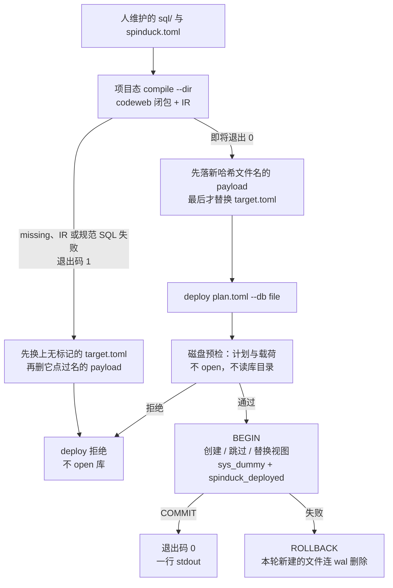
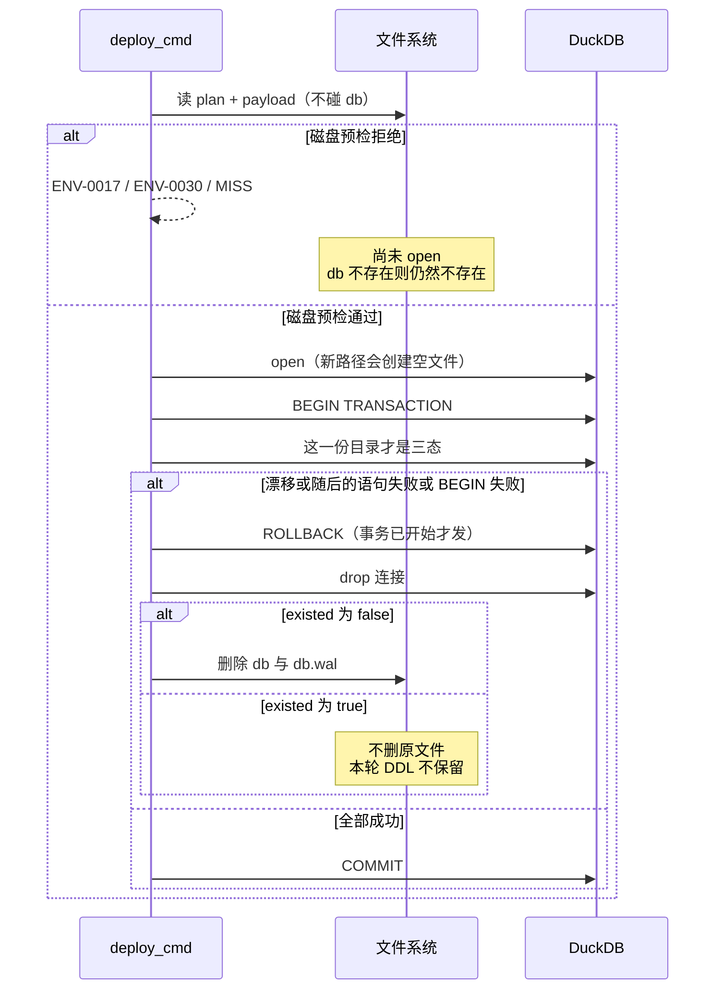

# `deploy`：把项目态 compile 产物原子、增量地装进本地 DuckDB

| 项 | 值 |
|---|---|
| 作者 | Jianjun Chen |
| 日期 | 2026-11-12 |
| 状态 | Draft |
| 基线代码 | 本工作树 `tuning/deploy-with-ddl` 的父提交 `663e182`（尚无 PR #29–#33） |
| compile 栈尖 | `ef3127d`（PR #33，`execute-plan/db74071b-pr-5-docs-record-codeweb-as-the-only-project-closure-so`）。下文 `git show ef3127d:<path>` 即此提交 |
| 取代范围 | 取代 `ef3127d:docs/design-compile.md` 里的 deploy 契约，不改 codeweb 闭包正文。2026-11-12 对照该提交复核过行号：Goals「`deploy` 下发顺序不改」第 85 行；Non-Goals「不改 `deploy` 的装配语义」第 94 行；IR 节「失败仍会装到 `register_routine_files` 再失败」第 389 行；衔接节「判定顺序不改、视图仍靠 `views/` 目录分流」第 393 行；决策记录 9 第 674 行再次写了「`deploy` 下发顺序不改」，一并指向本文。`[[ref]]` / `[[dynamic]]` 的生成和 `call` 的产品边界不重做 |

本文是设计，不是机制说明，也不是实证。落地后机制写入 `docs/architecture.md` §13.6（同一 PR），实证进 `docs/validation.md` 的新小节。行号以本工作树为准；compile 栈上的文件以 `git show ef3127d:<path>` 为准，工作树里还没有 `compile_project.rs`。

---

## Overview

项目态 `compile --dir`（PR #29–#33）已经能把一个入口的闭包写成 `<home>/plan/<target>.toml`（`generator = "codeweb 0.9.7"`，`schema_version = 1`）。今天的 `deploy` 不消费这份「编译成功」的事实：它读计划里的相对路径，再打开活的 `sql/`，把 `CREATE` 直接打进 DuckDB。计划在 IR 检查之前就落盘（`compile_with_export` 先 `write_plans` 再 `ir_failures`），所以「文件在」不等于「compile 退出码 0」。对同一个库再跑一次，`deploy_ddl_file` 把内核的 already exists 包成 `KERNEL-0070`。例程只进进程内目录，`plan.schema` 不建 schema。

本文把 `deploy` 收成这条流水线的安装器，而不是第二遍编译器：

```text
人准备源码 → 项目态 compile --dir 在即将退出 0 时写下带成功标记的计划 + 冻结载荷
          → spinduck deploy <plan.toml> --db <file> 只读这份载荷，装进本地 DuckDB
```

表和序列按对象三态处理（没有则建、文本相同则跳、文本不同则整单拒绝）。视图换上新文本，不再在将要提交的事务里退回 `SELECT 1`。`sys_dummy` 仍走现有的 `IF NOT EXISTS`。同一次事务提交对象、视图替换、`sys_dummy` 和引擎自有登记表；失败则滚回部署前的目录、行和登记。本轮新建的空库文件连同 `-wal` 删掉。同一份未改载荷的第二次 deploy 是成功的空操作，不再是 `KERNEL-0070`。

`materialize` 仍不建对象。本地缺表继续 `ENV-0015`（只问 `duckdb_tables()`，视图不算）。远端缺表在 `COPY` / `SELECT` 之前用新码拒绝，不和认证、语法、列不一致混成 `ENV-0020`。`deploy` 不连接 GaussDB。

---

## Background & Motivation

### 今天 deploy 实际在做什么

三段落点（architecture §13.6，代码与文档一致）：

| 段 | 落点 | 今天 |
|---|---|---|
| 壳 | `spinduck/src/cli/deploy.rs::deploy_cmd` | 读计划 → `missing` 非空则打印 `MISS` 并 `EXIT_FAIL`，**不开库** → `locate` 项目 → `plan::deploy::resolve` → `DuckExecutor::open` → `apply`。stdout 一行 `deploy: target=… ddl_files=… routine_files=… db=…` |
| 消费 | `spinduck/src/plan/deploy.rs` | `resolve` 把 `ddl_tables` / `ddl_routines` 按 `project.root` 拼绝对路径，缺文件 `ENV-0030`（`计划引用的文件不存在`）。路径落在 `<ddl>/views/` 的进 `views`，其余进 `ddl`。`apply` 顺序：`deploy_ddl_file` → `deploy_view_file` → `ensure_engine_provided_tables` → `register_routine_files` |
| 下发 | `spinduck/src/verify/deploy.rs` | 表/序列：`sql_units(strip_defaults(整文件))`，然后每个 unit `drop_cache_option(clamp_sequence_bounds(unit))` → `rewrite_tokens_with_rules(..., &Default::default(), funcs)` → `apply_ast_transforms` → `ex.execute`。`strip_defaults` 在切句之前。失败包成 `KERNEL-0070`（`建表 {path}`）。视图：`deploy_view` 先试改写后的体，任何失败都吞掉，再执行 `CREATE OR REPLACE VIEW {name} AS SELECT 1`，占位本身失败才是 `KERNEL-0071` |

`DuckExecutor::open`（`spinduck/src/sql/exec_native.rs`）是 `Connection::open`，打开即创建文件。壳上的注释已经把「先核对、后开库」写成纪律；核对的是活文件是否存在，不是载荷是否就是那次成功编译。

`Engine::register_persistent` / `reload_catalog` / 表 `spinduck_routines`（`engine.rs` 的 `CATALOG_DDL`）已经存在。`register_routine_files` 走的是 `Engine::register`，不写这张表。`call` 不读它。本文不改变这一点。

### compile 栈尖（工作树里还没有）

`ef3127d:spinduck/src/cli/run/compile_project.rs` 的 `compile_with_export`：

1. `plans_from_export` 造内存中的 `RunPlan`（`plan/codeweb/plans.rs` 的 `GENERATOR = "codeweb 0.9.7"`）。
2. `write_plans` → `cli/plan.rs::write_plan`，落 `<home>/plan/<target>.toml`。
3. 然后才 `ir_failures`：对 `ddl_routines` 做 `read_source_strict` + `Engine::register`（`NoopExecutor`）。
4. 退出码 0 当且仅当 `missing == 0` 且 IR 失败表为空。

`RunPlan::to_toml_string`（栈上 `plan/mod.rs`）在 `[[ref]]` / `[[dynamic]]` / `[[missing]]` 为空时不写出这些段，`schema_version` 保持 1。`from_toml_str` 忽略不认识的键。design-compile 决策 9 禁止为 `[[ref]]` / `[[dynamic]]` 升版本。

路径模式 `compile <path>...` 不写计划。它不是 deploy 的输入。

### 物化的缺口

`GaussConn::ensure_local_table`（`io/gauss/mod.rs`）在拉取前查 `duckdb_tables()`，`count = 0` 即 `ENV-0015`，消息里点名 `deploy`。单测 `should_err_env_0015_with_deploy_hint_when_table_missing` 锁了前缀和「必须出现 deploy」。视图不在 `duckdb_tables()` 里，缺视图不会被这条守卫当成「表在」。

`GaussConn::materialize` 在这道守卫之后进入 `materialize_copystream`。`source_columns` → `client.prepare(select_sql)` 在 `create_dir` / `copy_to_csv` 之前。远端没有这张表时，`prepare` 失败且 `loaded = false`，`apply_fast_failure` 再进 `materialize_insert_batch`，对外仍是 `db_err` → `ENV-0020`（`gaussdb: {SQLSTATE} {message}`），与认证失败、语法错误、COPY 列对不上同一码。这条路径不会先写出 CSV。`materialize` 没有任何 `CREATE TABLE`。这条「不建表」保持不变；要补的是在 `prepare` 与 INSERT 回落之前单独判红。

### 痛点（本轮要消掉的，且只消这些）

1. 活文件：compile 和 deploy 之间改 `sql/`，deploy 装的是改过的文本。
2. 未成功的计划可被装进库：IR 失败或 `missing` 非空时计划文件仍在；`missing` 今天会拒，IR 失败不会。
3. 非幂等：第二次 deploy 是 `KERNEL-0070`，不是空操作。已有行没有「定义没变就留着」的登记。
4. 视图占位会在成功路径上提交。verify 可以继续占位；deploy 不行。
5. 没有事务：下发到一半，库文件留着，目录和行都不是部署前的样子。`open` 对不存在的路径会留下空文件。
6. 物化远端缺表伪装成驱动错误。`materialize_copystream` 里 `source_columns` → `client.prepare(select_sql)` 在 `create_dir` / `copy_to_csv` 之前（`io/gauss/materialize.rs`）。缺表在这里失败且 `loaded = false`，`apply_fast_failure` 再进 `materialize_insert_batch`。要切断的是这次回落，不是一条尚未创建的 CSV。

---

## Goals & Non-Goals

### Goals

- `spinduck deploy <plan.toml> --db <file>` 形状不变。不加必填旗标，不加「重新扫 `sql/ddl`」的旗标。
- 输入只是一份项目态 compile 的计划，外加 `--db`。deploy 不调用 compile、codeweb、闭包或第二遍 IR。
- 可部署当且仅当：`generator` 以 `codeweb ` 开头、`[[missing]]` 为空、计划带本文规定的成功标记、载荷哈希与路径集合和计划一致。否则拒绝，且不创建、不修改目标库文件。
- compile 只在即将退出 0 时写成功标记和载荷；失败仍可留下**无标记**的计划（给人看 `MISS`），但必须删掉载荷，不能留下可部署对。
- 载荷是冻结快照。deploy 安装时不 `open` `sql/` 下的任何路径。
- 表、序列、索引：无则建，登记文本相同则跳，不同则整单拒绝。不 `DROP`，不 `ALTER`。单位是对象，不是文件。`sql_units` 切句。
- 视图：目录里没有这个视图就建，文本相同则跳，文本不同则 `CREATE OR REPLACE`。禁止在将要提交的 deploy 里执行 `SELECT 1` 占位。
- `sources.materialize` 里的每个名字必须被本载荷 `ddl_tables` 里的 **table** 对象覆盖。否则拒绝。不扫目录。`[[dynamic]]` 只留在计划里，不建表。
- 一次事务提交本轮的创建、视图替换、`sys_dummy`、登记表。失败滚回。本轮新建的库文件删除，含 `-wal`。
- 同一未改载荷再次 deploy：退出码 0，用户表的行还在，定义不变，不再出现 `KERNEL-0070`。
- 依赖内核 DDL 事务之前，先有一条内核探针测试。探针在本地绿，安装才用事务，这条绿测试随 PR 2 合并。探针在本地红：不合并失败测试；同一次改动改成通过的内核锁，并实现 Alternatives B 的 copy-and-swap。没有运行时旗标。
- 物化：本地缺表仍 `ENV-0015`。远端缺表是 `ENV-0019`，前缀 `remote table missing:`，发生在 `materialize_copystream` 之前，因此 `prepare` 与 INSERT 回落都不会跑。列不一致仍走今天的物化错误，不改判成缺表。
- 错误码只沿用现有四段。新数字是现有码表达不了的那三个，见下文。

### Non-Goals

实现时不得顺手做下列任何一条：

- `call` 不读 `spinduck_routines`，不调用 `reload_catalog`，不改 `call --plan` / `call --db` 的源码来源。`call --plan` 继续按计划里的相对路径读活文件（`should_refuse_a_plan_call_when_a_routine_file_it_lists_is_absent` 的 `ENV-0030` 语义不变）。
- 不把例程体写成 `call` 的真相来源。本轮 deploy **不**调用 `Engine::register`、`register_routine_files` 或 `register_persistent`。进程退出后没有进程内目录可留。载荷里仍保存例程文本，供以后的分支使用；本轮不执行这些文本。
- `plan.schema` 不 `CREATE SCHEMA`。对象在 `main`。带非 `main` 限定名的 `CREATE` 在预检拒绝，不交给内核碰运气。
- 不 `DROP` 计划里已经消失的对象。登记表里多出来的旧行留着，本轮不删。
- 不跑 `deploy_seeds`，不跑 `materialize`，不 `call` 目标例程。
- deploy 不连接 GaussDB，不读 `SPINDUCK_OG_*`。
- 不升 `SCHEMA_VERSION`。不加 Cargo 依赖，不改 `SqlExecutor` / `TraceSink` 签名。只读打开是 `DuckExecutor` 的新方法，落在已经允许调用 DuckDB API 的 `sql/exec_native.rs`，不进 trait。
- 不改 verify 的占位行为，不改 `deploy_view` 给 verify / 黄金 harness 用的那条路径。
- 不改 codeweb 闭包、`plans_from_export` 的缺件规则、路径模式 compile 的 stdout。
- 不提供 `--adopt` / `--force` / `--from-sql`。旧版 deploy 装出来的库没有登记行，新 deploy 拒绝它，而不是猜定义相同。迁移方式是换一个新库文件。

---

## Proposed Design

### 流水线



路径模式 `compile <path>...` 不产生计划，也就没有箭头进 deploy。栈上 `plan::build` 已经调用 `plans_from_export`，`generator` 就是 `codeweb 0.9.7`（`plan/codeweb/plans.rs` 的 `GENERATOR`）。它仍然没有 `[artifact]`，deploy 以 `ENV-0017` `unmarked plan:` 拒绝。本工作树 `closure.rs::generator()` 的 `spinduck … (plan schema 1)` 不是栈上 `plan` 的产出，不要按那个字符串写测试。`plan` 子命令不是第二条编译器；deploy 不调用它。

### 成功标记放哪

**不升 `schema_version`。** 标记是计划 toml 里可选的 `[artifact]` 段，只有成功写盘才出现。`RunPlan` 增加 `artifact: Option<PlanArtifact>`。`None` 时 `to_toml_string` 不写这一段，字节与栈上 PR #30 的口径相同（空段不写出，和 `[[ref]]` 同一条规则）。`from_toml_str` 在段缺失时得到 `None`，不报解析错。旧计划因此仍能被解析；**新 deploy 把 `None` 当成拒绝，而不是当成成功。**

选择 sidecar 而不是把 SQL 嵌进计划，有两个原因。一是失败计划必须和今天的字节兼容，SQL 正文（含换行）一写进计划，`quoted()` 的转义就会碰到「不含换行则字节不变」那条不变量的反面。二是 design-compile 已经禁止为附加信息升 `schema_version`；旧二进制的 `from_toml_str` 会忽略未知的 `[artifact]`，仍可能去读活的 `sql/`。这是旧二进制的行为，本文不改它。新 deploy 是执法点。升到 `schema_version = 2` 能让旧 deploy 以 `ENV-0030` 拒绝新计划，但会把「失败计划字节稳定」和决策 9 一起打破，所以不升。

成功计划在 `[sources]` 之后、`[[ref]]` 之前多出固定三行（字段序锁死，不写日期，不写绝对路径）：

```toml
[artifact]
status = "ok"
payload = "pkg.prc.<64位小写hex>.payload.toml"
payload_sha256 = "<与文件名中同一串 hex>"
```

| 字段 | 规则 |
|---|---|
| `status` | 只有精确的 `ok`。其它值、缺字段，与整段缺失一样拒绝 |
| `payload` | 相对**计划文件所在目录**的文件名，不是相对项目根，也不是绝对路径。形式 `{target}.{sha256}.payload.toml`。`sha256` 就是下一行的 `payload_sha256`。不使用固定的 `{target}.payload.toml`：那个名字会在新计划可见之前被替换掉，见「compile 何时写标记」 |
| `payload_sha256` | 载荷文件原始字节的 SHA-256，小写十六进制。不是对「解析后再序列化」的结果哈希。deploy 用计划里的这个字段核对文件字节，不从文件名反推哈希 |

`generator` 仍在 `[plan]` 里，不搬进 `[artifact]`。deploy 要求 `generator.starts_with("codeweb ")`（用户定的前缀，不把 `0.9.7` 再钉死在 deploy 侧）。栈上的常量继续是 `codeweb 0.9.7`。

### 载荷的磁盘布局

```text
<home>/plan/<target>.toml
<home>/plan/<target>.<sha256>.payload.toml
```

`<home>` 就是今天的 `plan_dir`（`plan/closure.rs::plan_dir` = `project.home_dir.join("plan")`，缺省 `.spinduck/plan`）。不新建目录层次，不把每个对象拆成一个 SQL 文件。整份载荷仍是一个文件，一次哈希；文件名带这份字节的 SHA-256，是为了发布顺序，不是为了按对象寻址。

载荷自己手写 toml，不用 `toml::to_string_pretty`（它会重排 `[[statement]]`）。字符串只走 `plan/mod.rs` 的 `quoted`。栈上它是该模块的私有函数，不是方法。PR 1 把它改成 `pub(crate) fn quoted`，`plan/payload.rs` 调用这一个函数，不另写一套 match。转义规则保持栈上的实现：反斜杠、引号、换行、回车、制表符；不含这些字符的字符串与今天逐字节相同。`format = 1` 是载荷格式，不是计划的 `schema_version`。

```toml
[payload]
format = 1
target = "prc_seed_count"
generator = "codeweb 0.9.7"

[[file]]
role = "ddl"
path = "sql/ddl/tables.sql"
sha256 = "<utf-8 文本的 sha256>"
text = "CREATE TABLE t_a (id INT);\nCREATE SEQUENCE seq_a START WITH 1;\n"

[[file]]
role = "routine"
path = "sql/routines/10_main.sql"
sha256 = "<utf-8 文本的 sha256>"
text = "CREATE OR REPLACE PROCEDURE ..."

[[statement]]
path = "sql/ddl/tables.sql"
ord = 0
kind = "table"
name = "t_a"
sha256 = "<canonical sql 的 sha256>"
sql = "CREATE TABLE t_a (id INT)"

[[statement]]
path = "sql/ddl/tables.sql"
ord = 1
kind = "sequence"
name = "seq_a"
sha256 = "<canonical sql 的 sha256>"
sql = "CREATE SEQUENCE seq_a START WITH 1"
```

渲染顺序：`[[file]]` 按 `path` 排序；`[[statement]]` 按 `path` 再按 `ord`。`ord` 是该文件里 `sql_units` 切出来的序号，从 0 开始。

| 角色 | 内容 | deploy 是否执行 |
|---|---|---|
| `role = "ddl"` | `sources.ddl_tables` 的每一个相对路径恰好一个 `[[file]]`。`text` 是 `source::read_text` 的解码结果（UTF-8 严格，否则 GBK 严格；与 `read_source_strict` 是同一个函数） | 不执行 `text`。执行同路径下的 `[[statement]].sql` |
| `role = "routine"` | `sources.ddl_routines` 的每一个相对路径恰好一个 `[[file]]`。只有 `text`，没有 `[[statement]]` | **不执行**。不 `register`。哈希仍要核，避免载荷被换成另一份例程却仍声称是这次 compile |

例程文本进载荷是为了快照完整，以及让 deploy 不必打开 `sql/`。它不是 `call` 的源。这一点写在 Non-Goals，这里再钉一次：安装器看到 `role = "routine"` 只做存在性与哈希检查。

`[[statement]].sql` 是 **compile 当时** 算出的、deploy 将要 `execute` 的字符串。deploy **不再**跑 `rewrite_tokens_with_rules`。规则在 compile 时已经折进去；之后改 `rewrite-rules.toml` 不会改变已封印载荷的安装结果。要吃新规则，重新 compile。

表 / 序列 / 索引的顺序必须和今天 `deploy_ddl_file` 一致（`verify/deploy.rs` 90–93 行）。`strip_defaults` 作用在**整文件**上，然后才 `sql_units`。它只在 ` DEFAULT` 之后的表达式以 `(` 开头时，从该处把行尾（包括同行的分号）换成逗号。列类型自己的括号（`character varying(12)`、`numeric(15,3)`）不触发，字面量默认值保留。先切句再 `strip_defaults` 会切出不同的语句边界，登记里的 `sql` 就不是今天 `execute` 的那一串。

```text
file_text
  → strip_defaults(file_text)                         # 整文件
  → sql_units(...)                                    # 之后才切句
  → 每个 unit：drop_cache_option(clamp_sequence_bounds(unit))
  → rewrite_tokens_with_rules(unit, &Default::default(), funcs)
  → apply_ast_transforms
```

视图文件不经 `strip_defaults`。对 `sql_units(原始文本)` 的每个 unit 调用 `canonical_view_unit`：只做 `rewrite_tokens_with_rules(..., &Default::default(), funcs)` 然后 `apply_ast_transforms`。这是 `deploy_view` 成功臂在 `execute` 之前的那两步，不含占位。

```rust
/// 已经过 strip_defaults + sql_units 的一个表/序列/索引 unit。
/// 不再调用 strip_defaults。
pub(crate) fn canonical_ddl_unit(
    unit: &str,
    funcs: &BTreeMap<String, String>,
) -> Result<String, EngineError> {
    let unit = drop_cache_option(&clamp_sequence_bounds(unit));
    let rewritten = crate::sql::rewrite_tokens_with_rules(unit, &Default::default(), funcs)?;
    crate::sql::apply_ast_transforms(&rewritten.text)
}

/// 视图 unit，输入是未做 strip_defaults 的原文切句。
/// 失败返回 Err。不许吞掉，也不许改写成 SELECT 1。
pub(crate) fn canonical_view_unit(
    unit: &str,
    funcs: &BTreeMap<String, String>,
) -> Result<String, EngineError> {
    let rewritten = crate::sql::rewrite_tokens_with_rules(unit, &Default::default(), funcs)?;
    crate::sql::apply_ast_transforms(&rewritten.text)
}
```

`verify` 的 `deploy_ddl_file` 改为调用同一条顺序，避免两套文本。`deploy_view` 的占位分支不动：rewrite 或 `execute` 失败仍可退 `SELECT 1`。compile 不走那条分支。

任一 `canonical_ddl_unit` / `canonical_view_unit` 返回 `Err`，或分类返回 `unsupported ddl`：这一入口的 compile 失败，退出码 1。写无标记计划，删除载荷（规则见下节）。不省略这条语句，不写一份少了该对象的可部署载荷。今天 `deploy_view` 会吞掉改写失败并提交占位；封印之后，这种视图不再「靠占位才能装上」。它让 compile 退出 1，deploy 看不到标记，也不会在事务里提交 `SELECT 1`。

登记和比对用的就是 `[[statement]].sql`。`strip_defaults`、`clamp_sequence_bounds`、`drop_cache_option` 的语义损失保持今天的注释（括号默认值被削掉、超 BIGINT 的序列边界被拿掉、`CACHE` 被拿掉）。这些损失发生在 compile 写载荷时。

顺序锁在测试 `should_seal_the_same_sql_as_deploy_ddl_file_when_default_shares_a_line_with_a_semicolon`。夹具整文件是一行里同时有 `DEFAULT (` 和分号：

```text
CREATE TABLE t_d (id INT DEFAULT (1));
CREATE TABLE t_e (id INT);
```

`strip_defaults` 会吃掉第一行分号并接上逗号，两个 `CREATE` 变成 `sql_units` 的一个 unit。断言封印出的 `sql` 等于「整文件 `strip_defaults` → `sql_units` → 每 unit `canonical_ddl_unit`」。同一夹具若先 `sql_units` 再对 unit 做 `strip_defaults`，结果不得相等。

SHA-256 在树内实现（`plan/sha256.rs`），不把锁文件里传递依赖的 `sha2` 提成直接依赖（那是新的 Cargo 依赖，Ask first）。测试向量锁两个已知值：空串 `e3b0c44298fc1c149afbf4c8996fb92427ae41e4649b934ca495991b7852b855`，`abc` `ba7816bf8f01cfea414140de5dae2223b00361a396177a9cb410ff61f20015ad`。

### compile 何时写标记

改 `compile_with_export` 的顺序，不改它的 stdout 顺序。今天是「先写计划、再渲染、再 IR」。改成「先读源、再 IR、再按成败写盘、再按今天的顺序渲染」。`plan:` / `MISS` / `REF` / `DYN` / `FAIL` / `compile: entries=` 的形状不变。

一次读入。`ir_failures` 不得再自己 `read_source_strict` 第二遍，否则读和快照之间文件可以被换掉。伪代码：

```text
plans = plans_from_export(...)
texts = 对所有 ddl_routines ∪ ddl_tables 调用 source::read_text，键是相对路径
failed = 用 texts 里的例程文本 register（不再读盘）
seal_err = 空
if 所有 plan.missing 为空 且 failed 为空:
    rules = rules_for_paths(例程路径)   # 与 IR 同一份
    对每个 plan 尝试在内存中生成 payload 字节
    任一 canonical_* 或分类返回 Err → 记入 seal_err，丢弃这份内存字节
ok = missing 为空 且 failed 为空 且 seal_err 为空
if ok:
    对每个 plan 按下面的「成功发布」写盘
else:
    对每个 plan 按下面的「失败发布」写盘
render_plans(...)          # 与今天相同，仍在 FAIL 行之前
打印 FAIL 行与 compile: 汇总
退出码：ok 则 0，否则 1（与今天「missing 或 IR 失败为 1」相同，另加规范 SQL 失败）
```

成功发布，上一份 `status = "ok"` 的计划在新计划可见之前必须仍然指向自己的载荷字节。单个文件的 rename 是原子的，一对文件不是。若先替换固定文件名 `<target>.payload.toml` 再替换计划，崩溃窗口里旧计划的 `payload_sha256` 已经对不上新 sidecar，最后一份好封印就丢了。

1. 把新载荷写到计划目录里的临时名 `<target>.payload.toml.tmp`，`sync_all`。
2. 计算这批字节的 SHA-256。最终文件名是 `<target>.<sha256>.payload.toml`。把临时文件 rename 成这个名字。哈希不同则不会覆盖上一份载荷。
3. 在内存计划里写入 `[artifact]`：`status = "ok"`，`payload` 为这个文件名，`payload_sha256` 为这串 hex。把计划写到 `<target>.toml.tmp`，`sync_all`，**最后**才替换 `<target>.toml`。
4. 计划替换成功之后，删除该目录中同一 target 的其它载荷。能删的只有文件名恰好是 `{target}.{64 位小写 hex}.payload.toml` 且不等于刚发布的那个名字，以及 `{target}.payload.toml.tmp`。`pkg` 不得匹配 `pkg.prc.<hash>.payload.toml`。其它入口的文件不动。

崩溃落在第 3 步之前：磁盘上的计划仍是旧的 `ok` 计划，它点名的载荷还在；新载荷至多是多出来的文件。deploy 仍能装上一份。崩溃落在第 3 步的 rename 上：要么仍是旧计划，要么已是新计划。两种都匹配自己的哈希。第 4 步没跑完只留下无人点名的旧载荷，下一次成功发布会删掉。不会出现 `status = "ok"` 但哈希对不上的计划。

失败发布（missing、IR、`canonical_*` 的 `Err`，三者任一）：

1. 若目录里已有计划，记住它的 `[artifact].payload` 文件名（没有标记则这份名单为空）。
2. 用临时文件替换 `<target>.toml`，内容是 `artifact: None` 的计划（字节口径与今天无标记的 `to_toml_string` 相同）。这一步去掉 `status = "ok"`。
3. 删除第 1 步记住的那个载荷，并删除本入口写到一半的 `{target}.payload.toml.tmp` 以及任何 `{target}.{64 位小写 hex}.payload.toml`（同一条精确匹配，不按裸前缀扫）。无标记计划不点名任何载荷。

失败覆盖上一份成功计划是故意的。留下旧的可部署对，等于在「源码已经编译失败」的树上安装上一次的 SQL。无标记计划仍然在，`MISS` 和 `FAIL` 还看得到。第 2 步之后、第 3 步之前崩溃：计划已经无标记，残留载荷无人点名，deploy 拒绝。不会装上上一份快照。

Windows 上 `std::fs::rename` 不能覆盖已存在文件。替换计划 toml 时：目标改名为 `*.bak`，tmp 改成目标，再删 bak；第二步失败则把 bak 改回去。载荷的最终名含新哈希，正常情况下目标不存在，直接 rename。这只保护计划目录里的文件对，不是库文件。库文件的原子性见安装一节。

IR 失败不再指望 deploy 的 `register_routine_files` 再失败一次。无标记计划在 deploy 预检就被拒绝，库文件不会出现。这是对 design-compile「IR 失败不阻止计划落盘，deploy 会在注册时再失败」的 deploy 侧修正：计划仍落盘，但不可部署。

`[[dynamic]]` 与 `[[ref]]` 继续由 `plans_from_export` 写入计划。compile 不为它们生成 `[[statement]]`。

### 对象分类

只对 `role = "ddl"` 的 `text` 跑 `sql_units`（`verify/deploy.rs::sql_units`，`/` 分块 + 顶层分号，注释与字符串不参与）。每个非空 unit 必须分成恰好一个对象。分类用 `verify::tokens`，与 `creates_view` 同一把刀，注释拆开 `CREATE` 和 `VIEW` 时仍能认出（`should_deploy_the_view_body_when_a_comment_splits_the_create_keywords` 那条语料形态）。

| 词法形状 | kind | 名字 |
|---|---|---|
| `create table [if not exists] <ident>` | `table` | `<ident>` |
| `create sequence [if not exists] <ident>` | `sequence` | `<ident>` |
| `create [unique] index [if not exists] <ident> on …` | `index` | 索引名，不是表名 |
| `create view <ident>`，以及 `create or replace view`，含 `creates_view` 已经认的注释拆开形态 | `view` | 与今天 `view_name` 相同的小写名。没有 `OR REPLACE` 的 `CREATE VIEW` 是合法的 Create |
| `alter` / `drop` / `comment` / `grant` / `revoke` / `truncate` / `create schema` / 认不出 | — | 预检 `ENV-0030`，前缀 `unsupported ddl:` |

名字归一：去引号、转小写。`main.<name>` 收成 `<name>`。其它 `schema.name`（包括 `[plan].schema` 里那个名字）一律 `ENV-0030`，前缀 `qualified name:`。不 `CREATE SCHEMA`，也不把限定名交给内核。

同一载荷里 `(kind, name)` 出现两次：`ENV-0030`，前缀 `duplicate object:`。

保留名，出现在用户语句里就拒绝（`ENV-0030`，前缀 `engine-provided:`）：`sys_dummy`（`ENGINE_PROVIDED_TABLES`）、`spinduck_deployed`（本设计的登记表）、`spinduck_routines`（已有的例程目录表，本轮不用，但名字已被 `Engine::CATALOG_DDL` 占用）。`sys_dummy` 不进登记表，因此也不会和用户对象做「定义漂移」比较。

索引纳入三态，是因为一个 DDL 文件里经常在 `CREATE TABLE` 后面跟着 `CREATE INDEX`。若只登记表，第二次 deploy 会在索引上重新撞 already exists，空操作做不成。不认识的语句宁可拒绝，也不在事务里执行一遍不可重入的 `ALTER`。

视图可以出现在 `ddl_tables` 的任意路径上，不再靠 `<ddl>/views/` 前缀分流。`plan/deploy.rs::resolve` 里 `views_dir` 的 `starts_with` 判断退役。`creates_view` 仍是分类的实现，不靠 `[[ref]].kind`。

### 预检（只读，先于一切读写打开）

`deploy_cmd` 的顺序替换今天的「缺件 → locate → resolve 活文件 → open → apply」：

1. `read_source_strict(plan_path)`。读不到是今天的 `ENV-0010`（`read {path}`），不开库。
2. `RunPlan::from_toml_str`。`schema_version` 不符、缺 `[plan]`、缺必填字段：今天的 `ENV-0030`，不开库。`should_refuse_a_plan_written_by_an_unknown_schema_version` 保持。
3. `missing` 非空：打印与今天逐字相同的 `MISS {object} <- {from}`，再一行 `deploy: target={t} missing={n} 拒绝部署（补齐缺件后重跑 plan）`，`EXIT_FAIL`。**到此为止**，不看 generator，不看载荷，不开库。`should_refuse_a_plan_that_still_carries_missing_objects` 因此不用改。
4. `generator` 不以 `codeweb ` 开头：`ENV-0017`，消息前缀 `generator:`。不开库。
5. `artifact` 不是 `Some { status: "ok", .. }`：`ENV-0017`，消息前缀 `unmarked plan:`。不开库。
6. 载荷路径 = `plan_path.parent().join(artifact.payload)`。文件不存在：`ENV-0030`，前缀 `payload missing:`（与「计划点名的文件不在」同一码，前缀分开）。存在则读字节，SHA-256 必须等于 `payload_sha256`，否则 `ENV-0017`，前缀 `payload mismatch:`。
7. 解析载荷。`format != 1`、`target` / `generator` 与计划不一致、`[[file]]` 的路径集合不等于 `ddl_tables ∪ ddl_routines`、`role` 与所在清单不符、某个 `sha256` 与 `text` / `sql` 不符、`[[statement]]` 的 `path` 不是 ddl 文件、重新分类得到的 `kind`/`name` 与载荷不符：一律 `ENV-0017`，前缀 `payload mismatch:`。
8. 分类阶段的 `unsupported ddl` / `duplicate object` / `qualified name` / `engine-provided`：`ENV-0030`，对应前缀。不开库。
9. `sources.materialize` 的每个名字必须被步骤 7 的某个 `kind = table` 且 `path ∈ ddl_tables` 的对象覆盖。规范规则只这一条，**不**调用 `verify::chain::normalize`（那是 `db.schema.name` 保留最后两段，`a.b.c` → `b.c`，和这里登记的无限定名对不上）。对 materialize 条目：trim，剥掉一层双引号，ASCII 小写，若仍含 `.` 则只取最后一段，再与 `kind = table` 的 `name` 相等。`bigfund.t_a` 与 `"T_A"` 都覆盖名为 `t_a` 的表。同尾段的视图或序列不覆盖。`[[dynamic]]` 不覆盖。空清单通过。失败：`ENV-0030`，前缀 `materialize uncovered:`，消息里点名那个名字。不开库。architecture §13.5 的「截尾两段」只是闭包标识的背景，不是这道检查的函数。
10. 磁盘预检到此结束。`ENV-0018` **不**在打开库之前做终判。文件尚不存在时不要 `open`（`Connection::open` 会把文件造出来）。文件已经存在时，只读打开也不是三态的输入：DuckDB 的 `access_mode=READ_ONLY` 不回放 `{db}.wal`，只读目录可能比随后的读写打开更旧。用那份旧目录拒绝，会把读写打开后本应 Skip 的库判成漂移。只读打开仍要实现（探针：缺失路径不得被创建），deploy 的漂移决策不用它。权威目录是读写连接里 `BEGIN TRANSACTION` 之后的那一次，见安装一节。

预检不调用 `cli::verify::locate`。封印之后的计划对不再需要 `spinduck.toml`，也不再需要项目根下的 `sql/`。`project_dir` 字段保留给 `call --plan` 和人读，deploy 不跟它去开文件。

只读打开不在 `SqlExecutor` 上。`DuckExecutor` 增加：

```rust
/// 只读打开。路径不存在必须返回错误，且不得创建该路径。deploy 不用它做三态。
/// 实现：Connection::open_with_flags(path, Config::default().access_mode(AccessMode::ReadOnly)?)
/// duckdb 1.10505 已有这个 API（crate 的 config.rs::AccessMode::ReadOnly）。
#[cfg(feature = "native")]
pub fn open_read_only(path: &str) -> Result<Self, EngineError>;
```

这不是 `SqlExecutor` / `TraceSink` 的签名变更，不需要为 trait 走 Ask first。`open_read_only` 本轮只为「缺失路径不得被创建」而存在。deploy 的三态**不**调用它：`access_mode=READ_ONLY` 不回放 `{db}.wal`，只读目录不能产生 `ENV-0018`，也不能因为和随后的读写目录不一致就拒绝。探针 `should_not_create_a_database_file_when_read_only_open_misses`：对不存在的路径调用，返回 `Err`，`Path::exists()` 仍为 false，同目录不出现 `.wal`。deploy 对缺失路径只有在磁盘预检通过之后才 `DuckExecutor::open`（读写，会创建文件）。无标记计划到不了这一步。

### 登记表与三态

引擎自有表，不是用户对象，不参与漂移比较的「被比较方」以外的角色：

```sql
CREATE TABLE IF NOT EXISTS spinduck_deployed (
  kind VARCHAR NOT NULL,
  name VARCHAR NOT NULL,
  body VARCHAR NOT NULL,
  body_sha256 VARCHAR NOT NULL,
  PRIMARY KEY (kind, name)
)
```

| 列 | 含义 |
|---|---|
| `kind` | `table` / `sequence` / `index` / `view` |
| `name` | 归一后的无限定名 |
| `body` | `[[statement]].sql`，即改写后的那一串。比对用字符串相等，不用「看起来像」 |
| `body_sha256` | `sha256(body.as_bytes())`。写入时一起算。读出时若与 `body` 不符，当成登记损坏，整单 `ENV-0018`，前缀 `definition drift:`，不安装 |

`sys_dummy` 不插入此表。

目录查询在 `BEGIN TRANSACTION` 之后做（列名由 PR 2 的探针锁死）：

```sql
SELECT count(*) FROM duckdb_tables()
 WHERE lower(schema_name) = 'main' AND lower(table_name) = 'spinduck_deployed'
SELECT count(*) FROM duckdb_tables()
 WHERE lower(schema_name) = 'main' AND lower(table_name) = lower($n)
SELECT count(*) FROM duckdb_views()
 WHERE internal = false
   AND lower(schema_name) = 'main' AND lower(view_name) = lower($n)
SELECT count(*) FROM duckdb_sequences()
 WHERE lower(schema_name) = 'main' AND lower(sequence_name) = lower($n)
SELECT count(*) FROM duckdb_indexes()
 WHERE lower(schema_name) = 'main' AND lower(index_name) = lower($n)
```

视图的 `internal = false` 与 `verify/run.rs::kernel_objects` 相同。不把 DuckDB 内部视图算成用户对象。`duckdb_tables()` 不含视图，与 `ensure_local_table` 相同。

`spinduck_deployed` 的第一问走 `duckdb_tables()`。计数为 0：登记快照是空的，**不要** `SELECT` 这张还不存在的表（那是内核错误，不是零行）。计数大于 0：再 `SELECT kind, name, body, body_sha256 FROM spinduck_deployed`。这条查询若失败（列不对、IO），保持执行器已经标好的 `KERNEL-0010`（`sql/exec_native.rs` 的 `kernel_err` 就是 `kernel(10)`），不改判成 `ENV-0018`。

对每个 `[[statement]]`，设 `present = 目录里有这个对象`，`row = 登记快照里的对应行`（表不存在则快照为空，`row` 就是无）：

| present | row | kind | 动作 |
|---|---|---|---|
| 否 | 有或无 | 任意 | **Create**。目录里没有就是没有。旧登记行在本次事务里被新 `body` 覆盖 |
| 是 | 无 | 任意 | **拒绝** `ENV-0018` `definition drift:`。对象在，但没有可核对的文本。旧版 deploy 装出来的库走这条，不静默收养 |
| 是 | body 相等且哈希自洽 | 任意 | **Skip**。不执行 SQL |
| 是 | body 不等 | `view` | **Replace**，但仅当规范文本是 `CREATE OR REPLACE VIEW`（`creates_view` 认得出，且词法里有 `or replace`）。没有 `OR REPLACE` 的 `CREATE VIEW` 在 Create 时合法，在 Replace 时是 `ENV-0030` `unsupported ddl:`，不执行。整单不写 |
| 是 | body 不等 | `table` / `sequence` / `index` | **拒绝** `ENV-0018` `definition drift:`。整单不写 |

`ENV-0018` 只由这一份权威快照产生。消息至少包含前缀 `definition drift:`、`kind`、`name`。登记行存在但 body 不同时带上两边的 `body_sha256`；登记表本身不存在则不要假装有哈希。不把整段 SQL 打进 stdout。判漂移之后 `ROLLBACK`（若事务已开始），不执行这条语句之后的 `CREATE`。已存在的库文件不删。本轮新建的文件按下一节删除。

`ENV-0018` 不用 `KERNEL-0070`：`KERNEL-0070` 是 `deploy_ddl_file` 把内核执行失败包起来的码，表示「已经在写了」。漂移是写之前的策略拒绝。也不用 `ENV-0021`：那是 sync 的列清单与目标表不兼容（`io/sync.rs` 的 `ENV_SCHEMA_DRIFT`），故障域和操作者动作都不同。

`ENV-0017` 不用 `ENV-0030`：`ENV-0030` 是「toml 不可用，或计划点名的路径不在」（`from_toml_str`、`existing`、项目声明）。无标记计划是一份合法的 schema 1 文件，compile 可能以退出码 1 留下它。操作是重新跑到退出码 0，不是改 toml 语法。`payload missing:` 留在 `ENV-0030`，因为它就是「点名的文件不在」。

### 事务安装

探针（必须先于实现合并，见 PR 2）放在 `sql/exec_native.rs` 的 `#[cfg(test)]`：

`should_roll_back_a_create_table_and_keep_the_preexisting_row`

```text
open_in_memory
CREATE TABLE old_t(a INT); INSERT INTO old_t VALUES (1);
execute "BEGIN TRANSACTION"    # 与 engine.rs 的 call_with_sink 同一串，不用裸 BEGIN
CREATE TABLE new_t(a INT);
执行一条必然失败的语句
ROLLBACK
old_t 仍在，且那一行仍是 1
new_t 不在 duckdb_tables()
```

语句文本必须是 `BEGIN TRANSACTION`。本仓库没有裸 `BEGIN` 的调用方；`engine.rs` 的 `call_with_sink` 与 `runtime/interp/flow.rs` 执行的都是这一串。`COMMIT` / `ROLLBACK` 同样用这两个词的完整形式（`COMMIT`、`ROLLBACK`），与解释器已经发给内核的文本一致。它们不是 `is_ddl`（`exec.rs` 只认 CREATE/DROP/ALTER 前缀），走普通 `execute`。

DuckDB 1.5.5（crate `=1.10505.0`）的 DDL 被认为在事务里。这条探针在本地是绿的，PR 2 才合并，下面的事务路径才是唯一安装路径。探针在本地是红的：不打开一个测试失败的 PR，不 `#[ignore]`，不把断言改弱。同一次改动里换成「锁住内核报错原文、并证明 ROLLBACK 没有撤掉 `new_t`」的通过测试，并实现下面 Alternatives B 写明的 copy-and-swap。不在每次 deploy 里现场二选一，也没有切换旗标。

探针绿时的安装。三态只算这一次，不算只读预检：

```text
existed = db.is_file()          # 磁盘预检已结束；无标记计划到不了这里
ex = DuckExecutor::open(db)     # 新路径会创建文件。已有文件则打开并回放 wal
ex.execute("BEGIN TRANSACTION")
读 duckdb_tables/views/sequences/indexes 与登记快照   # 唯一的三态输入
若任一 statement 是 definition drift 或 Replace 缺少 OR REPLACE：
    ROLLBACK，走「open 之后的清理」，返回 ENV-0018 或 ENV-0030
CREATE TABLE IF NOT EXISTS spinduck_deployed (...)   # 在三态决定 Skip/Create 之后
按 path、ord 两遍：
  第一遍 table / sequence / index 的 Create（Skip 不执行）
  第二遍 view 的 Create 与 Replace（Skip 不执行）
ensure_engine_provided_tables        # 现有函数，IF NOT EXISTS，不进登记
对每个 Create / Replace：
  INSERT ... ON CONFLICT (kind, name) DO UPDATE SET body, body_sha256
COMMIT
```

`CREATE TABLE IF NOT EXISTS spinduck_deployed` 放在三态之后。三态看到的「表不存在」才是空登记。若先建表再读，空表会被当成「有登记关系」，然后 `SELECT` 到零行，和「关系不存在」在结果上一样，但探针要锁的是「不存在则不要 SELECT」。实现就按这个顺序，避免两套读法。

失败语句会把 DuckDB 事务标成 aborted（`exec_native.rs` 里那条 `TransactionContext Error` 的回归注释）。安装循环遇到第一个 `Err` 必须立刻 `ROLLBACK`，不得再发下一条 `CREATE`。内核执行失败仍包成 `KERNEL-0070`，消息前缀保持 `建表` 或改为 `安装 {kind} {name}`，但码不变。

`open` 之后的任何错误（`BEGIN TRANSACTION` 失败、三态拒绝、中途 `execute` 失败、`COMMIT` 失败）走同一条清理，不管当时有没有进到 `CREATE`：

1. 若事务已经开始，`ROLLBACK`。回滚失败只追加到原错误文本上，不替换原错误码（与 `engine.rs` 对 `call` 的做法相同）。
2. 丢掉连接。
3. `existed == false`：删除 `{db}` 与 `{db}.wal`。`existed == true`：不删这两个路径。读写打开回放已有 wal 是内核恢复，不是本轮要删掉的文件。
4. 返回最初的安装错误。删除失败时把 `io::Error` 附在后面，退出码仍是 1。

视图失败是 `KERNEL-0071`，消息前缀 `视图体 {name}:`。**不**调用 `deploy_view`，因此不会执行 `CREATE OR REPLACE VIEW {name} AS SELECT 1`。`deploy_view` / `deploy_view_file` 留给 `deploy_schema` → verify。deploy 走新函数 `install_view_sql`，只 `execute` 载荷里的规范文本。占位分支一个字都不进这个事务。

`ensure_engine_provided_tables` 保持现有 SQL：`CREATE TABLE IF NOT EXISTS sys_dummy AS SELECT 1`。它在事务内。失败则整单滚回。

例程：不调用 `register_routine_files`。库文件里没有例程体。`call --plan` 继续自己读活源码，与本轮无关。

提交之后进程退出，`Engine` 丢掉。没有「只在本进程里注册过」的残留需要解释。若有人在库文件里查 `spinduck_routines`，结果是没有这张表（除非别的路径建过）。deploy 不建它。

### 失败时磁盘回到哪



删除的伴随文件只包括 `{db}` 与 `{db}.wal`。不扫目录，不删无关文件。删除前必须先丢掉 `Connection`，否则 Windows 上文件仍被占用。若删除失败，把删除的 `io::Error` 附在原来的安装错误后面返回，不要只报「删不掉」而把安装错误吞掉。退出码仍是 1。

「回到部署前」指目录成员、用户表的行、`spinduck_deployed` 的行。不承诺库文件字节级相同：DuckDB 的空事务提交或 checkpoint 可能改文件大小。空操作的可观察结果是：退出码 0、用户行还在、每个对象的 `body` 还是那一串、stdout 里 `created=0 replaced=0`。

### 一次、增量、拒绝

| 场景 | 预检 | 库文件 | 行 | 退出 |
|---|---|---|---|---|
| 新路径，载荷干净 | 通过，目录为空 | 本轮创建，COMMIT 后留下 | 无用户行；有 `sys_dummy` 的一行和登记行 | 0 |
| 同一载荷再跑 | 全部 Skip | 打开又提交，定义不变 | 原样 | 0，不再 `KERNEL-0070` |
| 一张表的规范文本变了 | 事务内快照 `ENV-0018` | 已有文件不删；`ROLLBACK` | 原样 | 1 |
| 一张视图的规范文本变了且是 `CREATE OR REPLACE`，表没变 | 事务内 Replace | COMMIT | 表的行原样；视图无物化行 | 0，`created=0 replaced=1` |
| 视图文本变了但是没有 `OR REPLACE` 的 `CREATE VIEW` | 事务内 `ENV-0030` `unsupported ddl:` | `ROLLBACK`，已有文件不删 | 原样 | 1 |
| 目录里有表，`duckdb_tables()` 没有 `spinduck_deployed` | 空登记，`ENV-0018` | `ROLLBACK`，不 SELECT 缺表 | 原样 | 1。旧版 deploy 的库走这里。不是 `KERNEL-0010` |
| 第一次装注释拆开的视图，库是新的 | Create | COMMIT | 无用户行 | 0，`created=1 replaced=0`（这份夹具只有该视图） |
| `[[missing]]` 非空 | `MISS`，不看标记 | 不创建 | — | 1。stdout 与今天相同 |
| 无 `[artifact]`，或 status 不是 ok | `ENV-0017` `unmarked plan:` | 不创建 | — | 1 |
| generator 不是 `codeweb ` 前缀 | `ENV-0017` `generator:` | 不创建 | — | 1 |
| 载荷哈希不符或路径集合不符 | `ENV-0017` `payload mismatch:` | 不创建 | — | 1 |
| 载荷文件不在 | `ENV-0030` `payload missing:` | 不创建 | — | 1 |
| `materialize` 里的名字没有对应 table 语句 | `ENV-0030` `materialize uncovered:` | 不创建 | — | 1 |
| 事务中途内核失败 | 预检已过 | ROLLBACK；新文件删除 | 旧库的行原样；新库不留下 | 1，`KERNEL-0070` 或 `KERNEL-0071` |
| 视图体被内核拒绝 | 同上 | 同上，且**没有** `SELECT 1` 视图 | 同上 | 1，`KERNEL-0071` 前缀 `视图体` |

`[[dynamic]]` 在所有行里都不产生 `CREATE`。

### 物化：远端表必须先存在

`GaussConn::materialize` 在 `ensure_local_table` 之后、`materialize_copystream` 之前插入 `ensure_remote_table`。本地缺表仍先返回，不打到 GaussDB（`ENV-0015` 的单测不动）。

远端探针不查用户表本身（那会把「没有这张表」变成 SQLSTATE `42P01`，再被 `db_err` 收成 `ENV-0020`）。查目录，表名走参数，不拼进 SQL。名字解析用已有的 `io/sync.rs::split_schema`：恰好一个点且两段都非空 → `(Some(schema), table)`；否则整串是 relation，schema 为 `None`。不要把 CLI 整串 `bigfund.t_a` 去和 `relname` 比。

限定名（`$1` = schema，`$2` = table）：

```sql
SELECT c.relkind
FROM pg_catalog.pg_class c
JOIN pg_catalog.pg_namespace n ON n.oid = c.relnamespace
WHERE lower(n.nspname) = lower($1)
  AND lower(c.relname) = lower($2)
  AND c.relkind IN ('r', 'p')
```

无限定名（`$1` = 整串）。限制在 `current_schemas(true)` 里，并排除 `pg_catalog` 与 `information_schema`。不在 search_path 上的同名表不算命中，否则随后的 `SELECT` / `COPY` 会以 `ENV-0020` 失败：

```sql
SELECT c.relkind
FROM pg_catalog.pg_class c
JOIN pg_catalog.pg_namespace n ON n.oid = c.relnamespace
WHERE lower(c.relname) = lower($1)
  AND n.nspname = ANY (current_schemas(true))
  AND n.nspname NOT IN ('pg_catalog', 'information_schema')
  AND c.relkind IN ('r', 'p')
```

两边都 `lower()`，与 `ensure_local_table` 一样，不依赖服务器把未加引号的标识折成哪一种大小写。CLI 今天把未加引号的名字直接拼进 `SELECT` / `COPY`。加了引号的混合大小写远端表可能被判成缺表；本轮不另写引号解析器。超过一个点时 `split_schema` 把整串当成 relation，探针按无限定名去比，对不上则 `ENV-0019`。

`r` 是表，`p` 是分区表。视图（`v`）、序列、索引都不算。`Ok(0)` 是零行，不是 `42P01`。`classify_remote_probe`：`Ok(0)` → `ENV-0019`，消息前缀固定为 `remote table missing:`，并带上 CLI 给出的表名；`Ok(n)` 且 `n > 0` → `Ok`；`Err` → 原样返回，不改成 `ENV-0019`。此分支不 `prepare`，不创建 CSV，不 `COPY`，不 `INSERT`，不回落 `materialize_insert_batch`。

单测两则，喂绑定结果而不是真连 Gauss：`should_bind_schema_and_relname_when_the_argument_has_one_dot`（`bigfund.t_a` 的参数是 `bigfund` 与 `t_a`，SQL 是限定名那一条）；`should_not_treat_a_relname_outside_search_path_as_present`（无限定名 SQL 含 `current_schemas(true)`，同名但不在该集合里的行不算 `Ok(n>0)` 的输入——分类函数只看调用方传入的行数；这一则锁的是 SQL 文本含 `current_schemas` 且绑定参数只有 relation）。

探针语句本身的驱动失败（连接已断、权限不够、SQLSTATE 不是「零行」）：原样 `ENV-0020`，函数 `classify_remote_probe` 不得把 `Err` 改写成 `ENV-0019`。认证失败仍发生在 `open_gauss`（`cli/run/io.rs`），到不了这里；`should_exit_1_with_env_0014_when_materialize_has_no_instance_env` 保持，因为它在连库之前就返回。

列不一致：探针只证明「有这样一张表」。列数、列名、类型仍由随后的 COPY / INSERT 暴露，继续 `ENV-0020`（今天 `materialize.rs` 里 COPY 失败的那条路径）。不把列不一致收成 `ENV-0019`，也不新造码。

`materialize_parallel` 的每个工作线程都走 `GaussConn::materialize`，所以每个表各自探针。一表 `ENV-0019` 不取消其它表，与今天「单表失败不中断其余表」相同。失败的那一张不写本地行。

deploy 的 `materialize uncovered` 检查的是计划自洽，不连库。物化命令仍然是 `materialize --db --table`，不读计划文件。两道检查独立：计划没覆盖会在 deploy 时红；人用 CLI 直接点名一张远端没有的表，会在物化时红。

### stdout

成功时仍一行，走 stdout，stderr 空。保留今天的两个计数字段并且让它们相邻，这样现有 `contains` 不用改：

```text
deploy: target={target} ddl_files={ddl_files} routine_files={routine_files} created={created} skipped={skipped} replaced={replaced} db={db}
```

| 计数 | 含义 |
|---|---|
| `ddl_files` | 载荷里 `role=ddl` 的文件数。等于 `ddl_tables.len()`。与今天「表文件 + 视图文件」的和相同 |
| `routine_files` | 载荷里 `role=routine` 的文件数。这些文件不执行，但仍然计数，好让 `ddl_files=1 routine_files=1` 这个子串还在 |
| `created` | 本轮动作是 Create 的对象个数。包括第一次安装的视图。不含 `sys_dummy`，不含 Skip，不含 Replace |
| `skipped` | 本轮 Skip 的对象个数，任何 kind |
| `replaced` | 仅此一种：目录里已经有该视图，且 `body` 不同，并且规范文本是 `CREATE OR REPLACE`，本轮把它装上。第一次建视图不是 `replaced` |

没有第二套计数。`CREATE VIEW`（没有 `OR REPLACE`）在三态动作是 Create 时合法，计入 `created`。只有动作是 Replace 时，缺少 `OR REPLACE` 才是 `ENV-0030` `unsupported ddl:`，那一轮 `created=0 replaced=0`，部署失败。

锁在两条断言上，都进 `tests/cli/deploy.rs`（Ask first，见 PR 4），不改已有的 `contains("ddl_files=")`：

- 注释拆开的视图夹具（`should_deploy_the_view_body_when_a_comment_splits_the_create_keywords`，图里只有这一张视图）第一次 deploy：stdout 含 `created=1` 且含 `replaced=0`。
- 新测试 `should_count_a_changed_view_as_replaced_not_created`：同一库第二轮只把该视图换成另一句 `CREATE OR REPLACE`，退出码 0，stdout 含 `replaced=1` 且含 `created=0`。

`tests/cli/deploy.rs` 里两条成功断言是子串，不是整行相等：

- `should_leave_a_persisted_database_a_second_process_can_run_against` 要求含 `deploy: target=prc_seed_count ddl_files=1 routine_files=1`
- `should_deploy_the_view_body_when_a_comment_splits_the_create_keywords` 要求含 `ddl_files=1`

上面的字段序让这两条子串仍然成立。**不为 stdout 去改这两条人类测试。** 缺件那一行摘要也不改。

CLI 把 `EngineError` 打成 `[{code}] {message}`（`cli/run/mod.rs` 的 `Err` 臂），没有 `Display` 里的域名称。所以前缀必须写在 `message` 里：操作者在 stdout 上能看到 `definition drift:` 与 `remote table missing:`，而不是只看到码。

### 错误码

已占用、本文不复用的相邻号码：`ENV-0015` 本地缺表，`ENV-0016` 审计日志已存在以及 slice 环境变量缺失（两处共用 16，见 `cli/trace.rs` 与 `io/sync.rs` 的 `ENV_NO_ENV_REF`），`ENV-0020` Gauss/物化驱动与 IO，`ENV-0021` sync 列漂移，`ENV-0022` sync 缺唯一索引，`ENV-0030` 计划/项目文本与缺失路径，`ENV-0031` / `ENV-0032` 用例与规则文件。`KERNEL-0070` 建表执行失败，`KERNEL-0071` 视图执行失败，`KERNEL-0072` 种子。`ENG-0010` 只留给用法（缺 `--db` 仍是退出码 2，`should_exit_2_when_deploy_has_no_db_target`）。

| 码 | 前缀 | 产生点 | 为什么不是旁边那个码 |
|---|---|---|---|
| `ENV-0017` | `unmarked plan:` / `generator:` / `payload mismatch:` | deploy 预检，写库之前 | 计划文本合法，不是 `ENV-0030` 的解析失败；也不是文件 IO 的 `ENV-0010` |
| `ENV-0030` | `payload missing:` / `materialize uncovered:` / `unsupported ddl:` / `duplicate object:` / `qualified name:` / `engine-provided:` | 同上 | 能装进「计划不自洽或点名的东西不在」。前缀必须有，因为 `ENV-0030` 已经很宽 |
| `ENV-0018` | `definition drift:` | 读写连接上 `BEGIN TRANSACTION` 之后的那一份快照 | 不是磁盘预检，也不是「只读目录和读写目录不一致」。不是 `KERNEL-0070`（还没写）；不是 `ENV-0021`（那是 sync 的列） |
| `ENV-0019` | `remote table missing:` | `ensure_remote_table`，在 COPY 之前 | 不是 `ENV-0015`（那是本地 `duckdb_tables`）；不是 `ENV-0020`（驱动/认证/语法/列） |
| `ENV-0015` | 今天的「本地表 {t} 不存在」 | `ensure_local_table`，不改文案 | 用户要求本地缺表保持此码 |
| `KERNEL-0070` | `安装 {kind} {name}` 或沿用 `建表` | 事务内 `execute` 失败 | 只表示内核拒绝了我们发出的语句 |
| `KERNEL-0071` | `视图体 {name}:` | deploy 路径的视图执行失败 | verify 路径仍是 `占位视图 {name}:`。同一码，两条路径，前缀不同 |
| `ENG-0010` | `usage: deploy` | 参数解析 | 不拿来表示无标记或漂移 |

`ENV-0017` / `0018` / `0019` 在本工作树的 `src/` 与 `docs/` 中都没有使用方（`ENV-0016` 已用，所以从 17 起）。产生点就是上表的函数，不允许在 `deploy_cmd` 里把 `KERNEL-*` 改判成 `ENV-*`。

### 和 verify 的分界

| 函数 | verify / `deploy_schema` | 本轮 deploy |
|---|---|---|
| `sql_units`、`strip_defaults`、`clamp_sequence_bounds`、`drop_cache_option`、`creates_view` | 继续用 | compile 写载荷时用；deploy 只重放结果 |
| `deploy_ddl_file` / `deploy_view_file` / `deploy_view` | 继续，含占位 | **不调用** |
| `ensure_engine_provided_tables` | 继续 | 事务内调用 |
| `register_routine_files` | 继续 | **不调用** |
| `deploy_seeds` | verify 继续 | 不调用 |

占位是 verify 的产品行为（`deploy_view` 的文档注释：核验项仍 PASS，语义归黄金层）。把它改成失败会动人类测试与黄金 harness。所以 deploy 使用单独的函数，放在 `plan/deploy/`，不改 `deploy_view` 的函数体。

### 模块与行数

`plan/deploy.rs` 今天 81 行。新逻辑拆开，避免单文件越过 500 行、单函数越过 60 行：

| 文件 | 职责 |
|---|---|
| `spinduck/src/plan/sha256.rs` | SHA-256 与十六进制。无 IO |
| `spinduck/src/plan/payload.rs` | 载荷的渲染、解析、与 `RunPlan` 的集合校验 |
| `spinduck/src/plan/classify.rs` | `classify_unit`、保留名、尾段归一 |
| `spinduck/src/plan/deploy/mod.rs` | `preflight` 与 `Deployment` 的新形状：语句列表，不是 `PathBuf` |
| `spinduck/src/plan/deploy/registry.rs` | 目录查询与三态决策。输入是已经取回的行，便于无内核单测 |
| `spinduck/src/plan/deploy/apply.rs` | 探针绿：`BEGIN TRANSACTION` / 执行 / 登记 / `COMMIT` / `ROLLBACK` / 删新文件。探针红则改由 `plan/deploy/swap.rs` 承担同一职责，树里只留一份 |
| `spinduck/src/verify/deploy.rs` | 只抽出 `canonical_ddl_unit` / `canonical_view_unit`，占位逻辑不动 |
| `spinduck/src/sql/exec_native.rs` | `open_read_only` 与事务探针 |
| `spinduck/src/cli/run/compile_project.rs` | 只在栈上改写盘顺序。本工作树没有这个文件 |
| `spinduck/src/cli/deploy.rs` | 壳：预检顺序、一行 stdout。仍然零 DuckDB API |
| `spinduck/src/io/gauss/mod.rs` | `ensure_remote_table` / `classify_remote_probe` |

`plan/mod.rs` 的 `RunPlan` 增加 `artifact: Option<PlanArtifact>`，`to_toml_string` / `from_toml_str` 按「空则不写」处理。这个改动要落在 compile 栈的 `RunPlan` 上（那里已有 `refs` / `dynamic`），不要落在本工作树的旧结构上再人工合并。

---

## API / Interface Changes

### CLI

无新旗标，无新子命令。

```text
spinduck deploy <plan.toml> --db <file>
```

缺 `--db`、多余位置参数：仍然 `ENG-0010`，退出码 2，全文用法。不在本文改 `usage()` 的句子，除非实现时发现用法文本写了「从零装配」这种已经被本文作废的话——那一行若存在，属于文档而不是断言。当前 `args` 的用法串没有承诺非幂等。

退出码：`0` 安装完成或空操作；`1` 缺件、无标记、漂移、内核失败、物化缺表；`2` 用法。未编 `native` 时仍是 `ENV-0012`（`deploy.rs` 的 `open_engine`）。

成功 stdout 见上。失败 stdout：

- 缺件：与今天逐字相同（`MISS` 行 + 摘要），不是 `EngineError`。
- 其它：`[{code}] {message}`，message 带本文的前缀。stderr 空。

### `RunPlan`

栈上的结构追加，不升版本：

```rust
pub struct PlanArtifact {
    pub status: String,          // 只接受 "ok"
    pub payload: String,         // 相对计划文件目录
    pub payload_sha256: String,  // 小写十六进制
}

pub struct RunPlan {
    // ...现有字段，含 refs / dynamic / missing...
    pub artifact: Option<PlanArtifact>,
}
```

`artifact: None` 的 `to_toml_string` 与栈上今天的输出逐字节相同。这是 PR 1 的守护断言，用一份不含换行的旧计划夹具锁住。

### 库文件里有什么

| 写入库文件 | 不写入库文件 |
|---|---|
| 新建的 table / sequence / index | 例程源码 |
| 文本变化的视图（`CREATE OR REPLACE`） | `spinduck_routines` |
| `sys_dummy`（`IF NOT EXISTS`） | `[[dynamic]]` 的 SQL |
| `spinduck_deployed` 的行 | 种子、物化来的业务行 |
| | `plan.schema` 对应的 schema |

进程内：无。`deploy_cmd` 返回后 `Engine` 丢弃，本轮不 `register`。

### 物化

`GaussConn::materialize` 的签名不变。新增私有函数：

```rust
/// `Ok(0)` → ENV-0019，前缀 `remote table missing:`。
/// `Ok(n)` n>0 → Ok。
/// `Err(e)` → 原样返回（保持 ENV-0020 或调用方已经标好的域）。
pub(crate) fn classify_remote_probe(
    probe: Result<usize, EngineError>,
    table: &str,
) -> Result<(), EngineError>;
```

SQL 文本是 `GaussConn` 的两段常量，按 `split_schema` 二选一。单测断言两段都含 `pg_class` 与 `relkind`，限定名那段含 `nspname`，无限定名那段含 `current_schemas`，并且两段都不含被测表名。表名只出现在绑定参数里。

本地守卫的 SQL、错误码、文案不变。`should_err_env_0015_with_deploy_hint_when_table_missing`、`should_pass_when_table_present`、`should_pass_case_insensitively_and_bind_table_name` 不改。

---

## Data Model Changes

计划 schema 仍是 1。附加物是可选段加 sidecar，不是迁移。

库文件新增 `spinduck_deployed`。没有 ALTER 旧表。没有数据迁移。

已经由旧 deploy 装好的库：表在，`duckdb_tables()` 里没有 `spinduck_deployed`。下一次新 deploy 在 `BEGIN TRANSACTION` 之后把登记快照当成空，`ENV-0018`，`ROLLBACK`，不改那份文件。操作者新建一个 `--db` 路径再装。不提供把「目录里的现表」登记成「与载荷相同」的开关；那会在没有文本可比的情况下跳过建表，等于把未知定义当成匹配。

`spinduck_routines` 的定义不变，本轮不写、不读。

载荷 `format = 1`。以后若要改字段，升 `format`，deploy 对未知 format 给 `ENV-0017` `payload mismatch:`，不猜。

---

## Alternatives Considered

### A. deploy 继续读计划点名的活 `sql/` 路径

这就是 `plan/deploy.rs::resolve` + `existing` 的现状。实现少，并且 `tests/cli/deploy.rs::should_refuse_when_a_file_listed_by_the_plan_is_absent` 已经把「删掉活文件就 `ENV-0030`」锁死了。

不选。compile 与 deploy 之间的编辑会被装进库，载荷不是快照。用户已经否定「文件在即成功」。活文件检查留下给 `call --plan`（Non-Goal，本轮不改）。deploy 改为核载荷；那条人类测试的断言要改，见 PR 4，Ask first，不在实现里悄悄改弱。

### B. 就地事务，还是同目录 copy-and-swap

就地事务：一份文件，`ROLLBACK` 恢复目录和行，Windows 不需要「替换已存在文件」。前提是探针证明 DuckDB 1.5.5 的 `CREATE TABLE` 在 `ROLLBACK` 之后消失，且原表的行还在。`std::fs::rename` 不能覆盖已存在文件，所以事务是首选，不是风格。探针绿时树里只有这一条安装路径。

copy-and-swap 只在探针于本地失败时写进仓库，并且和「锁住内核报错、证明 `ROLLBACK` 没撤掉 `new_t`」的通过测试在同一次改动里。合并之后树里只有这一条安装路径。没有运行时旗标，不在每次 deploy 里二选一。伴随文件只有 `{db}` 与 `{db}.wal`（wal 不存在就不复制）。不发明其它 sidecar。三态仍是副本上 `BEGIN TRANSACTION` 之后的那一次目录，不是只读打开原文件。

新路径（`{db}` 还不是文件）：没有可复制的原件。删掉上次崩溃留下的 `{db}.building` 与 `{db}.building.wal`（若在），然后 `open` `{db}.building`。在这条连接上 `BEGIN TRANSACTION`、三态、安装、`COMMIT`。成功：丢掉连接，把 `{db}.building` rename 成 `{db}`（目标不存在），若有 `{db}.building.wal` 则 rename 成 `{db}.wal`。失败：丢掉连接，删除 `{db}.building` 与 `{db}.building.wal`。`{db}` 从未出现。在最终 rename 之前崩溃：`{db}` 不存在，下次开头会清掉 `.building`。

已有文件：在 `open` 之前把 `{db}` 复制到 `{db}.building`，若 `{db}.wal` 存在则复制到 `{db}.building.wal`。复制失败则不 open，原文件不动，返回这个 `io::Error`。然后 `open` 副本（读写，回放复制来的 wal），`BEGIN TRANSACTION`，三态，安装，`COMMIT`。成功之后丢掉连接，再换名，各平台同一套（Windows 上 `rename` 不能覆盖已存在的文件）：

1. `{db}` → `{db}.bak`。若原 wal 存在，`{db}.wal` → `{db}.wal.bak`。
2. `{db}.building` → `{db}`。若 building wal 存在，`{db}.building.wal` → `{db}.wal`。
3. 删除 bak。删除失败不把已经换上的成功安装改成退出码 1；bak 留到下一次成功换名之前再删。

第 2 步失败：把 bak 改回 `{db}`（wal 同理），返回这个 `io::Error`，副本可以留下，下次会重新复制盖掉它。在第 1 步之前崩溃：原文件仍在原路径，下次删掉副本再重来。第 1 步已完成、第 2 步还没做时崩溃：下次 deploy 在任何 `open` 之前看到「`{db}` 不在且 `{db}.bak` 在」，把 bak 改回 `{db}`（wal 同理），再删 `.building`。操作者看到的仍是部署前的文件。

不选「每次 deploy 都先 copy」。成本高，而且 Windows 替换的失败窗口比 `ROLLBACK` 大。探针绿就不写这段代码。

### C. deploy 自己再调 compile / codeweb / IR

不选。用户已拒绝。deploy 的输入是一份已经写好的计划文件。再编译会把「安装」变成「又一次闭包」，也会让无 codeweb 的环境无法安装一份已经封印的载荷。IR 失败的门在 compile 的退出码和成功标记上，不在 deploy 的 `register` 上。

### D. materialize 用 CSV 推断或 Gauss `information_schema` 来 `CREATE TABLE`

不选。用户已拒绝。本地缺表保持 `ENV-0015`，远端缺表是 `ENV-0019`，两边都不建表。列不一致继续当物化错误，不在缺表分支里「顺手建对」。`information_schema` 建表还会把「deploy 是 schema 的唯一来源」拆掉，和 `ensure_local_table` 的注释（`io/gauss/mod.rs` 114–116 行）相反。

### E. 把规范 SQL 嵌进计划 toml，不另起 sidecar

不选。失败计划的字节稳定性依赖「没有额外段」。SQL 正文几乎一定含换行，栈上的 `quoted()` 会把换行写成 `\n`，成功计划变大可以接受，但把正文和 `[[dynamic]].raw` 挤在同一个文件里，哈希就覆盖了人还要手改的 `materialize` 清单——人填一个表名就要重算嵌在同一文件里的哈希，或者哈希只能覆盖部分字节。sidecar 让 `payload_sha256` 覆盖整份载荷，人改 `[sources].materialize` 不必重算 SQL 哈希；deploy 仍要求表名被 ddl 语句覆盖。

### F. 把锁文件里的 `sha2` 提成直接依赖

不选作为默认。`sha2` 已在 `Cargo.lock`（gaussdb 的传递依赖），但 `spinduck/Cargo.toml` 没有它。直接依赖是新运行时依赖，Ask first。树内 SHA-256 加上两个已知向量，足够这份载荷。若评审拒绝自写哈希，再单独开 Ask-first 把 `sha2` 写成直接依赖，不引入新的 crates.io 条目。在那之前不阻塞载荷格式。

### G. 升 `schema_version` 到 2

不选。见「成功标记放哪」。旧 deploy 忽略未知段，这是已知的兼容缺口，写在这里，不用版本号去修旧二进制。

---

## Security & Privacy Considerations

威胁模型是单用户、本机文件，不是多租户服务。

| 威胁 | 处理 |
|---|---|
| 未成功的 compile 被拿去装库 | 无标记即 `ENV-0017`，且失败路径删除载荷。不创建库文件 |
| compile 之后改 `sql/` 偷换定义 | deploy 不打开这些路径。执行的是载荷里的规范 SQL |
| 改载荷但不改计划里的哈希 | `payload mismatch`，不装 |
| 改载荷又改计划哈希，冒充 compile | 做得到。那就是编辑工件。没有签名。不引入签名密钥或新依赖。信任边界是「谁能写计划目录」 |
| 载荷里的 `CREATE` 是任意 SQL | 安装器本来就会执行 DDL。分类拒绝 `DROP` / `ALTER` / 未识别语句，缩小的是意外，不是对抗性用户。对抗性用户可以在规范 SQL 里写内核接受的任何 `CREATE`。这与今天 deploy 执行改写后的 DDL 相同 |
| `[[dynamic]]` 被当成 DDL 执行 | 不执行。动态 SQL 只留在计划里 |
| deploy 连上 GaussDB 误写生产库 | deploy 不打开 Gauss 连接，不读口令环境变量 |
| 物化探针把表名拼进 SQL | 探针用绑定参数。表名不进入 SQL 文本。驱动错误不改判成缺表，避免把认证失败显示成「请去建表」 |
| 登记表里的 `body` 含 DDL 默认值中的字面量 | 与库文件里的对象定义同机密级。不写进 stdout 的漂移消息（只写哈希和名字） |
| 只读打开却创建空库，被下一次命令当成环境 | 预检在 `open` 之前结束；只读 API 对缺失路径必须失败且不创建文件，由探针锁住 |
| 事务失败留下半个目录 | `ROLLBACK`；新文件删除。不在失败之后继续下一条 `CREATE` |

不记录口令，不新增日志文件，不把载荷复制到库文件以外的第二份缓存。

---

## Observability

不新增 `TraceEvent` 变体，不改 `TraceSink`。deploy 今天没有埋点，本轮也不加。

可观察面只有：

- 成功：一行 stdout，计数字段见上。`created` / `skipped` / `replaced` 是本轮新的操作计数。
- 缺件：`MISS` 行 + 一行摘要，与今天相同。
- 拒绝与失败：stdout 一行 `[CODE] message`，stderr 空，退出码 1。
- 物化成功仍是 `MATERIALIZE {table} rows=`。不新增 stderr。列不一致与驱动错误仍是 `ENV-0020`。已有的 `WARN materialize … 已回落 INSERT` 只在「入库前失败且允许回落」时出现。`ENV-0019` 在 `materialize_copystream` 之前返回，不回落，因此不打这条 WARN。
- 单表失败走 `cli/run/mod.rs` 的 `Err` 臂：`[{code}] {message}`，没有域名称。`classify_remote_probe` 的 message 以 `remote table missing:` 开头，所以这一行是 `[ENV-0019] remote table missing: …`。
- 多表失败走 `cli/run/io.rs` 已有的 `FAIL {table} {e}`。`e` 用 `EngineError` 的 `Display`（`error.rs`），格式是 `[{code}] {DOMAIN}: {message}`。可观察行是 `FAIL {table} [ENV-0019] ENV: remote table missing: …`。不改 `Display`，不改这条 `FAIL` 打印机。测试断言三截：`contains("FAIL {table} ")`、`contains("[ENV-0019]")`、`contains("remote table missing:")`。不要求域记号 `ENV:` 消失。

没有指标和告警。这是本机 CLI。排障靠错误码前缀，不靠新的日志通道。

---

## Rollout Plan

无 feature flag，无新旗标。行为在合并 PR 4 时一切换。

| 阶段 | 内容 | 回退 |
|---|---|---|
| PR 1–3 | 载荷、探针、纯函数。deploy 的可观察行为不变。`tests/cli/deploy.rs` 不改 | 直接 revert |
| PR 4 | deploy 改读载荷。人类测试的夹具封印与「删活文件」那条断言一起改，Ask first，不单独合并「只会让 CI 红」的中间态 | revert PR 4。已用新 deploy 装好的库多了一张 `spinduck_deployed`。旧 deploy 忽略它，但对已存在的表会 `KERNEL-0070`，和今天的第二次部署一样。不需要删表才能回退二进制 |
| PR 5 | 物化远端探针 | revert 后远端缺表回到 `ENV-0020`。本地 `ENV-0015` 不受影响 |
| 文档 | 与对应行为同一个 PR，不另开「以后再补 architecture」 | 随行为 PR 回退 |

发布说明要写三句：deploy 不再读 `sql/`；无成功标记的计划（栈上 `plan` 的 generator 已是 `codeweb 0.9.7`，但没有 `[artifact]`；compile 退出码 1 留下的 toml 也没有）会被 `ENV-0017` `unmarked plan:` 拒绝且不创建库；旧库文件要换新 `--db` 才能被新 deploy 增量安装，否则事务内快照给出 `ENV-0018`。

不改 golden 期望，不改 `config/rewrite-rules.toml`。规范文本的生成调用现有改写函数，不改规则值。

---

## Open Questions

没有剩下要用户拍板的产品问题。成功标记的位置、载荷布局、是否升 `schema_version`、事务优先于 copy-and-swap、例程本轮不进库、错误码数字、stdout 计数、远端探针的名字解析，都已经在上文选定。

探针在本地是红是绿，不需要再开会。绿：PR 2 合并回滚断言，PR 4 只写事务安装。红：不打开失败的 PR；PR 2 那一次改动改成通过的内核锁并实现 Alternatives B，PR 4 只调用那一份安装代码。没有切换旗标。

---

## Key Decisions

1. **deploy 只安装，不编译。** 不调用 codeweb、`plans_from_export`、`closure::build`、`Engine::register`。输入是计划文件 + `--db`。路径模式 compile 不是输入。
2. **成功标记是可选的 `[artifact]`，`schema_version` 保持 1。** `None` 不写出，失败计划字节与 PR #30 兼容。`status` 只有 `ok`。旧二进制会忽略这段并继续读活文件，这是已知缺口，不用升版本去修。
3. **冻结字节在内容寻址的 sidecar 里，不在计划正文里。** 文件名 `{target}.{sha256}.payload.toml`，相对计划文件目录。成功发布：临时文件 fsync，按哈希改名，计划 toml 最后才替换，然后删掉同 target 前缀里这份计划没有点名的 payload。崩溃留下旧对或两对，不会留下哈希对不上的 `ok` 计划。失败 compile 先换上无标记计划，再删它点过名的 payload。deploy 核对哈希后执行 `[[statement]].sql`。不打开 `sql/`。
4. **规范 SQL 在 compile 时算好，deploy 不重跑改写。** 表/序列/索引是 `sql_units(strip_defaults(整文件))`，然后每 unit `drop_cache_option(clamp_sequence_bounds(unit))`、`rewrite_tokens_with_rules(..., &Default::default(), funcs)`、`apply_ast_transforms`。`canonical_ddl_unit` 不再调用 `strip_defaults`。视图走未 strip 的原文，只有改写和 AST。任一 `canonical_*` 的 `Err` 让该入口 compile 退出 1，计划无标记，载荷删除，不省略这条语句。规则变化要重新 compile 才进库。
5. **compile 在 IR 之前不写可部署对。** 源文本只读一次，供 IR 和载荷共用。失败写无标记计划并删除载荷，避免上一份成功快照留在已经编译失败的树上。stdout 顺序不变。
6. **磁盘预检全部结束才允许 `open`。** 缺件检查仍在 generator 检查之前，所以现有 `MISS` 人类测试不用改。`ENV-0018` 不在这一段做。`DuckExecutor::open_read_only` 只证明缺失路径不会被创建，不改 `SqlExecutor`，也不作为三态输入。权威三态是读写连接里 `BEGIN TRANSACTION` 之后的快照。`duckdb_tables()` 没有 `spinduck_deployed` 时登记为空，不 `SELECT` 缺表。
7. **对象三态，登记在 `spinduck_deployed`。** 比对的是规范 SQL 字符串。表/序列/索引文本不同则整单 `ENV-0018`，不 `DROP` 不 `ALTER`。视图文本不同且是 `CREATE OR REPLACE` 则替换；没有 `OR REPLACE` 的 `CREATE VIEW` 只在 Create 时合法。`sys_dummy` 不进登记表。目录里有对象但没有登记行，或登记关系本身不存在：拒绝，不收养旧库。查询失败保持 `KERNEL-0010`。
8. **安装要么是一次事务，要么是 copy-and-swap，由 PR 2 的本地探针选定，且只落地一条。** 探针绿：失败 `ROLLBACK`；本轮新建的 `{db}` 与 `{db}.wal` 删除。探针红：按 Alternatives B 在副本上安装，最终 rename 之前原文件还在。不在失败后继续下一条 DDL。没有运行时旗标。
9. **deploy 不调用 `deploy_view`。** verify 的 `SELECT 1` 占位保留。deploy 的视图失败是 `KERNEL-0071`，前缀 `视图体`，并且滚回，库里不会留下占位视图。
10. **本轮不把例程写入库，也不在进程内注册。** `call` 不改。载荷仍保存例程文本并核哈希，以免安装器为了「看看例程在不在」去打开 `sql/`。`call --plan` 继续读活文件。
11. **`sources.materialize` 必须被本载荷的 table 语句覆盖。** 不扫 `sql/ddl`。`[[dynamic]]` 不建表。不调用 `verify::chain::normalize`。trim、剥一层双引号、ASCII 小写、只取最后一段，再与无限定的 `kind = table` 名比较。`bigfund.t_a` 与 `"T_A"` 覆盖 `t_a`。同尾段的视图或序列不覆盖。
12. **物化仍不建表。** 本地 `ENV-0015` 文案不动。远端探针在 `ensure_local_table` 之后、`materialize_copystream` 之前，用 `split_schema` 分限定名与无限定名。零行是 `ENV-0019` `remote table missing:`，不 `prepare`，不回落 INSERT。驱动错误保持 `ENV-0020`。列不一致不改码。
13. **新码只用 0017 / 0018 / 0019。** 0016、0020、0021、0022、0030 都已有主人。`ENG-0010` 仍只是用法。单表 CLI 打印 `[{code}] {message}`，没有域名称，所以前缀写在 `message` 里。多表物化的 `FAIL` 行仍走 `Display`，域名称留在行内，不改打印机。
14. **stdout 在旧子串后面追加计数。** `ddl_files` 与 `routine_files` 相邻且含义仍是文件数。`created` 含第一次安装的视图，`replaced` 只计已存在且文本不同的 `CREATE OR REPLACE` 视图，`skipped` 是任何 kind 的 Skip，`sys_dummy` 三个都不进。真正要 Ask first 的是 `ef3127d:tests/cli/deploy.rs` 里把 `deployed_plan` 和两处视图夹具的 `plan_in_process` 封印，以及删活 DDL 那条断言的含义反转。红的是 `unmarked plan:`，不是 `generator:`。
15. **无新依赖，无新旗标，无 `SqlExecutor` / `TraceSink` 变更。** SHA-256 写在树内。DuckDB API 仍只在 `sql/exec_native.rs`。

---

## Risks

| 风险 | 严重度 | 缓解 |
|---|---|---|
| DuckDB 1.5.5 的 DDL 实际上自动提交，`ROLLBACK` 留不住旧行 | 高 | 探针绿，PR 2 才合并那条回滚断言。本地红：不打开失败 PR，不 `#[ignore]`，不改弱。同一次改动换成通过的内核锁并实现 Alternatives B。`cargo test --features cli` 全绿才合并 |
| 只读 `open_with_flags` 仍创建文件或 `.wal` | 高 | `should_not_create_a_database_file_when_read_only_open_misses`。deploy 本来就不用只读目录做 `ENV-0018`。这条探针红则修 `open_read_only`，不改成「只读和读写不一致就拒绝」 |
| 栈上 `tests/cli/deploy.rs` 的成功夹具没有 `[artifact]`，一切换就会 `ENV-0017` `unmarked plan:` | 高 | generator 已经是 `codeweb 0.9.7`，红的不是 `generator:`。PR 4 把 Ask-first 的封印和断言 diff 写进 PR 说明，与行为同一个合并单位。不先合并「只拒绝」的提交 |
| 旧库被拒绝，操作者以为回归 | 中 | 发布说明与 `ENV-0018` 消息写明「目录中已有对象但 `spinduck_deployed` 没有可核对文本」。不提供 `--force` |
| 限定名拒绝让带 schema 的语料 DDL 在预检失败，而今天可能会被内核执行 | 中 | 这是 `plan.schema` 不下发的执法。消息前缀 `qualified name:`。不在 deploy 里剥任意 schema 再执行，避免装进 `main` 的对象和源文不是同一句 |
| 人改了 `[sources].materialize` 但没重新 compile | 低 | 允许。覆盖检查看的是载荷里的 table 语句，不看活目录。名字没有对应表才拒绝 |
| 人改了规则文件，已封印载荷仍装旧 SQL | 低 | 故意的。快照不跟随规则。重新 compile 才更新规范文本 |
| `call --plan` 在 deploy 之后仍依赖活的例程文件，和「快照」的直觉不一致 | 中 | Non-Goal，写进 architecture 的同一段。本轮的快照只覆盖 deploy 会执行的 DDL/视图，加上为了不读盘而保存、但未执行的例程文本 |
| 自写 SHA-256 实现错误 | 中 | 两个公开向量，加一条「改一个字节则哈希变」的往返测试。评审可改成 Ask-first 的直接依赖 `sha2` |
| Windows 上删除刚关闭的 db 文件失败 | 中 | 先 drop 连接再删。删失败时保留原始安装错误，并把 `io::Error` 附上。不把退出码改成 0 |
| 事务 `COMMIT` 一个空操作仍改文件字节 | 低 | 不承诺字节相同。承诺行、定义、退出码 |
| 分类漏掉一种语料 DDL（例如 `CREATE GLOBAL TEMPORARY TABLE`） | 中 | 认不出就 `unsupported ddl`，整单拒绝，不部分安装。补分类是后续小 PR，带一条红→绿的单元测试 |
| 栈上 `compile_project.rs` 与本工作树分叉，补丁打错基线 | 高 | 写盘行为的 PR 以 `ef3127d` 为基线，不在 `663e182` 上新造一份 `compile_project.rs` |

---

## References

- `docs/architecture.md` §13.5、§13.6、§13.7（本工作树）。§13.6 是落地时要改的机制段。
- `docs/design-compile.md`（`ef3127d`）：本文取代文首表里点名的五处 deploy 契约，不改 codeweb 闭包正文。决策 9 里「不升 `schema_version`」继续有效；同一条里的「`deploy` 下发顺序不改」指向本文。
- `docs/design-production-gaussdb.md` §6.2 / 差距表里 V31 的三条限制（非幂等、例程不落盘、`plan.schema` 不下发）。例程不落盘与 schema 不下发继续成立；非幂等被本文取消。
- `docs/runbook-real-gaussdb.md` §4：先 deploy 后 materialize。落地时改一段，说明 deploy 读的是载荷，以及远端缺表是 `ENV-0019`。
- `docs/materialize-copystream-design.md`：目标表必须已存在，`ENV-0015` 不变。本文只加远端对称的一道门。
- 代码：`spinduck/src/cli/deploy.rs`、`spinduck/src/plan/deploy.rs`、`spinduck/src/verify/deploy.rs`、`spinduck/src/engine.rs`（`register_persistent` / `CATALOG_DDL`）、`spinduck/src/sql/exec_native.rs`、`spinduck/src/io/gauss/mod.rs`（`ensure_local_table`）、`spinduck/src/io/gauss/materialize.rs`、`spinduck/src/error.rs`、`spinduck/src/io/sync.rs`（已占用的 ENV 号）。
- 栈尖 `ef3127d`：`git show ef3127d:spinduck/src/cli/run/compile_project.rs`、`git show ef3127d:spinduck/src/plan/codeweb/plans.rs`（`GENERATOR`）、`git show ef3127d:spinduck/src/plan/mod.rs`。
- 人类测试：`spinduck/tests/cli/deploy.rs`。物化入口门禁：`spinduck/tests/cli/gauss_boundary.rs`。本地缺表单测：`GaussConn` 的 `should_err_env_0015_with_deploy_hint_when_table_missing`。
- duckdb crate `=1.10505.0`：`Connection::open_with_flags`，`AccessMode::ReadOnly`。

---

## PR Plan

每个合并单位在 `main`（或 compile 栈已合并后的主干）上都必须能单独评审、单独通过 fmt / clippy / `cargo test --features cli`。TDD 的红→绿发生在该 PR 内部的提交顺序里，不把「人类测试正红着」的提交推上去。人类测试默认只读；下面点名的改动是 Ask first，PR 说明里逐条写断言 diff 的含义。不改 `SqlExecutor` / `TraceSink`。不加依赖。

### PR 1 — 载荷格式与「只在 compile 退出 0 时封印」

- 标题：`compile: seal a payload sidecar only when the project compile exits 0`
- 基线：`ef3127d`（PR #33 head，含 #29–#32）。本工作树 `663e182` 没有 `compile_project.rs`，不要在旧树上平行造一份。
- 文件：`spinduck/src/plan/sha256.rs`（新）、`spinduck/src/plan/payload.rs`（新）、`spinduck/src/plan/mod.rs`（`PlanArtifact`，空则不写出；`quoted` 改为 `pub(crate) fn quoted`，`payload.rs` 只调用这一个函数，不另写 match）、`spinduck/src/verify/deploy.rs`（抽出 `canonical_ddl_unit` / `canonical_view_unit`，`deploy_ddl_file` 改为先整文件 `strip_defaults` 再切句，`deploy_view` 占位分支不动）、`spinduck/src/cli/run/compile_project.rs`（读一次、IR、再按成败写盘）、`spinduck/src/plan/classify.rs`（新，供 compile 产生 `[[statement]]`）。
- 依赖：PR #29–#33。不依赖本文其它 PR。不改 `plan/deploy.rs` 的行为。
- 红→绿：
  - `should_hash_the_empty_string_and_abc_as_sha256`（先红：函数不存在）。
  - `should_omit_the_artifact_section_when_unset_and_roundtrip_it_when_set`：`artifact: None` 的 `to_toml_string` 与改动前夹具逐字节相同；设了之后能读回 `status/payload/payload_sha256`。
  - `should_reject_a_payload_whose_file_set_differs_from_the_plan`。
  - `should_write_payload_only_when_ir_and_missing_are_clean`：假 `CodewebExport`，退出码 0 时磁盘上有 `[artifact] status = "ok"`，`payload` 是 `{target}.{sha256}.payload.toml`，且 `payload_sha256` 等于该文件字节；制造 IR 失败或 `missing` 时计划里没有 `[artifact]`，该计划点过名的 sidecar 不存在（若预先放了一个，会被删掉）。
  - `should_publish_the_payload_under_its_hash_before_replacing_the_plan`：发布函数先让哈希文件名落盘，再让计划字节指向它。预先放着的另一份 `{target}.{旧哈希}.payload.toml` 在新计划可见之后被删；新计划可见之前那个旧文件还在。失败路径先把计划换成无标记，再删载荷。
  - `should_seal_the_same_sql_as_deploy_ddl_file_when_default_shares_a_line_with_a_semicolon`：正文那份 `DEFAULT (` 与分号同行的夹具。先切句再 strip 的结果不得相等。
  - `should_fail_the_compile_entry_when_canonical_sql_errors`：`canonical_view_unit` 或 `canonical_ddl_unit` 返回 `Err` 时退出码 1，计划无 `[artifact]`，不写出少了这条语句的载荷。
  - `should_keep_compile_stdout_order_when_sealing`：`plan:` 行仍在 `FAIL` 行之前，末行仍是 `compile: entries=`。
- 不改 `tests/cli/deploy.rs`。deploy 仍读活文件，所以现有 deploy 测试保持绿色。
- 若栈上已有「成功计划全文相等」的断言，把 diff 含义写进 PR 说明：多了 `[artifact]` 三行加 sidecar。这是 Ask first，只发生在那些断言真的存在时；`plans.rs` 里 `assert!(text.contains("generator = \"codeweb 0.9.7\""))` 这种子串不用改。

### PR 2 — 内核事务探针与只读打开

- 标题：`duckdb: probe transactional ddl rollback and read-only open`
- 文件（探针绿）：`spinduck/src/sql/exec_native.rs` 只加 `open_read_only` 和测试。不改 `SqlExecutor`。不写 copy-and-swap。
- 文件（探针在本地红，同一次改动，仍须全绿才合并）：上面那些，再加 `spinduck/src/plan/deploy/swap.rs`。不把失败的回滚断言留在树上。
- 依赖：无。可与 PR 1 并行。PR 4 消费这里的结论，不自己再决定走哪条安装路径。
- 先写 `should_roll_back_a_create_table_and_keep_the_preexisting_row`。语句文本是 `BEGIN TRANSACTION`，不是裸 `BEGIN`。在本机跑。
  - 绿：这条测试原样合并。PR 4 的 `apply.rs` 用事务序列。树里没有 `swap.rs`。
  - 红：不要开 PR。不 `#[ignore]`，不把断言改成 `is_ok()`。同一次改动换成 `should_keep_new_t_when_rollback_does_not_undo_ddl`：消息包含这次运行看到的内核报错原文（子串写死在测试里），`old_t` 的那一行仍是 1，`new_t` 仍在 `duckdb_tables()`。同时实现 Alternatives B，并用 `should_leave_the_original_db_when_the_building_copy_fails` 锁住：已有文件上副本安装失败后 `{db}` 的字节与复制前相同，`{db}.building` 不留下；新路径上失败后 `{db}` 不存在。PR 4 只调用 `swap.rs`。
- 两条路径都要有的测试：
  - `should_not_create_a_database_file_when_read_only_open_misses`。
  - `should_list_table_view_sequence_and_index_by_the_documented_catalog_functions`：创建四种对象后，正文里的四条 `duckdb_*` 查询各命中一次，视图查询带 `internal = false`，且 `duckdb_tables()` 不含刚建的视图。列名若与正文不符，改设计备注里的列名，不改「视图不进 `duckdb_tables`」这条。
- 不改 deploy 的可观察行为。人类测试不碰。文档不在这个 PR。

### PR 3 — 三态决策的纯函数（不写库）

- 标题：`deploy: decide create, skip, or refuse from a catalog snapshot`
- 文件：`spinduck/src/plan/deploy/registry.rs`（新）、`spinduck/src/plan/classify.rs`（若 PR 1 未含索引/保留名，在这里补全）。
- 依赖：PR 1 的 `[[statement]]` 类型。不依赖 PR 2。
- 红→绿（全部无 DuckDB，喂结构体）：
  - `should_create_when_the_catalog_has_no_such_object`
  - `should_skip_when_the_registry_body_matches`
  - `should_refuse_a_table_whose_body_differs`
  - `should_replace_a_view_whose_body_differs`
  - `should_refuse_a_present_object_that_has_no_registry_row`
  - `should_refuse_when_the_registry_relation_is_absent_and_the_table_is_present`：调用方标明 `duckdb_tables()` 没有 `spinduck_deployed`。期望 `ENV-0018` `definition drift:`，且决策函数不返回 `KERNEL-0010`。这和「表在、行不在」是同一动作，但输入是「关系不存在」，不是一次失败的 `SELECT`。
  - `should_refuse_a_registry_row_whose_hash_does_not_match_its_body`
  - `should_refuse_materialize_names_that_are_not_tables_in_ddl_files`
  - `should_cover_a_materialize_name_by_its_last_segment_only`：语句名 `t_a` 覆盖 `bigfund.t_a` 与 `"T_A"`。同尾段的 view 或 sequence 不覆盖 `other.t_a`。不调用 `normalize`。
  - `should_ignore_dynamic_entries_when_covering_materialize`
  - `should_allow_plain_create_view_only_as_create`：没有 `OR REPLACE` 的 `CREATE VIEW` 在 Create 时通过，在 Replace 时是 `ENV-0030` `unsupported ddl:`。
- 不把 `deploy_cmd` 接上。现有 CLI 测试不红。

### PR 4 — 预检、事务安装、deploy 路径禁止占位、文档

- 标题：`deploy: install a sealed payload transactionally and refuse definition drift`
- 基线测试文件是 `ef3127d:spinduck/tests/cli/deploy.rs`，不是本工作树里 `cli(&["plan", ...])` 那一版。`deployed_plan`（约第 24 行）调用 `plan_in_process(..., cw_graph(...))`。`plan/codeweb/plans.rs` 的 `GENERATOR` 已经是 `codeweb 0.9.7`。切到载荷之后，这些测试红在 `ENV-0017` `unmarked plan:`，不是 `generator:`。不要按 `spinduck … (plan schema 1)` 去改断言，栈上的 `plan` 不写那一串。
- 文件：`spinduck/src/cli/deploy.rs`、`spinduck/src/plan/deploy/mod.rs`、`spinduck/src/plan/deploy/apply.rs`（仅探针绿；探针红则调用 PR 2 的 `swap.rs`，不在本 PR 再实现一套）、`spinduck/src/plan/deploy.rs`（变目录或变薄门面）、`docs/architecture.md` §13.6、`docs/runbook-real-gaussdb.md` §4 里 deploy 那一段、`docs/design-compile.md` 的四句（见下）。不重写 codeweb 闭包。
- 依赖：PR 1、PR 2（探针结论已经是绿测试）、PR 3。
- 内部顺序（一个 PR，避免主干停在红上）：
  1. 新测试 `should_refuse_an_unmarked_plan_without_creating_the_db` 红（今天的 deploy 会去装无标记计划）。
  2. 预检拒绝无标记 / 坏哈希 / `materialize uncovered`，测试转绿。此时凡是 `plan_in_process` 成功、又期望 deploy 成功的测试会红，消息含 `unmarked plan:`。
  3. **Ask first，同一 PR 里改人类测试，不先合并第 2 步。** 封印的是「期望 deploy 成功」的 `plan_in_process` 出口，调用与产品相同的 payload 写入函数，写上 `[artifact] status = "ok"` 和内容寻址的 sidecar。generator 字符串保持 `codeweb 0.9.7`，不要改成别的。这不是去跑 codeweb。要封印的位置：
     - `fn deployed_plan`（约第 24 行）。它覆盖 `should_leave_a_persisted_database_a_second_process_can_run_against`、`should_call_the_plan_target_without_passing_any_source_file`、`should_apply_the_execution_flags_on_the_plan_face_too`、`should_refuse_a_plan_call_when_a_routine_file_it_lists_is_absent`、`should_refuse_when_a_file_listed_by_the_plan_is_absent`、`should_refuse_a_plan_written_by_an_unknown_schema_version`。
     - `should_deploy_the_view_body_when_a_comment_splits_the_create_keywords` 自己的 `plan_in_process`（约第 402 行）。
     - `should_deploy_a_view_body_whose_comma_joined_base_tables_only_the_plan_knows` 自己的 `plan_in_process`（约第 483 行）。
     - **不要**封印 `should_refuse_a_plan_that_still_carries_missing_objects`（约第 181 行）和 `should_refuse_to_call_a_plan_that_still_carries_missing_objects`（约第 224 行）。这两处自己调 `plan_in_process`，停在 `MISS`，成功标记本来就不该出现。
  4. 断言 diff，写进 PR 说明：
     - `should_refuse_when_a_file_listed_by_the_plan_is_absent`：**含义反转**。函数名保留。旧断言是删掉 `sql/ddl/tables.sql` 则 `[ENV-0030]` 且 `!db.exists()`。新契约：封印之后删活 DDL，deploy 仍成功，表在库里；删 sidecar 则 `[ENV-0030]`、消息含 `payload missing:`，并且 `!db.exists()`。不把断言改成 `is_ok()`。
     - `should_refuse_a_plan_call_when_a_routine_file_it_lists_is_absent`：deploy 夹具被 `deployed_plan` 封印后仍先成功。随后删掉活的例程文件，`call --plan` **仍是** `[ENV-0030]`，消息仍含 `sql/routines/10_main.sql`。不改这条 call 断言。
     - `should_refuse_a_plan_written_by_an_unknown_schema_version`：把 `schema_version = 1` 换成 `2` 仍是 `ENV-0030`。封印不得让它变绿或改码。
  5. 不改、也不应该变红的人类测试：`should_refuse_a_plan_that_still_carries_missing_objects`、`should_refuse_to_call_a_plan_that_still_carries_missing_objects`、`should_exit_1_with_env_0010_when_the_plan_file_given_to_call_is_absent`、`should_refuse_a_plan_written_by_an_unknown_schema_version`、`should_exit_2_when_deploy_has_no_db_target`。若它们变红，是实现错了，修实现。缺件检查仍在 generator 与标记之前。
  6. 新测试，先红后绿，加进 `tests/cli/deploy.rs` 也是 Ask first：`should_skip_the_second_deploy_and_keep_the_inserted_row`（第一轮插入一行，第二轮退出码 0，行还在，stdout 含 `skipped=` 且 `created=0`）；`should_refuse_definition_drift_without_touching_existing_rows`；`should_roll_back_the_database_file_when_a_later_statement_fails`（探针绿：新文件最终不存在，预先放了一行的旧文件那一行还在；探针红：同一可观察结果由 swap 给出，旧文件字节在失败路径上不变）；`should_not_install_a_placeholder_view_when_the_body_is_rejected`（内核拒绝视图体时，库里没有 `AS SELECT 1`，已有表的行还在，走 `install_view_sql`，不改 `deploy_view`）；`should_count_a_changed_view_as_replaced_not_created`（第二轮只改视图，`replaced=1` 且 `created=0`）。注释拆开的视图夹具第一次 deploy 追加 `created=1` 与 `replaced=0`，不改它已有的 `ddl_files=1` 子串。
- stdout：保持 `ddl_files=` 与 `routine_files=` 相邻。不因追加 `created=` / `skipped=` / `replaced=` 去改已有的 `contains`。
- 文档与行为同一个 PR，四句都要改，并指向本文，不重写闭包：
  - Goals「`deploy` 下发顺序不改」（约第 85 行）→ 新顺序是 table / sequence / index，然后 view。
  - Non-Goals「不改 `deploy` 的装配语义」（约第 94 行）→ 删掉或改成「装配语义见 deploy 设计」。
  - IR 节「失败仍会装到 `register_routine_files`」（约第 389 行）→ deploy 路径不调用 `register_routine_files`。无标记计划装不进去。
  - 衔接节「判定顺序不改、视图仍靠 `views/` 目录分流」（约第 393 行）→ 不再做 `views/` 路径判断。
  - `docs/architecture.md` §13.6 改成「读载荷、可增量、例程仍不进库、schema 仍不下发、不再非幂等」。
  - `docs/runbook-real-gaussdb.md` §4 的 deploy 段改一句「deploy 安装的是 compile 写下的载荷，不是当前 `sql/` 目录」。远端缺表不写在这个 PR（那是 PR 5）。

### PR 5 — 物化远端存在性

- 标题：`materialize: refuse a missing remote table before copy`
- 文件：`spinduck/src/io/gauss/mod.rs`、`spinduck/src/io/gauss/materialize.rs`（只在 `ensure_local_table` 之后调用）、`docs/runbook-real-gaussdb.md` 的排障表加一行 `ENV-0019`、`docs/architecture.md` 里物化那一小节若写了「只查本地」则补远端一句。
- 依赖：无。与 PR 1–4 平行。不改 deploy。
- 红→绿：
  - `should_err_env_0019_when_the_remote_probe_returns_no_row`：`classify_remote_probe(Ok(0), "t")` 的 **message** 以 `remote table missing:` 开头，码是 `ENV-0019`。`Display` 仍会带域名称 `ENV:`，本测试断言 message，不要求 `Display` 去掉域。
  - `should_keep_the_driver_error_when_the_remote_probe_fails`：传入 `ENV-0020` 的 `Err`，返回同一个码，消息不以 `remote table missing:` 开头。
  - `should_bind_schema_and_relname_when_the_argument_has_one_dot`：`bigfund.t_a` 走限定名 SQL，绑定参数是 `bigfund` 与 `t_a`。
  - `should_not_treat_a_relname_outside_search_path_as_present`：无限定名 SQL 含 `current_schemas(true)`，绑定参数只有 relation。
  - `should_not_start_copy_when_the_remote_table_is_absent`：探针在 `ensure_local_table` 之后、`materialize_copystream` 之前返回 `ENV-0019`。断言 `prepare`、`COPY`、`INSERT`、CSV 路径都没有被调用。不把 `ensure_local_table` 的三个人类单测改掉。
  - 多表行若有 CLI 测试：`contains("FAIL {table} ")` 且 `contains("[ENV-0019]")` 且 `contains("remote table missing:")`。不要求行内没有 `ENV:`。没有这条 CLI 测试也可以，分类函数的 message 前缀已经锁住；不要为了去掉域记号去改 `Display` 或 `FAIL` 打印机。
- `tests/cli/gauss_boundary.rs` 的 `ENV-0012` / `ENV-0014` 在连库之前返回，不应变红。若变红，修实现。
- 不新增 `CREATE TABLE`。列不一致不在本 PR 改码。

### 明确不做的 PR

- 不写「`call` 改读 `spinduck_routines` / 载荷例程」的 PR。那是以后的分支。
- 不写 `--adopt`、`--force`、扫目录、建 schema、删多余对象、跑种子的 PR。
- 不把 verify 的占位删掉。
