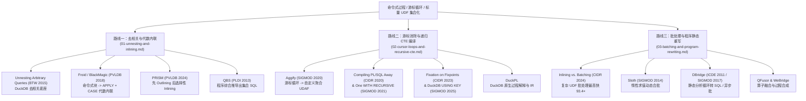

# 集合化（Set-Orientation）学术论文深度研究与 SpinDuck 演进映射

> **研究背景**：在 `c2j/SpinDuck` 的性能剖析中，Rust IR 解释器本体仅占总墙钟耗时的 **2.7%**，而 **97.3%** 消耗在逐行（RBAR, Row-By-Agonizing-Row）跨边界下发 DuckDB SQL、事务提交、参数表点查与标量往返上。要让 100k 行过程从 **316.2s** 跃升至 **10s–30s** 区间，单靠微调解释器远远不够，必须引入数据库学术界过去十余年沉淀的**集合化（Set-Orientation）**方法论。

---

## 1. 集合化技术谱系全景图

数据库界消除“命令式过程/UDF 与声明式 SQL 之间阻抗失配（Impedance Mismatch）”的研究，主要沿着**三条互补路线**演进：

---

## 2. 十二篇核心论文横评矩阵

| 论文 / 系统 | 年份 & 会议 | 所属路线 | 核心变换机制 | 关键实证结论 / 局限性 | 对 SpinDuck（Rust + DuckDB 1.5.5）的直接借鉴 |
| :--- | :--- | :--- | :--- | :--- | :--- |
| **Unnesting Arbitrary Queries** | BTW 2015 | 去相关底座 | 引入 `DEPENDENT_JOIN` 下推算法，系统性消除任意深度关联子查询 | **DuckDB 优化器的去相关基石**；保证集合化改写后的 `LATERAL`/子查询不退化为嵌套循环 | 只要 SpinDuck 产出规范的关联子查询/`LATERAL`，DuckDB 内核即可自动转为 Hash Join |
| **Froid / BlackMagic** (`arXiv:1712.00498`) | PVLDB 2018 | 代数内联 | 将顺序赋值、`IF-ELSE` 映射为 `CROSS/OUTER APPLY` + `CASE` 表达式树并内联 | 在 SQL Server 上实现标量 UDF 自动内联；**但复杂循环、异常处理、多层嵌套易导致计划爆炸或回退 RBAR** | 指导 SpinDuck 突破“仅单 `RETURN` 纯表达式进 MACRO”的限制，支持局部变量与 `sys_dummy` 块编译期折叠 |
| **PRISM** | PVLDB 2024 | 轮廓提取 + 内联 | 基于 SSA 区域 IR，先做 **UDF Outlining** 隐藏干扰片段，再选择性内联 | 在 SQL-ProcBench 上比传统全量内联在 **DuckDB 快 1.29×**、**SQL Server 快 298.73×** | 解释为何不能盲目把带异常处理/动态 SQL 的复杂 PL 全塞进宏，应按 §8 分派矩阵精准切分 |
| **QBS** | PLDI 2013 | 程序综合 | 利用静态分析 + 语法制导综合（Synthesis）将 ORM/应用循环推导为等价集合 SQL | 可跨越复杂变量依赖识别出过滤、Join 与聚合，但综合搜索空间受限于过程长度 | 启发 SpinDuck 对高频固定套路（“游标读取 + 维表查找 + INSERT”）构建模式化模板推导 |
| **Aggify** (`arXiv:2004.05378`) | SIGMOD 2020 | 游标聚合化 | 分析游标循环体状态转移与分支依赖，自动合成为等价自定义聚合函数（UDAF） | 将十万级游标迭代变成数据库单次流水线扫描，消除中间物化与长事务锁 | 直击 `prc_trd_deal_purchase` 等 RBAR 游标主循环；可用于无副作用聚合/累算型游标 |
| **Compiling PL/SQL Away** (`arXiv:1909.03291`) | CIDR 2020 | 控制流编译 | 通过编译技术将 PL/SQL 函数及内部循环整体翻译为纯递归 SQL，消除上下文切换 | 证实“PL/SQL 慢”并非语言语义慢，而是解释器与 SQL 引擎间频繁切换 | 为 SpinDuck P2 提供“免外部机器码 JIT、全量下沉 DuckDB”的理论原型 |
| **One WITH RECURSIVE is Worth Many GOTOs** | SIGMOD 2021 | Trampoline CTE | 采用 CPS / Trampoline 风格将任意 `WHILE` / `GOTO` / 分支控制流展平为单个 `WITH RECURSIVE` | 在主流 RDBMS 上无需修改引擎即可执行任意控制流；标准递归表只增不删易膨胀 | 解决含复杂条件跳转与多出口 `EXIT WHEN` 循环的纯 SQL 表达难题 |
| **Fixation on Fixpoints & DuckDB USING KEY** | CIDR 2023 / SIGMOD 2025 | 键控状态递归 | 在 `WITH RECURSIVE` 中引入 **`USING KEY`**，用聚合哈希表原地覆写迭代状态（已合入 **DuckDB v1.3.0+**） | 彻底消除传统单调不动点递归 CTE 的历史行膨胀与内存爆炸 | **SpinDuck 基于 DuckDB 1.5.5，原生具备 `USING KEY` 能力！** 可用于带状态累加的金融试算游标循环 |
| **DuckPL** | DuckDB 生态研究 | 栈式 IR 解释器 | DuckDB 原生过程语言扩展，栈式流解释 + 极简 IR + 表达式缓存 | 针对确需过程式控制流与副作用的场景，避免每步触发完整 SQL 解析 | 与 SpinDuck 现有 `IrProg` + `MemoizingExecutor` 架构高度同源，可借鉴其表达式缓存设计 |
| **Inlining vs. Batching** | **CIDR 2024** | 批处理 vs 内联 | 保持过程逐语句结构，但将外层输入打包为**批次表（Batch）**并用集合算子跨批执行 | **颠覆性结论：复杂 UDF 上批处理（Batching）最高比内联快 93.4×**，因为极大降低了优化器去相关难度 | **对 SpinDuck 极具战略价值！** `FnSite` 批量元组下沉、WriteBuffer、同构 UPDATE 攒批均属此范式 |
| **Sloth** | SIGMOD 2014 | 惰性合批 | 借鉴惰性求值思想推迟 DB 读取，跨循环与方法边界自动合并多个查询为批请求 | 极大压缩跨边界往返次数，无需像全量重写那样完全拆解控制流 | 可指导 SpinDuck 游标循环内的多张参数表异步预取与延迟刷盘策略 |
| **DBridge** | ICDE 2011 / SIGMOD 2017 | 静态重写与批处理 | 基于字节码控制流/数据流分析（DFG/CFG），将循环自动改写为集合 SQL 或异步批提交 | 将“N+1”循环查询与单行更新转为单次集合下发或批量接口 | 指导 SpinDuck `WriteBuffer` 从“只批纯 INSERT”扩展到“带 `fn_sites` 的 INSERT + 同构主键 UPDATE” |

---

## 3. 核心洞察：SpinDuck 为什么不能只靠“全量内联（Froid）”？

结合 **CIDR 2024（Inlining vs. Batching）** 与 **PVLDB 2024（PRISM）** 的最新研究结论，我们得出了对 SpinDuck 至关重要的架构判断：

1. **盲目全量内联的陷阱**：金融存储过程（如 `prc_trd_deal_purchase`）普遍包含上百个局部变量、`%ROWTYPE`、多分支 `CASE`、`EXCEPTION WHEN OTHERS`（如 2% `A999` 异常跳行）以及多表写操作。如果像纯 Froid 那样强行展平为一棵巨型嵌套 `APPLY`/`LATERAL` SQL 树，会导致：
   - DuckDB 优化器关联去相关（Decorrelation）与 Join 重排复杂度暴增；
   - 分区裁剪（Data Skipping）失效；
   - 异常行跳过（`BatchSkip`）语义极难在纯单条 SQL 中精确保持。
2. **SpinDuck 的最优组合拳 = 「选择性内联 + 跨行批处理（Batching）+ 键控集合下推」**：
   - **能折叠的标量片段（Froid + PRISM 思路）**：编译期直接折叠 `SELECT CASE ... FROM sys_dummy` 为 `IrStmt::Assign`；单表达式纯函数进 DuckDB `MACRO`。
   - **能本地直算的纯计算（PRISM Outlining 思路）**：将 `to_char` / `to_date` / `substr` / `nvl` 等高频标量“轮廓提取”留在 Rust 侧直接计算，零 SQL 边界往返。
   - **含副作用/异常处理的循环（CIDR 2024 Batching + DBridge 思路）**：不强行拆毁循环体，而是把单行操作升级为**批处理通道**（`LookupExecutor` 一次构建 Hash 索引、`FnSite` 元组批量求值、`WriteBuffer` 接入 DuckDB 原生 `Appender` 异常回退、`UPDATE` 攒批为 `TEMP TABLE + UPDATE FROM`）。
   - **纯读/聚合/单游标插表主干（Aggify + DuckDB `USING KEY` 思路）**：对无异常分支或可静态判定安全的主干游标循环，直接集合化下推为 `INSERT INTO ... SELECT ... JOIN` 或 `WITH RECURSIVE ... USING KEY`。

---

## 4. 分主题深度阅读导航

- **[01 · 去相关与代数内联：Unnesting、Froid、PRISM 与 QBS](./01-unnesting-and-inlining.md)**  
  详述关联子查询消除、命令式代码到 `APPLY`/`CASE` 的形式化转换、SQL Server 内联失败边界以及 PRISM “先轮廓提取再内联”算法。
- **[02 · 游标循环消除与递归 CTE：Aggify、Trampoline SQL 与 DuckDB USING KEY](./02-cursor-loops-and-recursive-cte.md)**  
  详述如何用自定义聚合（Aggify）、CPS/Trampoline（`WITH RECURSIVE`）和 DuckDB 原生 `USING KEY` 消除十万级 RBAR 游标循环。
- **[03 · 跨边界批处理与程序静态重写：CIDR 2024 Batching、Sloth、DBridge 与 QFusor](./03-batching-and-program-rewriting.md)**  
  深入对比 Inlining 与 Batching 的性能分界线（93.4× 实证），并给出 SpinDuck P0–P2 阶段的静态重写与批处理通道改造蓝图。
