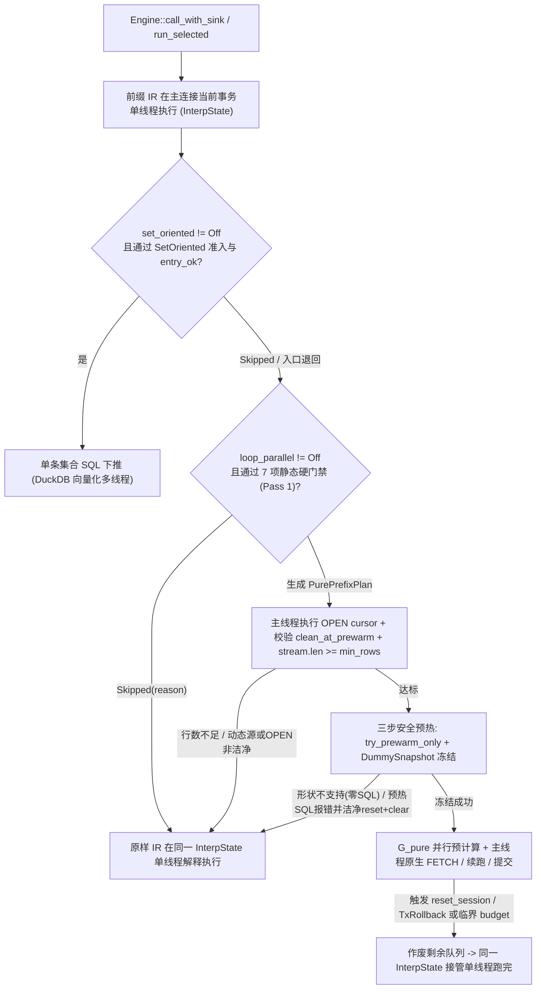

# SpinDuck 游标与循环并行优化引擎（`loop-parallel` V8 审校修正版）详细设计文档

> **适用基线**：`c2j/SpinDuck` 最新 **`v0.2.3`**（`main` `HEAD 6c50496` / PR #58，`spinduck/Cargo.toml` 为 **`version = "0.2.3"`**；内核固定 `ogsql-parser v0.11.0` + DuckDB `=1.10505.0` / 1.5.5）  
> **状态说明**：V8 在 V7 已落地实现（`feat-loop-parallel` 分支，V7 全部门禁与真实 DuckDB 守护测试通过）的基础上，依据 `golden/v4_loop_parallel_verify` 对真实语料 `prc_trd_deal_purchase` / `prc_trd_hz_byfund` 的实证结论修订：新增 **行键预热（E1）/ 确定性调用物化（E2）/ 携带态主线程解算（E3）/ 门禁区域化（E4）/ fn_site 快照化（E5）/ 多区域报告（E6）** 六项增强，逐机制详设见 `loop-parallel-v8/` 目录；V7 及更早轮次的全部安全不变量（Worker 零数据库接触、主线程独占 FETCH/写/事务/trace/步数、任一门禁失败同状态串行）**不变**。  
> **设计定位**：作为 `set_oriented` 的**二级降级协同通道**，严格收敛为 **“纯 CFG 前缀子图 $G_{\text{pure}}$ 并行预计算（Worker 零数据库连接） + 主线程持久上下文 `InterpState` 按 `row_idx` 顺序 `FETCH` 与多出口续跑”**。

---

## 0. 审校修正摘要

### 0.1 V4 轮：对上一轮静态复审意见（`HEAD 6c50496`：4 项 P1 + 1 项 P2）

| 审校编号 | 上版设计漏洞与反例（`HEAD 6c50496`） | 本版协议级修正方案 | 对应章节 |
| :--- | :--- | :--- | :--- |
| **R3-P1-1** | 允许“首行必达查询预热失败直接 `?` 上抛”，会在 `ENG-0032`（预算耗尽）、`BIZ-0126`（`FETCH` 错）或前置赋值错之前提前报错并丢失 `FETCH`/Trace | **预热报错绝不充当例程错误**：任一 `try_prewarm_only` `SqlFailed(_)`（含必达与条件查询）均严禁直接 `?` 上抛；仅在**预热前已证明洁净状态**下通过 `flow::reset_session()? + lookup.clear()` 还原会话后全量退回原串行循环，由原解释器按原预算、原优先级与原 PC 位置精确触发异常 | §5.1 |
| **R3-P1-2** | 仅靠 `open_pc` 前的静态 `TxCommit` 判洁净，遗漏 `batch_commit = true` 会吞并 `COMMIT`（`interp.rs:293–298`）及 `OPEN` 自身可触发 `materialize_fn_sites` 建写临时表（`cursors.rs:23`, `dynamic.rs:48–94`） | **改为“预热启动瞬间”静态+运行态双证（`clean_at_prewarm`）**：① 门禁要求 `OPEN` 为静态游标且 `cursor.fn_sites.is_empty()`；② `batch_commit = true` 时 `TxCommit`/`TxCommitIfWritten` 不视为提交，入口存在先序 DML/DDL/`CallRoutine` 且未真实提交即拒绝；③ 运行态实时校验 `wbuf_is_empty()` 与真实提交跟踪器 `dirty_tx_observed == false`，不满足则严禁启动预热 | §4.1 门禁 7, §5.1 |
| **R3-P1-3** | 暂停协议误概括成“`flush_all` 在 `TxCommit/TxRollback` 时触发”，违背 `batch_commit` 吞并 `COMMIT` 与 `TxRollback` **先 `discard` 再回滚**（`interp.rs:312–317`）等原语义 | **只新增“循环迭代暂停不刷盘”一条规则**：跨轮暂停交还控制权时不调用 `writebuf::flush_all`；其余所有指令（`TxCommit`、`TxCommitIfWritten`、`TxRollback`、`SqlQuery`、`FoldedQuery`、`SqlExecDynamic`、`CallRoutine` 及例程最终出口）的 `flush` / `discard` 行为**逐条原样继承 `interp.rs` / `writebuf.rs`**，不另立新规 | §3.3 |
| **R3-P1-4** | `written_vars: Vec<(VarName, SpinValue)>` 无法表达记录字段级增量：前缀仅写 `r.a` 而尾段跨轮维护 `r.b` 时，整变量写回会覆盖上一轮的 `r.b` | **字段级有序写日志 `write_log: Vec<(AssignTarget, SpinValue)>`**：精确记录 `AssignTarget::Var` 与 `AssignTarget::Field { rec, field }` 写入并按序经 `Frame::assign`（`frame.rs:106–114`）合入（V5 由 R4-P1-1 细化：按 `interp::assign` 同语义求值与合入）；同步将门禁 2 到达定值细化至 `(VarName, field)` 粒度 | §3.3, §4.1 门禁 2 |
| **R3-P2-1** | 反重入证明仅排除 `tail_jump_pc -> fetch_pc`，会误杀直接 `GOTO error_row` 回到 `fetch_pc`（`PKG_SPLIT_TRADE_STEP3_SH.sql:854–855, 885`）的 `prc_trd_deal_purchase`；且 §7.1 措辞易误读为已验证 | **定义完整迭代边界边集 $E_{\text{iter\_end}}$**：包含正常回跳及循环内所有合法跳转至 `fetch_pc` 的 `CONTINUE`/`GOTO` 边（以及循环退出边）；跨过任一边即结束本轮；同步将 §7.1 明确标注为**待真实 IR 准入测试实证的静态预期** | §3.1, §7.1 |

### 0.2 V5 轮（R4）：内部审核 + 外部审核合并修正（7 项 P1 + 8 项 P2）

| 审校编号 | 漏洞 / 缺口（含证据锚点） | 本版修正方案 | 对应章节 |
| :--- | :--- | :--- | :--- |
| **R4-P1-1**（内部） | 写槽语义缺口：设计原写"主线程逐条调用 `Frame::assign`"，但解释器实际写槽入口是 `interp::assign`（`interp.rs:415–429`）——先按 `var_types` + `implicit_assignment_loose` 走 `coerce_for_slot`，且 **coerce 失败本身是可被 trap 捕获的 `EngineError`**。裸 `Frame::assign` 跳过类型转换、丢失 trap 语义 | Worker 按 `interp::assign` **完整语义**求值（coerce 失败在原指令位置产生错误并参与 trap 分派）；`write_log` 存 coerce 后终值，主线程合入不再二次 coerce | §3.3, §7.2-4 |
| **R4-P1-2**（内部） | 门禁 2 的纯 IR 到达定值分析看不到**解释器隐式写**：`__sqlerrm` 由 trap 进入时 `frame.set` 写入（`interp.rs:199–202`），不是 IR `Assign`；`current_error` 同理 | 隐式帧写与 `current_error` 状态纳入跨轮定值集建模；前缀读 `SQLERRM` 或依赖"上轮 handler 是否触发过"的状态 → `CycleCarriedDependence` | 门禁 2, §3.3 |
| **R4-P1-3**（内部） | §7.1 段 2 预期 skip reason 与自家门禁矛盾：`c_fxj` 是 REF CURSOR **动态源**（426 行 `OPEN c_fxj FOR v_sql_txt`）、区域含嵌套游标循环（外层 `c_get_venture_data` 402 行 / 内层 441–506 行）、行中 `COMMIT`（492 行）、`GOTO error_row2` 跨层回跳；且 `ParallelSkipReason` 无动态游标变体 | 预期改为 `Skipped(DynamicCursorSource)`（门禁 7 先拒）或 `UnsupportedControlFlow`（门禁 1 次拒）；枚举新增 `DynamicCursorSource` / `TransactionAnchoredRead` / `PrewarmFailed` 变体 | §4.2, §7.1 |
| **R4-P1-4**（外部） | 洁净复位 ≠ 恢复原执行环境：`flow::reset_session` 是真实的 `ROLLBACK` + `BEGIN TRANSACTION`（`flow.rs:13–22`），预热失败复位路径会**切换事务**；事务锚定观察值（`CURRENT_TIMESTAMP` / `NOW` 等）可变。反例：循环前保存时间戳、条件分支缺失表预热失败（串行根本不会执行该查询）、尾段比较两值——串行相等、并行路径不等。门禁 5 禁令只覆盖 $V_{pure}$，前缀 / `cond_pc` / `ResidualSuffix` 均不受限；`clean_at_prewarm` 只证明无未提交写入，证明不了事务环境不变 | 门禁 5 事务锚定禁令扩大到 **"[例程入口..=close_pc] 全范围"**（V6 由 R5-P1-1 扩至全例程体，close_pc 截止作废）；"单连接、无外部写者"列为有效性前提；事务锚定行为须在**目标内核 DuckDB 1.5.5** 上以反例探针实证（外部审核的本机 1.4.4 探针不作为验收证据） | 门禁 5, §5.1, §7.2-10 |
| **R4-P1-5**（外部 + 内部收敛） | Worker 游标属性输入契约缺失：`eval.rs:72` 经 `Frame::cursor_attr` 求值 `IrExpr::CursorAttr`，游标**缺失时静默**返回 `%ROWCOUNT=0`、`%FOUND/%NOTFOUND=false`——Worker 沙箱无 `CursorState`，逐行语义（`cur%ROWCOUNT` 应得 1,2,3…）失真且**不报错** | 首期 `IrExpr::CursorAttr` 在 $V_{pure}$ 内一律拒绝（`UnsupportedControlFlow`）；外层游标（迭代间不变）快照放行与循环游标逐行合成列为二期，须另配守护测试 | §3.1, 门禁 1, §7.2-9 |
| **R4-P1-6**（外部） | "零拷贝切片"与主线程 FETCH 借用冲突：`RowStream` 的 `rows` 与 `pos` 同对象共置（`exec.rs:16–47`），`fetch()` 推进 `pos` 需 `&mut`——`&[Row]` 切片借用持续期间无法再经可变游标执行 FETCH；提前 `CLOSE` 还涉及行数据生命周期 | 废弃"暴露只读切片"微扩展；`rows` 改 `Arc<Vec<Row>>`（`RowStream::new` 签名不变），主线程独占 `pos`，Worker 持 `Arc` 克隆 + 行区间；`std::thread::scope` 出口 join 保证提前 CLOSE/回退时资源释放，配守护测试 | §3.2, §6, §7.2-11 |
| **R4-P1-7**（外部） | 验收矩阵**无法证明并行真的发生**：一个全程回退串行的实现也能通过现有全部断言；耗时口径不含预热、无收益门槛 | 补结果消费断言（`ParallelStatus == Parallelized`、`rows_dispatched == N`、`rows_fallback_serial == 0`）；报告含 `prewarm_ms` 的总墙钟与并行段占比；`threads=1` 作为纯开销对照组；定义最低加速比门槛（未达标即红） | §7.2-8 |
| **R4-P2-1**（内部） | $W_{\text{loop}}$ 未形式化：$R_{\text{prefix}} \cap W_{\text{loop}} = \emptyset$ 的可靠性依赖循环内**非内联 `CallRoutine` 的传递写集**计入，设计未写 | 门禁 7 补 $W_{\text{loop}}$ 形式定义（静态 DML/DDL ∪ callee 传递写集，取不到即判相交） | 门禁 7 |
| **R4-P2-2**（内部） | 预热 SQL / 策略 B 入口探测是串行模式中**不存在的额外执行**，trace / 步数 / SQL 审计口径未定义——§7.2 的 Trace 对齐断言会假红 | 规定三条：trace 静默、不计解释器步数、SQL 审计单列 `prewarm_sql_count` | §5.1, §7.2-8 |
| **R4-P2-3**（内部） | 预热 `SqlFailed` 记 `Skipped(InsufficientParallelWork)` 语义混载（缓存构建失败 ≠ 工作量不足），污染 §2 审计面 | 新增 `PrewarmFailed` 变体承接 | §4.2, §5.1 |
| **R4-P2-4**（内部） | 配置接线未定义（谁设 `mode/threads/chunk_size/min_rows`）；`LoopParallelConfig` 未实现 `Default` | 比照 `SetOrientedMode` 先例：`spinduck.toml [engine].loop_parallel` + Engine 字段 + CLI + `as_str/from_name`；补显式 `Default` impl | §2 |
| **R4-P2-5**（内部） | `std::thread::scope` 要求闭包 `Send`、共享引用 `Sync`——这是**隐式编译前提**，设计未锁定 | 编译期断言守护测试（对 `SpinValue` / `IrProg` / 快照负载 / `WorkerRowResult` 逐类型断言） | §6, §7.2-11 |
| **R4-P2-6**（内部） | Worker 前缀 trace 采集点未定义——事件次序差一拍即违反 §11.2 JSONL 契约 | 逐字对齐 `interp.rs:287–289`（指令起始发事件、`TxCommitIfWritten` 不发、`sink.is_enabled()` 门控） | §3.2, §7.2-7 |
| **R4-P2-7**（内部） | chunk 超前派发的正确性**完全系于门禁 2**（派发时刻 Frame 只反映 < chunk_start 行的状态），未写成显式不变量 | 列为显式不变量，补"suffix 写 → 后续行前缀读"静态拦截 + 派发等价守护测试 | §3.2, 门禁 2, §7.2-11 |
| **R4-P2-8**（内部） | 引用精度：`exec.rs:55–57` 实为注释，名单实名 `PURE_SCALAR_FNS`（`exec.rs:60`，5 个函数的 FROM-less SELECT 记忆化白名单，门禁 5 清单是其**超集**）；`frame.rs` 的 `assign` 实际在 112–120 行 | 修正引用 | 门禁 5, §3.3 |

### 0.3 V6 轮（R5）：第二轮复审（2 项 P1 + 2 项 P2）

| 审校编号 | 漏洞 / 缺口（含证据锚点） | 本版修正方案 | 对应章节 |
| :--- | :--- | :--- | :--- |
| **R5-P1-1**（外部） | 事务观察禁令**过早截止于 `close_pc`**：CLOSE 不结束事务，例程在 CLOSE 后执行 `SELECT CURRENT_TIMESTAMP INTO p_out` 时，预热失败复位的 `ROLLBACK → BEGIN` 仍改变输出所对应的事务起点，却绕过 `[入口..=close_pc]` 范围的门禁；与 §5.1"例程内不存在任何事务锚定观察点"的表述也不一致 | 禁令范围扩至**整个例程体（`[入口 ..= 程序尾部]`，含循环后残余、CLOSE 之后语句与 OUT 参数赋值）∪ 非内联调用的传递闭包**；动态 SQL（`SqlExecDynamic` / `OPEN FOR`，文本运行期构造）无法静态证明不读事务锚定值 → 启用预热即保守拒判 `TransactionAnchoredRead`；补"事务时间仅在 CLOSE 后读取"拒判测试 | 门禁 5, §5.1, §7.2-10 |
| **R5-P1-2**（外部） | 零 SQL 表达式门禁**遗漏 `IrExpr::SqlFn`**：规则中带 `@` 标记的函数（`@to_char` 等）编译为 `IrExpr::SqlFn { prepared }`（`ir/expr.rs:95–110`），运行时 `eval_sqlfn` 仍调用 `env.ex.query` 执行真实 SQL（`eval.rs:112–121`）——**已预编译 SQL、函数确定性，都不意味着可以零数据库求值**；且 `eval_funccall` 对未知内建同样下沉 `SELECT f($p0,…)`。原门禁只覆盖了 `FuncCall` 变体 | $V_{\text{pure}}$ 表达式**递归审计**，唯一准入判据 =「`eval` 求值路径不触碰 `env.ex`」：未本地降阶的 `SqlFn` 与未内联的 `FuncCall` 一律交权（语句成为 $E_{\text{yield}}$ 出口）；**不得复用集合化路径的"纯表达式"判定作为 Worker 准入依据**；补赋值 / 条件 / 嵌套表达式三形态测试 | §3.1, 门禁 1, 门禁 3, §7.2-12 |
| **R5-P2-1**（外部） | JSONL"逐字节一致"缺固定环境：`AuditSink::on_event`（`trace/sink.rs:86–92`）每行取注入时钟并写入 `sid/cid`——生产两次运行的日志必然不同 | 测试注入**相同固定时钟闭包与相同 `sid/cid`**（`AuditSink::new` 的接缝 3 注入点，`trace/sink.rs` 模块头即为此设计）后逐字节断言；生产日志只承诺**事件顺序与业务字段一致**（时间戳与会话标识逐次不同） | §3.2, §7.2-7 |
| **R5-P2-2**（外部） | 最低收益**没有数值**："既定最低加速比"未定义阈值、测量环境与重复统计方法，无法据此判红绿 | 定值：测量环境 = release 构建 + 100k 夹具 + 记录机器规格；每配置预热后连跑 **5 次取中位数**（首次冷启动剔除）并报告 min/max；门槛 = **`safe (threads=4)` 含 `prewarm_ms` 总墙钟相对 `off` 加速比 ≥ 1.2**，且 **`safe (threads=1)` 相对 `off` 退化 ≤ 10%**；阈值调整须附测量证据 | §7.2-8 |

### 0.4 V7 轮（R6）：第三轮复审收口（1 项 P1 + 1 项 P2）

| 审校编号 | 漏洞 / 缺口（含证据锚点） | 本版修正方案 | 对应章节 |
| :--- | :--- | :--- | :--- |
| **R6-P1-1**（外部） | 事务锚定审计**遗漏数据库对象中的隐式表达式**：门禁 5 遍历例程代码与调用闭包，但目标表 `created_at TIMESTAMP DEFAULT CURRENT_TIMESTAMP` 这类省略列默认值在 `INSERT INTO audit(id) VALUES (...)` 时**由内核隐式求值**——源码无任何时间函数，预热失败复位后省略列仍取**新事务的时间**；VIEW / 宏定义同理。仅遍历代码文本不足以证明"不存在事务观察" | 门禁 5 补**数据库对象隐式表达式闭包**：① INSERT / UPDATE 目标表**实际触发的省略列默认表达式**纳入审计（先例：集合化 `copy.rs:92–105` `prove_omitted_columns` 对 `Opaque` 默认返回 `NonDeterministicDefault`，只放行 `PureConst` / 可空无默认）；② prefix 查询依赖的 VIEW / 宏定义展开后纳入同一禁令；③ 首期无法静态解析（嵌套视图、不可解析默认、宏）→ 保守拒判 `TransactionAnchoredRead`；补"无显式时间函数但 INSERT 触发时间默认值"拒判测试 | 门禁 5, §7.2-10 |
| **R6-P2-1**（外部） | `SqlFn` 处置**自相矛盾**：§3.1 写"三类表达式命中即整域拒绝"，门禁 3 与 §7.2-12 又写"交权出口"——留下"交权或拒绝"的任意选择 | 处置按类固定，无任意选择：**`CursorAttr` 整域拒绝** `UnsupportedControlFlow`（无任何可靠合成语义，静默错值不可检出）；**未降阶 `SqlFn` / `FuncCall` 一律截断纯前缀并交权**（语句成为 $E_{\text{yield}}$ 出口），截断后的剩余前缀照常接受最小工作量（门禁 1）与反重入（§3.1）检查——交权后前缀为空则由最小工作量门禁确定性判定 `InsufficientParallelWork` | §3.1, 门禁 1, §7.2-12 |

### 0.5 V8 轮（R7）：真实语料实证驱动的覆盖面扩展（6 项机制）

V7 实现落地后，`golden/v4_loop_parallel_verify` 对 `PKG_SPLIT_TRADE_STEP3_SH.sql` 两个真实存储过程的实测结论：**全部保守 Skipped、零收益**——purchase 死于门禁 1（行键 `SELECT INTO` 不可预热 → `G_pure` 为空）；byfund 死于门禁 7（游标 `fn_sites`）且叠加例程级动态 SQL（门禁 5 全例程扫描）与真实循环携带依赖（`v_temp_stock_kind` 残留）。根因不是实现缺陷，而是 V7 的"循环不变绑定预热"模型**结构上不覆盖行键工作负载**——而真实语料的耗时恰好全在行键上。

V8 的核心洞察：**游标行集在 `OPEN` 后已物化（`Arc<Vec<Row>>`），一切行键查询/调用的 distinct 键元组在派发前即可枚举**——预热成本是 `Σ distinct_keys` 而非 `Σ rows`。据此新增六项机制，逐机制详设见 `loop-parallel-v8/`：

| 编号 | 机制 | 解决的阻断 | 详设 |
| :--- | :--- | :--- | :--- |
| **E1** | 行键预热 Keyed Prewarm | 行键 `SqlQuery` 全部交权 → `G_pure` 空 | `loop-parallel-v8/e1-keyed-prewarm.md` |
| **E2** | 确定性调用物化 Call Materialization | `CallRoutine`/`FuncCall`/`SqlFn` 交权（含 OUT 参整体快照） | `loop-parallel-v8/e2-call-materialization.md` |
| **E3** | 携带态主线程解算 Carried-State Partition | 门禁 2"检出即拒"无法表达"主线程顺序解算" | `loop-parallel-v8/e3-carried-state.md` |
| **E4** | 门禁 5 区域化 Tx-Anchor Scoping | 全例程扫描被无关动态 SQL 污染 | `loop-parallel-v8/e4-gate5-scoping.md` |
| **E5** | fn_site 物化快照化 | `cursor.fn_sites` 非空即拒 | `loop-parallel-v8/e5-fnsite-snapshot.md` |
| **E6** | 多区域判定与报告 Multi-Region | `extract` 只认首个游标，byfund 4 段共存判定 | `loop-parallel-v8/e6-multi-region.md` |

**V8 不变量（与 V7 完全一致，不得放宽）**：Worker 零数据库连接/零 SQL/零写缓冲；主线程独占 `InterpState`、FETCH、写、事务、trace 顺序、trap、错误、步数预算；任一门禁失败同状态串行续跑；`Off` 默认语义不变。E1–E6 全部是"把更多工作证明为可快照化"的**准入面扩展**，不是安全边界的放松——每项机制自带独立门禁与守护测试，任一证明不出即回退 V7 行为。

**实施顺序**：Phase A = E1+E2+E8 报告字段（解锁 purchase）；Phase B = E4+E5+E3+E6（解锁 byfund 段 1）；段 2（嵌套动态游标）/段 3（无工作量）/QFII 段本期**显式排除**（收益面/复杂度比最差，见 §7.1 V8 修订）。

**E7 候选记录（Worker 只读连接，已评估暂缓）**：曾讨论"Worker 持 `try_clone` 同库连接执行只读 SQL、写回主线程"的放宽方案。实测结论（`DuckExecutor::try_clone` 探针）：克隆连接可读已提交基表且与主连接写事务并发不阻塞（MVCC 读写不互斥），但 **① TEMP 表连接级不可见**（`sd_*`/游标表全失效）、**② 未提交写不可见**（read-your-writes 断裂，需新增"前缀读集 ∩ 入口未提交写集 = ∅"门禁）、**③ 克隆连接自身写入独立事务无法并入主连接原子提交**（写回主线程排队为必需而非可选）。叠加 trace 事件序契约与步数预算口径问题，且 DuckDB 单查询已内核级并行——收益面限于"snapshot 证明不了的普通表长尾查询"。**判定：暂缓**，待真实 profile 出现该类热点再启用；启用前须补三门禁（未提交写不相交、TEMP 表引用静态排除、Worker SQL 的 trace/步数口径）。

---

## 1. 定位、协同漏斗与核心设计铁律

### 1.1 `SetOriented` × `LoopParallel` 二级协同漏斗



### 1.2 核心设计铁律

1. **Worker 零数据库接触**：Worker 线程仅接收不可变 `Arc<FrozenLookupSnapshot>`、`Arc<DummyCardinalitySnapshot>` 与当前只读初始 `Frame` 视图；**不持有 `SqlExecutor`、不执行任何 DuckDB SQL、不建临时表、不写 `WriteBuffer`、不触发 `flush_all`**。
2. **主线程独占事务、游标推进与副作用**：`OPEN`、`FETCH`、`JumpIfNot`、`SqlExec`、`CallRoutine`、`FoldedQuery`（非预检路径）、`TxCommit`、`TxRollback`、`CLOSE`、`reset_session()` 全部留在主线程同一 `InterpState` 上按 `row_idx` 顺序原生执行。
3. **遵守 `AGENTS.md §1 / §3` 边界**：
   - **不修改 `SqlExecutor` 与 `TraceSink` trait 签名**；
   - **不引入新的运行时 crate 依赖**（使用 `std::thread::scope`）；
   - 单文件 `≤ 500` 行，单函数 `≤ 60` 行，零 `unsafe`，库代码禁止 `unwrap`/`expect`/`panic!` 控制流。
4. **语义等价靠"同路径复用"而非"近似复刻"（R4-P1-1 / R4-P2-6）**：Worker / 主线程的写槽必须走解释器同一 `interp::assign`（含 `coerce_for_slot`）语义，trace 采集点逐字对齐 `interp.rs:287–289`——并行路径上任何"看起来等价"的近似实现都按缺陷处理。

---

## 2. 配置开关与可观测结构

```rust
// spinduck/src/ir/loop_parallel/mod.rs
#[derive(Debug, Clone, Copy, PartialEq, Eq, Default)]
pub enum LoopParallelMode {
    /// 默认关闭：100% 保持现有单线程解释路径
    #[default]
    Off,
    /// 安全并行：仅在通过全套静态门禁、洁净入口检查与安全预热后启用
    Safe,
}

#[derive(Debug, Clone, Copy, PartialEq, Eq)]
pub struct LoopParallelConfig {
    pub mode: LoopParallelMode,
    /// 0 = 自动取 std::thread::available_parallelism().min(8)
    pub threads: usize,
    /// 每次派发给 Worker 池的游标行批大小（默认 256）
    pub chunk_size: usize,
    /// 最小行数门槛：OPEN 游标后剩余行数 < min_rows 则不启线程池（默认 256）
    pub min_rows: usize,
}

// R4-P2-4：非零默认值无法 derive，显式实现；threads = 0 语义为自动探测。
impl Default for LoopParallelConfig {
    fn default() -> Self {
        Self { mode: LoopParallelMode::Off, threads: 0, chunk_size: 256, min_rows: 256 }
    }
}
```

可观测报告新增 `prewarm_ms` 与 `rollback_invalidated` 字段，用于基准测试审计预热开销与运行时回滚降级情况：

```rust
#[derive(Debug, Clone, PartialEq, Eq)]
pub enum ParallelStatus {
    Parallelized {
        workers: usize,
        rows_dispatched: usize,
        /// 因临界 step_budget 或运行时 reset_session/TxRollback 退回原生串行的行数
        rows_fallback_serial: usize,
        rollback_invalidated: bool,
        prewarmed_tables: usize,
        prewarm_ms: u64,
        snapshot_hits: u64,
        snapshot_misses: u64,
        peak_snapshot_bytes: usize,
    },
    Skipped {
        reason: ParallelSkipReason,
    },
}
```

### 2.1 配置接线（比照 `set_oriented` 先例，R4-P2-4）

| 层 | `loop_parallel` 形态 | 仓库先例 |
| :--- | :--- | :--- |
| `spinduck.toml` | `[engine].loop_parallel = "off" \| "safe"`（布尔或规范名，非法值报错） | `[engine].set_oriented = off/strict/batch-atomic`（`project/mod.rs:101–118`） |
| Engine 字段 | `loop_parallel: LoopParallelConfig`（默认全关，`Default` impl） | `engine.rs:40` `set_oriented: SetOrientedMode` |
| 规范名互转 | `as_str()` / `from_name()`（`"off"` / `"safe"`） | `SetOrientedMode::as_str/from_name`（`ir/set_oriented/mod.rs:41–61`） |
| CLI | `--loop-parallel <off\|safe>`；`threads/chunk_size/min_rows` 仅显式给出时覆盖默认 | `cli/args/call.rs` 既有引擎调参先例 |
| 报告 | `ParallelStatus` 挂 Engine 报告向量，与 `set_oriented_reports` **并行双轨**（审计可还原完整漏斗） | `engine.rs:41` `set_oriented_reports` |

> 这是**运行期配置开关**而非 cargo feature：不触发 AGENTS §2「新增 feature flag 需 Ask first」；但 CLI / TOML 参数面新增仍随 PR 评审。

---

## 3. 核心执行模型：纯 CFG 子图 $G_{\text{pure}}$、主线程 `FETCH` 与完整续跑协议

### 3.1 纯 CFG 子图 $G_{\text{pure}}$ 与多路交权出口 $E_{\text{yield}}$（回应 P2-2）

放弃单一 `split_pc` 假设，将循环体内可并行区域形式化为以 `body_start_pc` 为唯一入口的**有向无环纯子图（DAG）**：

$$G_{\text{pure}} = (V_{\text{pure}},\; E_{\text{internal}},\; E_{\text{yield}})$$

* **节点集 $V_{\text{pure}}$**：自 `body_start_pc` 可达且仅包含纯白名单指令（见 §4.1 门禁 1）的指令 PC 集合，禁止内部任何向后回边或局部循环。
* **表达式级排除（R4-P1-5 / R5-P1-2）**：$V_{\text{pure}}$ 内任何语句的表达式（`Assign` 右值、`JumpIf*` 条件、`Perform` 实参、SQL 绑定表达式，**含嵌套子表达式递归审计**）**禁止出现**：① `IrExpr::CursorAttr`——`eval.rs:72` 经 `Frame::cursor_attr` 求值，Worker 沙箱无 `CursorState`，游标缺失时**静默**返回 `%ROWCOUNT=0`、`%FOUND/%NOTFOUND=false`（`frame.rs` `cursor_attr` 缺失分支），逐行语义失真且不报错；② **未本地降阶的 `IrExpr::SqlFn`**——规则 `@` 标记函数（`@to_char` 等）编译为 `SqlFn { prepared }`（`ir/expr.rs:95–110`），运行时 `eval_sqlfn` 仍调用 `env.ex.query` 执行真实 SQL（`eval.rs:112–121`）：**已预编译 SQL、函数确定性，都不意味着可以零数据库求值**；③ 未内联的 `IrExpr::FuncCall`——未知内建同样下沉 `SELECT f($p0,…)` 交内核求值。**递归审计的唯一准入判据：「`eval` 求值路径不触碰 `env.ex`」**；不得复用集合化路径的"纯表达式"判定作为 Worker 准入依据（两者的纯度语义不同：集合化路径始终持有执行器，Worker 没有）。**命中后果按类固定，无任意选择（R6-P2-1）**：① `CursorAttr` **整域拒绝** `UnsupportedControlFlow`——无任何可靠合成语义，静默错值不可检出；② 未本地降阶 `SqlFn` / 未内联 `FuncCall` **一律截断纯前缀并交权**——所在语句成为 $E_{\text{yield}}$ 出口，截断后的剩余前缀照常接受最小工作量（门禁 1）与反重入（§3.1）检查，交权后前缀为空则由最小工作量门禁确定性判定 `InsufficientParallelWork`。二期可评估：非循环游标（循环外 OPEN、$V_{\text{pure}}$ 内无 Fetch、迭代间不变）经快照放行；循环游标逐行合成（如 `%ROWCOUNT = row_idx + 1`）须另配守护测试。
* **内部边 $E_{\text{internal}}$**：满足 $u, v \in V_{\text{pure}}$ 且 $v > u$ 的正常前向转移与局部可处理 `PushTrap` 异常展开边。
* **多路交权出口边 $E_{\text{yield}}$**：任意满足 $u \in V_{\text{pure}}$ 而目标 $v \notin V_{\text{pure}}$ 的出边，覆盖全部正常汇聚点与异常/早退分支，包括：
  1. 首个 `SqlExec` / `SqlExecDynamic` / `TxCommit` / `TxRollback` / `CloseCursor`（如 `prc_trd_deal_purchase:1015` `INSERT`）；
  2. 首个 `IrStmt::CallRoutine` 或含未降阶 `IrExpr::FuncCall` / 未本地降阶 `IrExpr::SqlFn` 的语句（回应 P1-5、R5-P1-2）；
  3. 含写副作用的异常处理器入口 `trap_handler_pc`（如 `prc_trd_deal_purchase:875, 897` `inst_log`）；
  4. 未启用 `DummyCardinalitySnapshot` 的 `FoldedQuery`（回应 P1-4）；
  5. 若整条分支纯无副作用直达循环尾，则出口可直接落在 `tail_jump_pc` 或 `RETURN` / `EXIT`。
* **迭代边界边集 $E_{\text{iter\_end}}$ 与反可重入证明（No-Reentry Invariant，回应 R3-P2-1）**：
  * 定义完整迭代边界边集 $E_{\text{iter\_end}}$：包含从循环体内部（含异常/分支路径）指向 **`fetch_pc`** 的**全部回跳边**（既包括尾部 `tail_jump_pc -> fetch_pc`，也包括诸如 `PKG_SPLIT_TRADE_STEP3_SH.sql:885, 904, 1081` 经 `GOTO error_row` 跳过尾部直达第 `854–855` 行 `FETCH` 前标签的合法续环跳转），以及跳出 `[open_pc ..= close_pc]` 的 `EXIT` / `RETURN` 出边；
  * 对完整循环 CFG（含正常边、`GOTO` 与 `TrapEntry.body_start` 异常边）执行可达性分析：在移除 $E_{\text{iter\_end}}$ 之后，从**任意**交权目标 $v \in E_{\text{yield}}$ 出发**绝不可到达 $V_{\text{pure}}$ 中的任何节点**；且 $E_{\text{iter\_end}}$ 中任何环内继续边必须精确指向 `fetch_pc`（严禁跳过 `FETCH` 直接 `GOTO` 至 `cond_pc` / `body_start_pc` 或 $V_{\text{pure}}$ 内部）。否则门禁 1 直接拒绝（`UnsupportedControlFlow`）。

### 3.2 主线程 `FETCH` 归属与迭代控制时序（回应 P2-1）

Worker **绝不执行 `FETCH` 指令**，也不触碰 `CursorState`（避免跳过 `BIZ-0126` 校验、`%ROWTYPE ensure_record` 初始化、流尾空 `FETCH` 及 `TraceEvent::Fetch` 序列）：

```text
[open_pc]（主线程 InterpState 原生执行，OPEN cur + 校验 stream.len >= min_rows + 安全预热冻结）
  │  （行集派发走共享所有权而非借用，R4-P1-3：exec.rs RowStream 内部 rows 改 Arc<Vec<Row>>，
  │    RowStream::new 签名不变、fetch_many 语义不变；主线程在派发时导出 Arc 克隆 + 本 chunk 行区间交 Worker，
  │    pos 仍由主线程 FETCH 独占推进。严禁"从 CursorState 借出 &[Row] 给后台线程"——rows/pos 同对象共置
  │    （exec.rs:16-47），切片借用与 fetch 的 &mut 冲突，且提前 CLOSE/RETURN 涉及行数据生命周期）
  ├───► 后台 Worker 池仅在内存中针对 peeked_rows[0..N] 预计算纯子图 [body_start_pc .. E_yield)：
  │       • 按 FETCH 目标绑定规则生成 WorkerSandboxFrame 的只读输入副本（不发 TraceEvent::Fetch、不计 FETCH 步数）
  │       • 返回 WorkerRowResult { row_idx, prefix_steps, prefix_traces, outcome }
  │
  ▼ 主线程 Coordinator 按 row_idx = 0, 1, 2, ... 原生驱动循环骨架：
[fetch_pc]: FETCH cur INTO targets      ──► 主线程 InterpState 原生执行（含 BIZ-0126 / ensure_record / TraceEvent::Fetch / 空取尾次）
[cond_pc]:  JumpIfNot(!NotFound, close) ──► 主线程 InterpState 原生执行（流尾自动跳出到 close_pc，步数与 Trace 完全一致）
[body_start_pc]: （唯一交接检验点！）
  ├── 若未失效 且 ctx.steps + plan.max_prefix_steps <= ctx.budget：
  │     1. ctx.steps += res.prefix_steps; 顺序回放 res.prefix_traces
  │     2. 按序以 Frame::assign(&target, val) 合入 res.write_log（已存 coerce 后终值，见 §3.3 R4-P1-1），同步 res.trap_delta 与 res.error_update
  │     3. 跳转至 res.resume_pc（或触发 UncaughtError / Returned），由主 InterpState 原生跑完 ResidualSuffix 直至触发任一 E_iter_end 边
  └── 若已失效（reset_session / TxRollback）或 ctx.steps + plan.max_prefix_steps > ctx.budget：
        丢弃全部未消费 Worker 结果，主 InterpState 直接自 body_start_pc 起逐指令串行跑完本轮及后续全部程序
```

> **临界步数精确性**：`FETCH` 与 `JumpIfNot` 均在主线程逐指令计数，因此哪怕在第 $k$ 行 `FETCH`、第 $k$ 行纯子图内部第 $j$ 步、或流尾最后一次空 `FETCH` 处耗尽 `step_budget`，都会在与单线程**完全相同的 PC、Frame 与 Trace 位置**触发 `ENG-0032`。

> **Worker trace 采集点（R4-P2-6）**：Worker 的事件采集点逐字对齐 `interp.rs:287–289` 语义——每条指令**起始**发事件、`TxCommitIfWritten` 不发事件、`sink.is_enabled()` 关闭时零采集零缓冲。任何"执行完再补发"的次序差异都是缺陷；验收以并行轮次 JSONL 事件序列与 `Off` **逐字节一致**为准（§7.2-7）。

> **chunk 超前派发不变量（R4-P2-7）**：派发 chunk $[k,\, k{+}\text{chunk})$ 时主线程 `Frame` 只反映 $< k$ 行的状态；该派发的正确性**完全**由门禁 2 的静态证明支撑（"第 $j$ 行 suffix 写 → 第 $m{>}j$ 行前缀读"被 `CycleCarriedDependence` 静态拦截）。此前提列为显式不变量并配守护测试（§7.2-11）：静态反例必须拦截，运行期禁止出现"以过期 `Frame` 快照派发"的路径。

### 3.3 持久 `InterpState` 与完整 Continuation 状态恢复协议（回应 P1-3、R3-P1-3 & R3-P1-4）

**禁止按行调用现有 `run_spanned`**（`interp.rs:142–178` 每次调用都会重置 `traps`/`wbuf`/`last_write_rows = 0`/`current_error = None`，且在返回 `RunOutcome::Stopped` 时错误触发 `writebuf::flush_all(&mut env)?`）。

V4 在 `spinduck/src/runtime/interp.rs` 内部抽取跨整轮循环存活的 **`InterpState`**（对外 `run_spanned` 签名与行为不变）：
* **持久持有字段**：`frame: Frame`、`traps: Vec<TrapFrame>`、`wbuf: WBufOpt`、`last_write_rows: usize`、`current_error: Option<EngineError>`、`dirty_tx_observed: bool`（见 §4.1 门禁 7）、`steps: u64`、`pc: usize`。
* **最小暂停规则（回应 R3-P1-3）**：**本设计仅新增“循环迭代交还控制权暂停时不触发 `writebuf::flush_all`、不销毁 `InterpState`”这一条规则**；所有指令在主 `InterpState` 内的 `flush` 与 `discard` 语义**逐条原样继承 `interp.rs` / `writebuf.rs`**（包括但不限于：`TxCommit` / `TxCommitIfWritten` 在 `wbuf.is_some()` 时吞并不刷盘，`TxRollback` 先 `writebuf::discard(env)` 再 `flow::tx(env, false)`（`interp.rs:312–317`），`SqlQuery` / `FoldedQuery` 按 `flush_if_touches` 局部刷盘，`SqlExecDynamic` / `CallRoutine` 按原实现刷盘，例程最终完成退出时统一 `flush_all`），**绝不另行概括或改变既有写缓冲时机**。

Worker 返回完整无损的字段级写日志与 Continuation 增量（回应 R3-P1-4）：

```rust
// spinduck/src/runtime/parallel/mod.rs
pub struct WorkerRowResult {
    pub row_idx: usize,
    pub prefix_steps: u64,
    pub prefix_traces: Vec<TraceEvent>,
    pub outcome: WorkerOutcome,
}

pub enum WorkerOutcome {
    ReadyToResume {
        resume_pc: usize,
        /// 保留写入顺序与 AssignTarget 粒度（Var / Field { rec, field }），存 coerce 后终值
        /// （Worker 按 interp::assign 完整语义求值，R4-P1-1）；主线程合入不再二次 coerce，
        /// 绝不因整变量覆盖丢失尾段维护的其他字段
        write_log: Vec<(AssignTarget, SpinValue)>,
        trap_delta: TrapStackUpdate,
        error_update: ErrorUpdate,
    },
    UncaughtError {
        err: EngineError,
        write_log: Vec<(AssignTarget, SpinValue)>,
    },
    Returned {
        value: Option<SpinValue>,
        write_log: Vec<(AssignTarget, SpinValue)>,
    },
    /// 运行期命中 lookup_cache::probe::ProbeOut::Fallback（如类型不匹配或未预判并列）或未知未覆盖 miss：
    /// Worker 严禁查库，交回主线程在 body_start_pc 丢弃结果并按原生串行执行本行
    NeedSerialFallback,
}

/// 精确还原 TrapFrame { entries } 栈（interp.rs:50-53），而非仅传深度
pub enum TrapStackUpdate {
    /// 前缀执行前后活跃 Trap 栈未发生净变更
    Unchanged,
    /// 保留入口前 base_keep 帧，并用 pushed 中的完整 TrapFrame { entries } 覆盖前缀净压入部分
    ReplaceSuffix {
        base_keep: usize,
        pushed: Vec<Vec<crate::ir::TrapEntry>>,
    },
}

/// 三态错误更新：严守 interp.rs:205“处理器结束后不清除 current_error”语义
pub enum ErrorUpdate {
    /// 本轮前缀未触发任何 Trap 处理器：主线程必须保持现有 ctx.current_error 原封不动！
    Unchanged,
    /// 本轮前缀在局部 Trap 中捕获到错误 e：主线程同步写入 ctx.current_error = Some(e)，
    /// 并按 interp.rs:199-202 同语义以 frame.set（无 coerce）写入 __sqlerrm
    EnteredTrap(EngineError),
}
```

**写槽语义对齐（R4-P1-1）**：`write_log` 的产生与合入必须复用解释器**同一写槽入口**的语义，而不是裸 `Frame::assign`（`frame.rs:112–120`）——解释器实际路径是 `interp::assign`（`interp.rs:415–429`）：先按 `var_types` + `implicit_assignment_loose` 走 `coerce_for_slot`，再 `Frame::assign`，且 **coerce 失败本身是可被 trap 捕获的 `EngineError`**。据此规定：

1. Worker 执行 `Assign` / `SqlQuery INTO` 时按 `interp::assign` 完整语义求值；coerce 失败在该指令位置产生错误并参与 trap 分派（与串行同一 PC、同一错误码，可进入 `UncaughtError` 或被前缀 trap 捕获）；
2. `write_log` 记录 **coerce 后终值**；主线程合入走 `Frame::assign`，**不再二次 coerce**（类型转换非幂等，双转可能失真）；
3. 例外：trap 进入时的 `__sqlerrm` 写入是 `frame.set`（`interp.rs:199–202`，**无 coerce**），Worker 捕获 trap 时同样以 `set` 语义写入，保持逐字一致。

---

## 4. 静态准入检查与七道安全硬门禁（Pass 1）

在 `spinduck/src/ir/loop_parallel/` 中对 `SetOriented` 未处理或退回的游标循环执行以下 7 项静态校验证明：

### 4.1 七项静态硬门禁清单

1. **门禁 1 · SESE 游标骨架、$G_{\text{pure}}$ 子图切分与反可重入证明（`region.rs`）**
   - 复用 `set_oriented::region` 识别单层游标循环 `[open_pc ..= close_pc]`，要求入口与出口 `trap_depth == 0` 且游标非共享跨过程可变流；
   - 自 `body_start_pc` 构建无环纯子图 $G_{\text{pure}}$ 与多路交权出口集 $E_{\text{yield}}$，并执行 §3.1 **反可重入证明**；
   - **纯指令白名单**：`Assign`、`Perform`、前向无环 `Jump`/`JumpIf`/`JumpIfNot`、`PushTrap`/`PopTrap`（仅当被保护区满足门禁 4 全定义）、已通过预热/预检门禁的 `SqlQuery` 与（启用双轨校验时）`FoldedQuery`；
   - **表达式级禁令（R4-P1-5 / R5-P1-2 / R6-P2-1）**：$V_{\text{pure}}$ 内语句表达式**递归审计**，唯一准入判据为「`eval` 求值路径不触碰 `env.ex`」：禁止 `IrExpr::CursorAttr`（静默 0/false，失效模式见 §3.1）、**未本地降阶 `IrExpr::SqlFn`**（`eval.rs:112` 仍执行真实 SQL）、未内联 `IrExpr::FuncCall`（未知内建下沉 `SELECT f($p0,…)`）。处置按类固定、无任意选择：`CursorAttr` → `UnsupportedControlFlow` 整域拒绝；未降阶 `SqlFn` / `FuncCall` → 截断纯前缀并交权（语句成为 $E_{\text{yield}}$ 出口）。不得复用集合化路径的"纯表达式"判定作为 Worker 准入依据；
   - **最小工作量门禁**：$V_{\text{pure}}$ 内必须包含至少 1 条预热维表 `SqlQuery` 或不少于阈值（默认 $\ge 4$ 条有效赋值/条件指令）的纯计算；否则返回 `InsufficientParallelWork`（如 `c_get_unknown` 首句即 `inst_log`）。

2. **门禁 2 · 字段粒度跨轮状态独立性（Loop-Carried Independence，回应 R3-P1-4）**
   - 对**整轮循环 CFG（$G_{\text{pure}}$ + 从全部 $v \in E_{\text{yield}}$ 到 $E_{\text{iter\_end}}$ 的残余路径，含异常跳转边）**做**路径与记录字段粒度敏感**的到达定值（按 `VarName` 整变量与 `(VarName, field)` 字段路径追踪，并保守将全记录读取/传入整变量绑定视作读取该记录全字段）：
     - 若 $V_{\text{pure}}$ 内部存在任何可达读取，其定义可能来自上一轮迭代（含“上一轮某异常路径未赋该变量造成值残留”或“上一轮残余段写回后被本轮前缀读取同一变量/字段”），直接拒绝并返回 **`ParallelSkipReason::CycleCarriedDependence`**；
     - **静态反例拦截**：`prc_trd_hz_byfund` 中 `c_get_data` 第 280–297 行（`v_par_bond` 异常漏写 `v_temp_stock_kind` 残留到第 354 行）及第 189–255 行（外层异常后读取残留 `v_return_rate_flag`）均预期在此处被精确拦截；
     - 若前缀仅写 `r.a` 且不读 `r` 整记录或 `r.b`，而残余段跨轮读写 `r.b`（或写 `p_o_succeed`），经字段粒度判为不相交，允许通过 `write_log` 放行；反之若存在未分离的整记录赋值导致部分字段覆盖风险，保守拒判。
    - **隐式帧写建模（R4-P1-2）**：trap 进入时解释器以 `frame.set` 写 `__sqlerrm`（`interp.rs:199–202`）并维护 `current_error`——均**不是 IR `Assign`**，纯 IR 到达定值分析不可见。跨轮定值集必须显式纳入隐式写：$V_{\text{pure}}$ 内读取 `SQLERRM`、或任何依赖上轮 handler 是否触发过的状态，一律按 `CycleCarriedDependence` 拒绝。

3. **门禁 3 · 零副作用、`fn_sites` 禁令与 `CallRoutine` 强制交权（回应 P1-5）**
   - $V_{\text{pure}}$ 内严禁 `SqlExec`、`SqlExecDynamic`、`TxCommit`、`TxRollback`、`OpenCursor`、`Fetch`、`CloseCursor`；
   - $V_{\text{pure}}$ 内全部 `SqlQuery` / `FoldedQuery` 强制要求 `fn_sites.is_empty()`（禁止 `materialize_fn_sites` 建临时表物化，否则报 `MaterializedFnSitePresent`）；
   - **`IrStmt::CallRoutine` 强制移出 $G_{\text{pure}}$**：因为 `interp.rs:367–373` 在每次 `CallRoutine` 前无条件执行 `writebuf::flush_all(env)?`（在 `batch_commit = true` 下直接影响前序缓冲 `INSERT` 的落盘时机与故障归因），**凡编译期未内联降阶为纯本地 `eval.rs` 表达式的 `CallRoutine` 语句、`IrExpr::FuncCall` 及未本地降阶的 `IrExpr::SqlFn`（R5-P1-2：`eval_sqlfn` 仍经 `env.ex.query` 执行真实 SQL），一律作为交权出口 $v \in E_{\text{yield}}$ 留在主线程执行**（仅 `body_start_pc` 首句即为未内联 `CallRoutine` 时因工作量为零退回串行）。

4. **门禁 4 · `G_pure` 无 Kernel 事务污染与 `FoldedQuery` 双轨安全协议（回应 P1-4）**
   - **Kernel 域全定义证明**：若 $V_{\text{pure}}$ 内存在被 `PushTrap` 包裹的 `SqlQuery` / `FoldedQuery` / 表达式，必须证明其在前缀输入域上全定义（除 `NO_DATA_FOUND`/`TOO_MANY_ROWS` 业务域外不产生 `FaultDomain::Kernel` 错误），否则因无法复现 `flow::reset_session()` 退回串行（`UnprovenPrefixTotalness`）；
   - **`IrStmt::FoldedQuery` 双轨处理（不视作 SQL-Free）**：针对 `interp.rs:341–346` 与 `guard_dummy_fold.rs:62–94` 的真实语义，提供两档安全策略：
     - *策略 A（保守交权）*：默认将 `FoldedQuery` 视为交权边界 $v \in E_{\text{yield}}$ 交由主线程执行；
     - *策略 B（单表 `dummy` 入口预检快照，用于保留 `prc_trd_deal_purchase` 完整纯前缀）*：当 `FoldedQuery` 仅查询静态单表（如 `sys_dummy` / `dual`）且无绑定变量时，要求：① 将该表加入 $R_{\text{prefix}}$，强制校验 $R_{\text{prefix}} \cap W_{\text{loop}} = \emptyset$（且全循环中即使在 `batch_commit = true` 写缓冲下也不修改该表，保证 `flush_if_touches` 无可刷行为）；② 在通过门禁 7 洁净检查后，入口主线程执行一次该 `FoldedQuery` 的表存在性与行数探测，冻结为 **`DummyCardinalitySnapshot::{MissingTable(err), ZeroRows, OneRow, TooManyRows}`**（注意若此探测报错需与 §5.1 同口径洁净复位退回串行，绝不提前抛错）；③ Worker 命中该指令时，严格按 `guard_dummy_fold.rs` 语义先向 `prefix_traces` 写入完全一致的 `TraceEvent::SqlExec`，再按冻结基数直接复现 `KERNEL-0010` / `BIZ-0100` / `BIZ-0101` 或求值 `expr`。

5. **门禁 5 · 传递性确定性、会话无关性、事务锚定观察禁令与 `AmbiguousTop1Tie` 零歧义门禁**
   - 递归拒绝 `RANDOM` / `SETSEED` / `UUID` / `SYS_GUID` / `CURRENT_DATE` / `CURRENT_TIMESTAMP` / `NOW` / `SYSDATE` / `LOCALTIMESTAMP` / `NEXTVAL` / `CURRVAL` 及任何依赖连接会话状态的函数（原则对齐 `exec.rs:60` `PURE_SCALAR_FNS` 保守白名单——注意该名单实为 5 个函数的 FROM-less SELECT 记忆化白名单，门禁 5 清单是其**超集**而非引用，R4-P2-8）；
   - **事务锚定观察禁令（R4-P1-4；R5-P1-1 扩界；V8-E4 收窄）**：启用预热的例程，其**`[例程入口 ..= close_pc]`（前缀 + 循环区域，含 trap 处理器体）及非内联调用的传递闭包**，禁止读取事务锚定值。**V8-E4 修订**：`close_pc` 之后的后缀语句不审计——并行路径不引入串行不存在的额外事务切换（预热仅只读 SELECT 且 DuckDB 1.5.5 实证失败不污染事务、预热失败不复位、物化调用经 `callmat` 排除事务操作），后缀在窗口关闭后原生执行、事务演化与串行逐语句一致；被禁的事务锚定值（`CURRENT_TIMESTAMP` / `NOW` / `SYSDATE` / `LOCALTIMESTAMP` 等及任何随事务切换变化的观察）。原 R4/R5 论证基于"预热失败复位会切换事务"：V8-E4 核实该路径在实现中不存在（预热失败直接串行续跑）且只读 SELECT 失败不污染事务（DuckDB 1.5.5 探针），故收窄成立；`flow::reset_session`（`flow.rs:13–22`），而 **CLOSE 不结束事务**——复位后例程内任何后置读取（包括 CLOSE 之后写入 OUT 参数的值）都对应新事务起点；`clean_at_prewarm` 只证明无未提交写入，**证明不了事务环境观察值不变**。反例一：循环前保存时间戳、条件分支缺失表预热失败、尾段比较两值——串行无额外事务切换故相等，优化路径复位后不等。反例二（R5-P1-1）：时间戳仅在 CLOSE 后读取并写入 OUT 参数——输出随复位改变。**静态可判定性边界**：`SqlExecDynamic` / `OPEN FOR` 的文本运行期构造，无法静态证明不读事务锚定值——例程含动态 SQL 即保守拒判；非内联 `CallRoutine` 沿 callee 体传递分析，闭包不可达（外部 / 未注册例程）同样保守拒判。违反返回 `TransactionAnchoredRead`；
   - **数据库对象隐式表达式闭包（R6-P1-1）**：事务锚定审计**不止于例程代码文本**——内核会在求值点隐式执行数据库对象内的表达式：① INSERT / UPDATE 目标表**实际触发的省略列默认表达式**（列清单未覆盖且非"可空无默认"的列）纳入同一禁令，`CURRENT_TIMESTAMP` / `NOW` 等默认即拒；语义对齐集合化先例 `copy.rs:92–105` `prove_omitted_columns`（`Opaque` 默认返回 `NonDeterministicDefault`，只放行 `PureConst` / 可空无默认）；② prefix 查询依赖的 **VIEW / 宏定义**展开后纳入同一禁令；③ 首期无法静态解析（嵌套视图、不可解析默认、宏）→ 保守拒判 `TransactionAnchoredRead`——**"遍历全部例程代码"不足以证明不存在事务观察**（反例：表定义 `created_at TIMESTAMP DEFAULT CURRENT_TIMESTAMP`，例程仅 `INSERT INTO audit(id) VALUES (...)`，复位后省略列取新事务时间）；
   - **有效性前提（须写入 `docs/architecture.md`）**：spinduck 为单连接嵌入式内核，循环期间无第二写者，复位后的新事务快照与原快照内容一致；gauss 网络连接模式不在本设计适用范围；
   - **验收证据口径**：事务锚定值随 `ROLLBACK; BEGIN` 变化的行为必须在目标内核 **DuckDB 1.5.5** 上以反例探针实证并挂 `docs/validation.md`（V6 口径）——外部审核提供的本机 1.4.4 探针不作为验收证据；
   - $V_{\text{pure}}$ 中的 `ROWNUM = 1` / `LIMIT 1` 查询若无基于 `PK/UNIQUE` 的全序唯一保证，**首期直接返回 `NonDeterministicOrAmbiguousTop1`**（绝不修改原 SQL 排序子句）。

6. **门禁 6 · $G_{\text{pure}}$ DAG 最长路径步数上界可计算**
   - 因 $G_{\text{pure}}$ 无环且不含 `CallRoutine` 嵌套调用，编译期沿拓扑序精确计算每行进入 $G_{\text{pure}}$ 到任一 $E_{\text{yield}}$ 出口的最大指令步数 `max_prefix_steps: u64`。

7. **门禁 7 · “预热启动瞬间”洁净状态双证（`clean_at_prewarm`）、读写集不交与静态预热检查（回应 P1-1、P1-2、R3-P1-2）**
   - **静态前序与 `OPEN` 传递副作用检查**：
     - 要求目标游标本身为 `CursorSource::Static`（动态源 `OPEN FOR` / REF CURSOR 返回 **`DynamicCursorSource`**，R4-P1-3）。**V8-E5 修订**：`cursor.fn_sites` 不再一律拒绝——物化在 `OPEN` 主线程同点完成、两种模式逐语句一致且结果对 Worker 只读，准入条件收窄为「`distinct_sql` 绑定无行相关源（`Field`/`Expr`）且物化表不被 `W_loop` 写」，详见 `loop-parallel-v8/e4-e5-gates.md`；
     - 沿例程入口到 `open_pc` 检查是否存在任何 DML、DDL、临时表写、`SqlExecDynamic` 或可产生写操作的 `CallRoutine`；当 **`batch_commit == true`**（`env.wbuf.is_some()`）时，`TxCommit` / `TxCommitIfWritten` 会被 `interp.rs:293–309` 吞并而**不提交 DuckDB 事务**，因此在此模式下即便源码存在 `DELETE; COMMIT;` 也一律判为存在未提交前序写入；
   - **运行态 `clean_at_prewarm` 硬校验（在 `OPEN` 成功之后、调用 `try_prewarm_only` 之前即时检验）**：
     - `InterpState` 维护真实事务脏标志 `dirty_tx_observed`（仅当执行了实际 DML/DDL/动态 SQL/`CallRoutine`/非空 `materialize_fn_sites` 时置 `true`，**仅当 `flow::tx(env, true)` 真实提交成功或 `flow::tx(env, false)`/`reset_session` 真实回滚清事务时才重置为 `false`**，被 `batch_commit` 吞并的 `COMMIT` 不清除该标志；且顶层调用处于干净事务起点）；
     - 仅当运行期同时满足 **`!dirty_tx_observed && wbuf.is_empty()`**（`open_cursor.fn_sites` 的物化写在 `OPEN` 同点完成、属两种模式共有的入口副作用，V8-E5 起不再计入洁净判定）时，才判定 **`clean_at_prewarm = true`**；否则即便源码表面看似有 `COMMIT`，亦直接返回 **`Skipped(DirtyPrefixWithRollbackRisk)`**，绝不在脏事务/脏写缓冲状态下发起预热或并发！
   - **读写集不交与零 SQL 静态预热能力检查**：$R_{\text{prefix}} \cap W_{\text{loop}} = \emptyset$（覆盖所有预热维表及策略 B 中的 `dummy` 表）。**$W_{\text{loop}}$ 形式定义（R4-P2-1）**：循环 CFG 内静态 DML/DDL 目标表 ∪ 区域内非内联 `CallRoutine` 的**传递写集**（callee 写集闭包；静态取不到写集的调用一律判相交）∪ `reset_session` / DDL 的潜在作用面；$W_{\text{loop}}$ 不可完备枚举时按相交拒判（`UncachedQueryInPrefix`）；$V_{\text{pure}}$ 内全部 `SqlQuery` 须静态通过 `lookup_cache::shape::recognize` 且索引 `range_key` 在循环入口静态可定值。

### 4.2 `ParallelSkipReason` 完备枚举

```rust
#[derive(Debug, Clone, Copy, PartialEq, Eq)]
pub enum ParallelSkipReason {
    NoLoopRegionFound,
    UnsupportedControlFlow,          // 含非 SESE、嵌套游标循环、不可纯化前缀、反重入证明失败、
                                     // V_pure 内 CursorAttr 等表达式级禁令
    DynamicCursorSource,             // 游标为动态源（OPEN FOR / REF CURSOR）——R4-P1-3 新增
    CycleCarriedDependence,          // 跨轮依赖（异常残留值、隐式 __sqlerrm 写、尾段写前缀读）
    MaterializedFnSitePresent,       // 存在 fn_sites 物化或未允许的非纯语句
    UncachedQueryInPrefix,           // 前缀查询无法静态预热进快照，或 W_loop 不可完备枚举
    NonDeterministicOrAmbiguousTop1, // 非确定性算子、会话耦合或 Top-1 歧义并列
    TransactionAnchoredRead,         // 例程范围读取事务锚定值（预热复位将切换事务）——R4-P1-4 新增
    UnprovenPrefixTotalness,         // 前缀受 Trap 保护但无法证明无 Kernel 错
    DirtyPrefixWithRollbackRisk,     // 入口存在未提交写入且循环存在 reset_session/回滚风险
    PrewarmFailed,                   // 预热 SQL 执行失败，洁净复位后退回串行——R4-P2-3 新增
    InsufficientParallelWork,        // 纯前缀工作量过小或 min_rows 未达标
}
```

---

## 5. 并发基础设施：安全预热协议、快照生命周期契约与零拷贝冻结

### 5.1 三步安全预热协议与 `try_prewarm_only`（回应 P1-2）

严禁在 `loop_parallel` 中直接调用 `LookupExecutor::query`（`lookup_cache/mod.rs:74–94` 在建索引失败写入 `Slot::Off` 后仍会兜底执行 `self.inner.query`，既非纯能力探测，又可能在中止事务上继续跑 SQL）。

在 `spinduck/src/lookup_cache/mod.rs` 新增专用内部方法 `try_prewarm_only`：

```rust
pub(crate) enum PrewarmOutcome {
    /// 已有缓存或成功通过 table-scan 建出 Arc<FrozenSlot>
    Frozen,
    /// shape::recognize 或 range_key 在内存中即不支持，绝对未向 DuckDB 下发任何 SQL
    UnsupportedShapeNoSql,
    /// 实际执行建索引 SQL 时遭遇内核/业务报错（未插入 Slot::Off，未兜底执行 inner.query）
    SqlFailed(EngineError),
}
```

入口预热按以下**三步零污染协议**执行（仅在主线程 `OPEN` 成功、验证 `remaining_rows >= config.min_rows` **且运行态证明 `clean_at_prewarm == true`** 之后方可启动）：

1. **Step A · 零 SQL 静态探测**：在执行任何 SQL 之前，`shape::recognize` 与 `range_key` 检查全部在内存中完成；若任一模板返回 `UnsupportedShapeNoSql`，**未执行过任何预热 SQL**，直接记录 `Skipped(UncachedQueryInPrefix)`，100% 无损退回原串行循环。
2. **Step B · 仅在 `clean_at_prewarm == true` 下执行 `try_prewarm_only`（及策略 B `DummyCardinalitySnapshot`）**：
   - 因门禁 7 已经静态 + 运行态双证确认当前事务无任何未提交 DML、DDL、临时表写入及 `wbuf` 缓冲行，此时执行的 `try_prewarm_only` 表扫描即使失败，也可安全复位至完全等价的预热前洁净状态；若未达到 `clean_at_prewarm == true`（例如 `batch_commit = true` 吞并了先序 `COMMIT`），则根本不进入 Step B，直接 `Skipped(DirtyPrefixWithRollbackRisk)` 走原串行路径。
3. **Step C · `SqlFailed(_err)` 统一安全复位并退回原解释器（严禁提前 `?` 上抛，回应 R3-P1-1）**：
   - **任何**预热失败（无论该查询在控制流上是否属于“首行必达”或“条件/Trap 分支”）**均严禁直接充当例程报错向上抛出**——因为在原串行执行中，`FETCH` 阶段消耗 `step_budget`（`ENG-0032`）、`FETCH` 列数校验（`BIZ-0126`）、前置赋值求值以及真实 `TraceEvent::Fetch` / 异常分派全发生在预热查询指令之前；
   - 发生任意 `SqlFailed(_err)`（或策略 B `Dummy` 探测报错）时，依托已证明的 `clean_at_prewarm == true` 不变量，主线程按固定两步安全恢复：
     1. 调用 `flow::reset_session(env)?` 清理可能已被 DuckDB 置为中止态的洁净事务（零未提交数据损失、零外部 Trace 污染）；
     2. 调用 `self.lookup.clear()` 清除已建部分索引，记录 `Skipped(PrewarmFailed)`（R4-P2-3）并**退回原串行解释器从第 0 行 `fetch_pc` 原样执行**——由原解释器在精确原指令位置、原预算余量与原异常分派顺序下自然暴露首达错误！

**复位的无损前提（R4-P1-4 / R5-P1-1）**：`reset_session` 是真实事务切换（`ROLLBACK` + `BEGIN`，`flow.rs:13–22`）。"零未提交数据损失"只覆盖写面；**可观察语义不变**还要求：① 门禁 5 全例程范围事务锚定禁令成立——复位前后**例程全范围（含 CLOSE 之后语句与传递调用闭包）**不存在任何事务锚定观察点；② "单连接、无外部写者"前提成立——复位后新事务快照与原快照内容一致。任一不成立即不得启用预热（静态面由 `TransactionAnchoredRead` 拦截）。

**额外 SQL 的可观测口径（R4-P2-2）**：预热 SQL 与策略 B 入口探测是串行模式中**不存在的额外执行**，必须满足三条：① trace 静默——不产生任何 `TraceEvent`；② 不计解释器步数；③ §7.2 的 DuckDB SQL 审计中单列为 `prewarm_sql_count`，不与业务 SQL 混计。

### 5.2 快照与事务生命周期契约 & 运行时回滚失效（回应 P1-1）

1. **数据结构零拷贝冻结（`lookup_cache/mod.rs`）**：将 `Slot::Ready` 中的只读负载抽为 `pub(crate) struct FrozenSlot { pub plan: Plan, pub index: Index, pub names: Vec<String> }` 以 `Arc<FrozenSlot>` 存储；新增 `pub(crate) fn export_frozen(&self) -> FrozenLookupSnapshot` 仅克隆 `Arc` 指针。
2. **快照有效生命周期铁律**：`FrozenLookupSnapshot` 仅在满足以下**双条件**时保持有效：
   - 静态与入口上：满足门禁 7 `clean_at_prewarm == true` 且 $R_{\text{prefix}} \cap W_{\text{loop}} = \emptyset$；
   - **运行时监视器（Defense in Depth）**：主线程在每轮执行 `ResidualSuffix` 时记录是否发生了 `flow::reset_session()` 或 `IrStmt::TxRollback`。**一旦任意第 `row_idx` 轮触发其中之一：**
     1. 立即作废并丢弃所有 `> row_idx` 的已计算/在途 Worker 结果；
     2. 销毁本轮持有的 `FrozenLookupSnapshot` 并执行 `self.lookup.clear()`；
     3. 置 `rollback_invalidated = true`，自第 `row_idx + 1` 行起在**同一 `InterpState`** 上永久切换为原生单线程解释执行（后续查询将按回滚后的最新事务视图按需重建 `LookupState`）。

### 5.3 `step_budget` 精确一致性与临界退回

* 主线程维护持久 `ctx.steps: u64`（衔接自循环前前缀真实步数）；
* 在原生跑完每轮 `[fetch_pc]` 与 `[cond_pc]` 后，在 **`body_start_pc`** 检查 `ctx.steps + plan.max_prefix_steps <= env.budget`：
  * **安全区内**：合入 `WorkerRowResult` 并续跑 `ResidualSuffix`；
  * **进入临界区**：丢弃队列，直接在当前 `InterpState` 从 `body_start_pc` 起按原生单线程逐指令运行直至精确在耗尽步数的那一条指令触发 `ENG-0032`。

---

## 6. 模块结构与 `AGENTS.md` 规模合规设计

严守单文件 `≤ 500` 行、不改 `SqlExecutor` / `TraceSink` 签名、零新增 crate 依赖：

```text
spinduck/src/
├── ir/
│   └── loop_parallel/                  # 【新增】纯静态分析（零 DuckDB 依赖）
│       ├── mod.rs                      # LoopParallelMode / Config / ParallelSkipReason / 总控入口
│       ├── region.rs                   # SESE 识别、G_pure 与多出口 E_yield 切分、反可重入证明、max_prefix_steps
│       ├── proof.rs                    # 跨轮依赖、全定义、确定性、Top-1、fn_sites 与 CallRoutine 交权边界
│       ├── prewarm.rs                  # 洁净入口检测、读写集不交、MustReach/Conditional 预热计划与 Dummy 判定
│       └── tests.rs                    # 纯 IR 准入/拒绝单测
├── exec.rs / runtime/cursor.rs       # 【微扩展】RowStream 内部 rows 改 Arc<Vec<Row>>（RowStream::new 签名不变）；
│                                     #   cursor.rs 按区间导出 Arc 克隆 + fetched 元数据，主线程独占 pos（R4-P1-3）
├── lookup_cache/
│   └── mod.rs                          # 【微扩展】Arc<FrozenSlot>、export_frozen()、try_prewarm_only()（复用 probe.rs，Fallback 转 NeedSerialFallback）
├── runtime/
│   ├── interp.rs                       # 【微扩展】抽取跨轮持久 InterpState 与不触发 flush_all 的单轮续跑入口
│   └── parallel/                       # 【新增】Pure-CFG-Prefix 并行调度器
│       ├── mod.rs                      # std::thread::scope 调度器（peek 切片派发，主线程 OWN FETCH）
│       ├── worker.rs                   # WorkerSandboxFrame + 纯内存/快照求值 + DummySnapshot 回放
│       ├── reducer.rs                  # TrapStackUpdate/ErrorUpdate 合入 + 运行时 reset_session 失效控制
│       └── tests.rs                    # 语义等价守护 + Send/Sync 编译期断言（R4-P2-5）+ 提前退出 join 测试
└── engine/
    └── loop_parallel.rs                # 【新增】三步安全预热 + run_loop_parallel() 协调驱动
```

**`Send`/`Sync` 编译期前提（R4-P2-5）**：`std::thread::scope` 要求派发闭包 `Send`、被共享引用的 IR / 快照类型 `Sync`。已抽查 `ir/`、`value.rs`、`frame.rs`、`lookup_cache/shape.rs` 无 `Rc`/`RefCell`/`dyn` 字段，当前成立；以编译期断言守护测试锁定——对 `SpinValue`、`IrProg`、`FrozenLookupSnapshot` 负载、`WorkerRowResult` 逐类型断言 `Send`/`Sync`（`fn assert_send<T: Send>() {}` 形态），未来任一字段引入非 `Send` 类型时在 CI 编译面即红，而非运行期才发现。

---

## 7. 对 `PKG_SPLIT_TRADE_STEP3_SH.sql` 的覆盖预期与强制验收测试矩阵

### 7.1 `PKG_SPLIT_TRADE_STEP3_SH.sql` 覆盖预期（静态源码分析，待真实 IR 准入测试实证，回应 R3-P2-1）

| 存储过程 / 循环 | 基于 `HEAD 6c50496` 的待验证静态预期 | 精准源码依据（尚待编译后 IR 准入单测实证） |
| :--- | :--- | :--- |
| **`prc_trd_deal_purchase`** (`c_get_purchase`, 853–1087) | **待验证准入**（`batch_commit = false`、P1 本地算子与 Top-1 守卫就绪后；多出口 `E_yield = {875, 897, 1015}`） | • **洁净入口**：在 `batch_commit = false` 下，842–851 行 `DELETE; COMMIT;` 后真实提交并进入静态 `OPEN c_get_purchase`（无 `fn_sites` 物化）；注：若在 `batch_commit = true` 下执行，843 行 `COMMIT` 被吞并（`dirty_tx_observed = true`），门禁 7 预期保守拒判退回串行；<br>• **跨边反重入**：`875`（`par_fund_partner` 异常）与 `897`（`par_sys_purchase` 异常）经 `GOTO error_row`（885/904 行）跨过 `E_iter_end` 边直达 854–855 行 `fetch_pc`，结合 `1015` 行 `INSERT`，满足无同轮重入 $G_{\text{pure}}$；<br>• **待就绪前提**：910–925 行待降阶为纯本地 `eval.rs`、948/995 行走策略 B（或作交权点）、980–993 行通过 Top-1 守卫。 |
| **`prc_trd_hz_byfund` 段 1** (`c_get_data`, 180–399) | **预期 `Skipped(CycleCarriedDependence)`** | 280–297 行 `v_par_bond` 异常不跳行且不写 `v_temp_stock_kind`（354 行沿用上轮值）；189–255 行外层异常可残留 `v_return_rate_flag`，由门禁 2 精确拦截。 |
| **`prc_trd_hz_byfund` 段 2** (`c_fxj`, 401–508) | **预期 `Skipped(DynamicCursorSource)`（门禁 7 先拒）或 `UnsupportedControlFlow`（门禁 1 次拒）**（R4-P1-3 修正） | `c_fxj` 是 REF CURSOR，426 行 `OPEN c_fxj FOR v_sql_txt` 为**动态源**，门禁 7 静态游标要求先拒；且区域含嵌套游标循环（外层 `c_get_venture_data` 402 行 / 内层 441–506 行）、行中 `COMMIT`（492 行）与 `GOTO error_row2` 跨回外层 FETCH 标签——门禁 1 SESE 单层与 $E_{\text{iter\_end}}$ 证明同样先于“纯前缀过短”触发。旧版预期 `UncachedQueryInPrefix` / `InsufficientParallelWork` 作废。 |
| **`prc_trd_hz_byfund` 段 3** (`c_get_unknown`, 510–526) | **预期 `Skipped(InsufficientParallelWork)`** | 循环首句即为 `inst_log`，无有效纯前缀。 |
| **`prc_trd_hz_byfund` 段 4** (`QFII`, 528–772) | **预期 `Skipped(MaterializedFnSitePresent)` / 读写集交叉拒判** | 游标含函数物化、循环内多处 `UPDATE qfqscjhbrbb_temp` 且存在分组键与更新键粒度错位。 |

### 7.2 强制验收测试矩阵（落入 `tests/guard/` 与基准套件）

以下 **12 类语义守护用例 + 3 组对照基准** 全部在真实引擎下跑通变绿前，不得声称实现等价或启用开关：

1. **预热失败 × `FETCH` 失败 × 预算耗尽优先级守护（R3-P1-1）**：
   - `should_preserve_error_priority_across_prewarm_failure_fetch_biz126_and_eng0032`：
     - 构造必达查询表缺失但同时存在 ① `OPEN` 后剩余预算不足首次 `FETCH`（应先报 `ENG-0032`）、② 首次 `FETCH` 触发 `BIZ-0126`、③ 必达查询前纯赋值表达式先崩溃 三类夹具；断言预热失败经 `reset_session + clear()` 退回串行后，错误码、发生 PC、`Frame` 与 `TraceEvent::Fetch` 序列与 `Off` 完全一致（绝不提前报 `KERNEL-0010`）。
2. **真实事务状态洁净度与 `OPEN` 物化拒判守护（R3-P1-2）**：
   - `should_reject_prewarm_when_batch_commit_swallows_commit_or_open_has_fnsites`：
     - 用例 A：`batch_commit = true` 下执行 `DELETE; COMMIT; OPEN` 并伴随预热可触发失败的查询，验证 `dirty_tx_observed` 精准阻止预热并保留先序 `DELETE` 语义（与 `Off` 完全一致）；
     - 用例 B：`OPEN` 含 `fn_sites`（触发 `materialize_fn_sites` 建写临时表）或动态游标时，验证静态直接拒判而不进入预热。
3. **暂停不刷盘与 `TxRollback` 先 `discard` 语义守护（R3-P1-3）**：
   - `should_inherit_exact_discard_before_rollback_and_skip_flush_on_loop_yield`：
     - 构造 `batch_commit = true` 下首行缓冲会违背约束的 `INSERT` 后在异常/分支执行 `ROLLBACK` 的循环，验证循环跨轮暂停不提前 `flush_all`，且 `TxRollback` 按原生 `discard -> rollback` 成功回滚不误报约束错，结果与 `Off` 逐字节一致。
4. **记录字段级 `write_log` 无损合并守护（R3-P1-4）**：
   - `should_preserve_record_field_b_updated_in_suffix_when_prefix_writes_field_a`：
     - 构造纯前缀仅写 `rec.a`、残余后缀跨迭代累加/更新 `rec.b` 的循环（含异常与正常路径混合），断言 Worker 返回字段级 `write_log` 合入后绝不覆盖主线程 `Frame` 中由上轮后缀写入的 `rec.b`，并与 `Off` 逐字段一致。
      - 追加（R4-P1-1）：前缀 `Assign` 触发 VARCHAR 槽 coerce 的夹具，及 **coerce 失败被 trap 捕获**的夹具——断言错误码、发生 PC、trap 分派与 `Off` 一致；`write_log` 存 coerce 后终值，主线程合入不再二次 coerce。
5. **跨 `GOTO error_row` 迭代边界反重入守护（R3-P2-1）**：
   - `should_admit_loop_with_goto_fetch_label_and_reject_intra_body_reentry`：
     - 验证含 `<<error_row>> FETCH ...; ... EXCEPTION WHEN OTHERS THEN inst_log; GOTO error_row;`（模拟 `prc_trd_deal_purchase` 854/875/885/897/904/1081 骨架）能通过 $E_{\text{iter\_end}}$ 反向不可重入检查；同时构造 `GOTO body_start_pc`（跳过 `FETCH`）的反例，验证精准拒绝 `UnsupportedControlFlow`。
6. **脏入口回滚失效、`TrapFrame.entries`、裸 `RAISE;` 与 `last_write_rows` 守护（P1-1, P1-3）**：
   - 覆盖 `ResidualSuffix` 触发 `reset_session()` 后的运行时队列作废降级、同深度不同 `entries` 的 `TrapFrame` 还原、正常轮次保持 `current_error` 供后续裸 `RAISE;` 重抛，以及跨轮 `last_write_rows` 驱动 `TxCommitIfWritten`。
7. **`FoldedQuery`、`CallRoutine` `flush_all` 边界、主线程 `FETCH` 与行中 `ENG-0032` 守护（P1-4, P1-5, P2-1）**：
   - 覆盖 `sys_dummy` 缺失/0行/2行 `TraceEvent::SqlExec` 对齐、`batch_commit = true` 下 `CallRoutine` 前 `flush_all` 时机、以及 `step_budget` 精准落在 `FETCH`/`G_pure`/流尾空取处的 `ENG-0032` 对齐。
   - 追加（R4-P2-6 / R5-P2-1）：Worker 前缀 trace 采集点逐字对齐 `interp.rs:287–289`（指令起始发事件、`TxCommitIfWritten` 不发、`sink.is_enabled()` 关闭时零采集）——测试注入**相同固定时钟闭包与相同 `sid/cid`**（`AuditSink::new` 的接缝 3 注入点，`trace/sink.rs` 模块头即为此设计）后，并行轮次 JSONL 与 `Off` **逐字节一致**；生产日志只承诺**事件顺序与业务字段一致**（时间戳与会话标识逐次不同，不作逐字节比较口径）；
   - 追加（R4-P1-2）：trap 进入路径 `__sqlerrm` 以 `frame.set`（无 coerce）写入并逐字对齐。
8. **非确定性、`fn_sites`、`AmbiguousTop1Tie` 拒判及三组对照基准验收（含 R4-P1-7 并行发生性断言）**：
   - 固定 `batch_commit`、P1 本地算子与 `LookupCache` 开关，在 `100k` 规模测试夹具上执行 **`off` vs `safe (threads=1)` vs `safe (threads=4)`** 三组对照，校验输出表排序 SHA-256 与 `OUT` 参数三组全等，并审计 `prewarm_ms`、`snapshot_hits / misses`（命中率 ≥ 99%）、`prewarm_sql_count`（单列口径，R4-P2-2）与峰值内存；
   - **并行发生性断言（R4-P1-7，防“全程回退串行也全绿”）**：基线用例必须断言 `ParallelStatus == Parallelized`、`rows_dispatched == N`（游标行数）、`rows_fallback_serial == 0`——只比输出一致与命中率的验收不完整；
   - **耗时与收益门槛（R5-P2-2 定值）**：测量环境固定为 **release 构建 + 100k 夹具 + 报告机器规格（CPU 型号 / 核数 / 内存）**；每配置预热后连跑 **5 次取中位数**（首次为冷启动剔除，报告 min/max）；判定门槛：**`safe (threads=4)` 含 `prewarm_ms` 的总墙钟相对 `off` 加速比 ≥ 1.2**，且 **`safe (threads=1)` 相对 `off` 退化 ≤ 10%**（纯开销上界）——任一不达即红，防止"能跑不赚"的实现合入；阈值调整必须在汇报中附新测量证据，不接受无数值的"既定门槛"。
9. **游标属性表达式拒绝守护（R4-P1-5）**：
   - `should_reject_cursor_attr_reads_in_pure_prefix`：
     - 构造 `v_no := cur%ROWCOUNT;`（及 `%FOUND` / `%NOTFOUND` / `%ISOPEN`、引用另一游标属性）进入 $V_{\text{pure}}$ 的四类夹具，断言一律 `Skipped(UnsupportedControlFlow)`；并在 `Off` 下记录其真实逐行值（1,2,3…）作为拒绝动机对照——游标缺失时静默 `ROWCOUNT=0` 是本禁令针对的失效模式。
10. **事务锚定读禁令与复位无损守护（R4-P1-4）**：
    - `should_reject_tx_anchored_reads_and_keep_prewarm_reset_lossless`：
      - 反例 A（必须被静态拦截）：循环前保存 `CURRENT_TIMESTAMP`、条件分支缺失表预热失败、尾段比较两值——门禁 5 全范围禁令返回 `Skipped(TransactionAnchoredRead)`，绝不进入预热；
      - 正例 B（禁令通过后）：无事务锚定读的例程预热失败复位，断言与 `Off` 逐字一致（含事务相关可观察值）；
      - 反例 C（R5-P1-1）：`CURRENT_TIMESTAMP` **仅在 `CLOSE` 之后**读取并写入 OUT 参数——CLOSE 不结束事务，预热失败复位改变输出对应的事务起点；门禁 5 全例程范围禁令必须同样返回 `Skipped(TransactionAnchoredRead)`（禁令不得在 `close_pc` 截止）；
      - 反例 D（R6-P1-1）：例程**无任何显式时间函数**，目标表定义 `created_at TIMESTAMP DEFAULT CURRENT_TIMESTAMP`，循环内 `INSERT` 省略该列——由数据库对象隐式表达式闭包拒判 `Skipped(TransactionAnchoredRead)`；对照：省略列默认为 `PureConst` 或可空无默认时放行（对齐 `copy.rs:92–105` 口径）；
      - 证据口径：事务锚定值随 `ROLLBACK; BEGIN` 变化的内核事实须在 **DuckDB 1.5.5** 探针实证并挂 `docs/validation.md`（V6 口径）——本机 1.4.4 探针不作为验收证据。
11. **chunk 超前派发不变量与提前退出资源释放守护（R4-P2-7 / R4-P1-3 / R4-P2-5）**：
    - `should_static_reject_suffix_write_feeding_later_prefix_read_and_join_workers_on_early_exit`：
      - 静态面：构造“第 j 行 suffix 写 `v_x` → 第 m>j 行前缀读 `v_x`”形态，断言门禁 2 精确拦截 `CycleCarriedDependence`（chunk 派发正确性的显式不变量）；
      - 运行面：提前 `CLOSE` / `RETURN` / 回退路径上断言在途 Worker 经 `std::thread::scope` 出口 join 全部完成、无悬挂借用、结果被丢弃且主路径输出与 `Off` 一致；
      - 附 `types_crossing_threads_are_send_sync` 编译期断言守护（`SpinValue` / `IrProg` / 快照负载 / `WorkerRowResult`）。
12. **`SqlFn` 表达式交权守护（R5-P1-2）**：
    - `should_yield_or_reject_sqlfn_expressions_in_pure_prefix`：
      - 构造规则 `@` 标记函数（如 `@to_char`）经编译产生 `IrExpr::SqlFn` 出现在前缀 `Assign` 右值、`JumpIf` 条件、嵌套表达式（CASE 分支内）三类夹具，断言处置**按类固定（R6-P2-1）**：含 `SqlFn` 的语句**一律**成为 $E_{\text{yield}}$ 交权出口，**绝不进入 Worker 求值**（`eval_sqlfn` 经 `env.ex.query` 执行真实 SQL，Worker 零数据库接触铁律不可绕过）；交权后剩余前缀为空则由门禁 1 最小工作量门禁**确定性**判定 `InsufficientParallelWork`——不存在"交权或拒绝"的自由选择；同时断言 `CursorAttr` 形态仍走整域拒绝路径；
      - 对照：同一函数完成本地降阶后（`eval` 路径不触碰 `env.ex`）允许进入 $V_{\text{pure}}$，结果与 `Off` 一致——验证判据是求值路径而非函数名单。

---

## 审核修订记录（PR #62 评审后）

- **回滚缓存失效（P0-1）**：`RollbackWatch` 恒启用（`is_enabled()=true`，侦测是正确性机制而非观测面），`TxRollback`/`ROLLBACK` 事件命中即调 `LookupState::invalidate_on_rollback()`——**只清数据承载的 `Slot::Ready`，保留 `Slot::Off` 降级标记**。全清会迫使回滚后重跑必然失败的 build SQL（如视图全量物化 CAST 错），失败语句把事务打入 aborted 态、改变后续语句成败序列（`set_oriented_dummy` 视图 CAST 场景实证）；`Off` 槽位本就不服务数据，保留它跨回滚既正确又避免该连锁。`MemoizingExecutor` 对回滚语句整体清缓存（仅缓存白名单纯标量，无表读）。该修复同时闭合**串行路径**上"回滚后读到回滚前缓存值"的既有漏洞（`invalidate` 表名提取对事务控制语句天然失效）。
- **trace 契约补齐（P1）**：Worker `SqlQuery` 快照命中路径补发 `IrStmt{SqlQuery}` 事件（与串行 `interp` 主循环→`sqlstmts` 的事件序一致）；`SqlExec.elapsed_us` 三个站点（静态/动态/execute）与 Worker 探测路径均改为实测耗时。
- **报告字段真实化（P1）**：`peak_snapshot_bytes` 由硬编码 0 改为 `FrozenLookupSnapshot::approx_bytes() + CallSnapshot::approx_bytes()` 估算和（堆布局估算口径，非精确字节）；`need_keys` 沿用真实计数。
