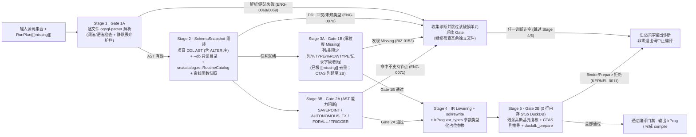

# SpinDuck 编译期（Compile）SQL 语法与方言门禁详细设计文档（V4 工程对齐定稿版）

> **适用基线**：`c2j/SpinDuck` `main`（单 crate `spinduck` + `ogsql-parser v0.11.0` + 嵌入式 `codeweb v0.9.10` + `duckdb = "=1.10505.0"` 对应 DuckDB 1.5.5）  
> **文档定位**：独立设计规范，定义 SpinDuck 在 `compile` 阶段（`IR` 封版与集合化改写之前）的强制前置校验门禁：  
> 1. 存在任何 GaussDB SQL/PL 语法问题、DDL 冲突或 Missing 对象，编译期立即报错；  
> 2. 存在 GaussDB 合法但 DuckDB 1.5.5 不支持的语法或函数签名（如 `SAVEPOINT`），编译期立即报错。  
> **前序关联规范**：`docs/design-compile.md`（项目态 `compile --dir` 闭包与 `RunPlan` 契约）、`docs/embeded-codeweb.md`（嵌入式 `codeweb v0.9.10`）、`AGENTS.md`（接缝、错误码与规则探针纪律）。

---

## 1. 背景、核心原则与现状差距

### 1.1 现存问题
1. **对象缺失检查粒度不足且滞后**：项目态 `compile --dir` 目前仅通过 `plan/codeweb` 瘦图检查入口闭包内的**表 / 视图 / 序列 / 例程名**是否存在（写入 `RunPlan.missing`），**不查列名、不查 `INSERT(cols)`、不查 `%TYPE` / `%ROWTYPE` 字段、也不覆盖无项目路径模式**；缺失列或未知函数往往要推迟到 `spinduck call` 运行期由 DuckDB Binder 抛出 `KERNEL-0010`。
2. **方言支持断层未在编译期阻断**：`ogsql-parser v0.11.0` 负责解析 GaussDB/openGauss 语法，能合法解析 `SAVEPOINT`、`ROLLBACK TO SAVEPOINT`、`PRAGMA AUTONOMOUS_TRANSACTION`、`CONNECT BY` 等语法；但 **DuckDB 1.5.5 不支持这些特性**，而 SpinDuck 解释器也未实现它们。若编译期不阻断，要么推迟到运行期失败，要么因忽略/降级破坏事务语义一致性。

### 1.2 五项工程硬性原则
1. **Compile 先行（Fail-Fast）**：在任何可执行 `IrProg` 封版与集合化优化之前完成门禁；存在阻塞诊断时以非零退出码中止。
2. **AST 优先，禁止关键字正则兜底**：Rust 正式实现必须消费 `ogsql-parser` 公共 API（`Tokenizer` / `Parser` / `AST`）与词法区间，严禁正则或子串扫关键字，避免注释或 `'SAVEPOINT'` 字符串字面量误杀。
3. **遵守 `SqlExecutor` / `exec_native` 接缝纪律（`AGENTS.md §1`）**：编译期绝不执行待编译业务 SQL；任何对 `duckdb::Connection` 的直接调用**只允许**落在原生执行模块（`src/sql/exec_native.rs`），上层编译器与门禁只能通过受控接缝（见 §2.3）调用。
4. **规则同源、禁止手工双份清单**：类型映射复用 `config/rewrite-rules.toml [types]` 与 `src/types.rs::SpinType`；函数清单由 `RuleRegistry` + `SqlFn` + 版本锚定的 DuckDB 1.5.5 内建快照三源合成，严禁手工维护孤立白名单。
5. **错误码全部纳入 `ENG-####` / `BIZ-####` / `KERNEL-####` / `ENV-####` 体系**：在产生点标注 `FaultDomain`，不另造 `ERR_*` 字符串错误系，且每个新增错误码配探针/单元测试（`AGENTS.md §5`）。

---

## 2. 与 `docs/design-compile.md` 的关系、适用范围与内核接缝

### 2.1 与 `docs/design-compile.md` 及 `plan/codeweb` 的边界切分

* **`plan/codeweb` 的真实能力边界**：`spinduck/src/plan/codeweb/`（经 `EmbeddedCodewebSource` 消费嵌入式 `codeweb v0.9.10`）输出的是**瘦投影图 `ThinGraph`**（节点仅含 `Procedure` / `Function` / `Package` / `Table` / `View` / `Sequence` / `MaterializedView` / `Unresolved` / `BuiltinFunction`；`trigger`/`index`/`synonym` 等节点在 `parse.rs` 投影时被丢弃），**不包含列（Column）元信息、不包含数据类型、也没有所谓的 `SchemaProvider`**。因此 `CREATE TRIGGER` 的阻断只能依赖 Gate 1A/2A 的 AST 判定，不能依赖图节点。
* **两份设计的协同分工**：
  * `docs/design-compile.md` 继续负责**项目级调用闭包、多文件依赖发现、`RunPlan`（`schema_version = 1`）落盘与 `[[missing]]` 产出**；
  * **本设计文档**负责接替并升级 `cli/run/compile_project.rs::ir_failures`（原仅调用裸 `eng.register`）与单文件编译前端，在闭包源文件及路径体检文件上执行**语法 + 列/%ROWTYPE/函数精细缺失 + DuckDB 1.5.5 兼容门禁**。

#### 与 `RunPlan [[missing]]` 的去重与互斥规则（防止双报与口径漂移）
在项目态 `compile --dir` 中：
1. `plans_from_source` 先通过 `codeweb` 瘦图求取每个入口的闭包并产出 `RunPlan.missing`（即 `[[missing]]`：`relation:` / `sequence:` / `routine:` 存在性缺失，继续按既有契约输出 `MISS <object> <- <from>` 并计入 `missing=`）；
2. 随后运行的本门禁 **Gate 1B 对已在当前入口 `plan.missing` 中报过的缺失表/视图/序列/例程名做去重豁免**，不重复输出一条列外报错；
3. **Gate 1B 专职补充 `[[missing]]` 无法看见的细粒度缺失**：
   * 物理表列缺失（限定 `t.col` / `alias.col`、`INSERT INTO t(cols)`、单表与多表 Join 非限定列名及跨表歧义列）；
   * 类型锚点与记录字段缺失（`t.col%TYPE`、`t%ROWTYPE` 及 `r_rec.typo_field`、游标投影记录 `r_cur.typo_field`）；
   * 未被 `codeweb` 视为关系对象的内建函数错用或未注册标量调用。

---

### 2.2 CLI 全命令适用范围矩阵

| CLI 入口 / 模式 | 代码位置 | 可用上下文与执行器 | 启用的门禁阶段 | 行为说明 |
| :--- | :--- | :--- | :--- | :--- |
| **`spinduck compile --dir <项目>`**（项目态） | `cli/run/compile_project.rs` | 完整项目源码、`[[entry]]`、codeweb 瘦图、项目 DDL 文件、可选 `--db <path>` | **全量启用：`Gate 1A` + `Stage 2` + `Gate 1B`（与 `[[missing]]` 去重） + `Gate 2A` + `Gate 2B`** | 本设计核心主战场；替代原裸 `ir_failures` 循环 |
| **`spinduck compile <path>...`**（路径态） | `cli/run/compile.rs` | 单/多 `.sql` 路径，无 `spinduck.toml` 闭包与全局 DDL，当前固定使用 `NoopExecutor` | **`Gate 1A` + `Gate 2A`**（纯 AST / IR，零 DuckDB 依赖） | 不启用跨文件 `Gate 1B`（无全局表/列快照），也不强制启 DuckDB 跑 `Gate 2B`，保持轻量与无 `native` 可运行性 |
| **`spinduck explain --file <f> <routine>`** | `cli/run/compile.rs` (`explain_cmd`) | 单文件例程源码，不打开 DuckDB | **`Gate 1A` + `Gate 2A`**（经 `eng.register` 侧复用） | 在打印 IR 前拦截无效语法与 DuckDB 不支持 PL/DDL |
| **`spinduck call --file <f>` / `call --plan <p>`** | `cli/run/call.rs` | 真 `DuckExecutor`（内存或 `--db`），运行前已有 `refuse_on_kernel_gaps` | `eng.register` 内自动复用 **`Gate 1A` + `Gate 2A`** | 对既有合法输入的 `kernel_gaps` 门与 stdout/退出码契约不变；对 Gate 2A 命中项（如 `SAVEPOINT`）由原先的运行期失败/静默降级**提前为编译期 `ENG-0071` 拒绝**——这是有意的新增错误路径，落地 PR 须配守护测试锁定新行为 |

---

### 2.3 `SqlExecutor` 内核接缝方案与 `native` Feature 边界（含 Ask First 项）

核实 `spinduck/src/exec.rs` 与 `AGENTS.md §1`：
* 现行 `pub trait SqlExecutor` 仅有 `query(&self, sql: &str, binds: &BindMap)` 与 `execute(&self, sql: &str, binds: &BindMap)`；
* `AGENTS.md §1` 明确约束：DuckDB API 只允许出现在原生执行器实现（仓库当前位于 `spinduck/src/sql/exec_native.rs`），且 **变更 `SqlExecutor` 签名 = Ask first**。

因此 Gate 2B 的内核校验接缝提供如下收敛方案（**实施 PR 前须确认一项 Ask First 选择**）：
1. **方案 A（推荐 · 零 `SqlExecutor` trait 签名破坏）**：
   * 在 `spinduck/src/sql/exec_native.rs`（`#[cfg(feature = "native")]`）内封装受控校验器 `pub struct DuckPrepareValidator { conn: Connection }`（与 `DuckExecutor` 同处 `exec_native.rs` 唯一准许触碰 `duckdb` crate 的模块内，对外不泄露任何 `duckdb::*` 类型）；
   * 仅暴露三个纯 SpinDuck 类型方法：`from_readonly_db(path)`（提取 `--db` 元数据快照）、`open_in_memory_stub(ddls: &[String])`（建立 0 行内存 Stub 表）与 `prepare_check(&self, sql: &str) -> Result<(), EngineError>`（内部仅调用 `conn.prepare(sql).map(|_| ())`）；
   * **优点**：完全不修改 `SqlExecutor` trait 签名，不破坏任何现有 `FakeExecutor` / `CountingExec` / `NoopExecutor` 实现与测试。
2. **方案 B（Ask First 备选 · 扩展 `SqlExecutor` 默认方法）**：
   * 为 `SqlExecutor` 增加带默认空实现的方法 `fn prepare_check(&self, _sql: &str) -> Result<(), EngineError> { Ok(()) }`，仅 `DuckExecutor` 覆写。需走 `AGENTS.md §1` Ask First 审批。
3. **无 `native` feature（`--no-default-features`）退化策略**：
   * `Cargo.toml` 当前默认已开启 `default = ["native"]` 与 `cli = ["dep:duckdb", "native"]`。若用户在显式关闭 `native` 的构建中调用项目态 `compile --dir`，`Gate 2B` 通过 `#[cfg(not(feature = "native"))]` 编译期跳过，并在摘要输出显式标出 `gate2b=skipped(no-native)`（不静默假装已通过）。

---

## 3. 三层能力归属模型与五阶段编译流水线

### 3.1 三层能力归属矩阵（防止误杀可降级语法）

| 能力层级 | 涵盖语法示例 | SpinDuck 处理方式 | 门禁判定 |
| :--- | :--- | :--- | :--- |
| **Layer A · IR 解释器接管** | `CREATE PROCEDURE/FUNCTION/PACKAGE BODY`、`DECLARE`、`IF/ELSIF/CASE/LOOP`、`CURSOR`、`EXCEPTION WHEN`、`COMMIT`/`ROLLBACK` | 编译为 `IrProg` 由 Rust 解释器执行 | **放行**；但解释器**未实现**且 DuckDB 不支持的构造（`SAVEPOINT`、`PRAGMA AUTONOMOUS_TRANSACTION`、`BULK COLLECT`、`FORALL` 等）由 **Gate 2A** 报错阻断 |
| **Layer B · SQL 方言重写层** | `NVL`、`DECODE`、`FROM sys_dummy`、`ROWNUM = 1`、`(+)` 外连接、`seq.NEXTVAL`、`a \|\| b`、`TO_CHAR`/`TO_DATE` | 经 `sql/rewrite/` 与 `sql/patterns.rs` 等价改写为 DuckDB SQL 或 `IrStmt` | 改写并消解原高斯基元后送 Gate 2B 验证；若改写未覆盖形态（如双向 `(+)`、`ROUND(date,'MM')`）由 **Gate 2B** 精准拦截 |
| **Layer C · 原生直通 DuckDB 1.5.5** | 标准 `SELECT`/`INSERT`/`UPDATE`/`DELETE`/`MERGE INTO`/`TRUNCATE`/`CREATE TABLE`/`VIEW` | 改写后交 DuckDB 执行 | 必须通过 **Gate 2B** 0 行内存 Stub `duckdb_prepare`；不被 DuckDB 1.5.5 支持的语法（`CREATE TRIGGER`、`CONNECT BY`、`FOR UPDATE`）**报错阻断** |

> **语法不支持 vs 语义差异边界**：诸如整型除法、除零、`||` 双 `NULL` 处理、PL 赋值宽松转换 `[implicit]` 开关等属于运行期/改写期语义对齐问题，由 `config/rewrite-rules.toml` 与 `sql/rewrite/` 负责，不作为 Gate 2 语法报错。

---

### 3.2 修正后的五阶段编译流水线（含 E2/E3 提前短路汇合）



> **短路汇合语义（解决流程闭环）**：只要 Stage 1 / 2 / 3A / 3B 任一产生阻塞诊断，诊断统一进入收集器并**跳过 Stage 4 改写与 Stage 5 DuckDB Prepare**（避免残缺 AST 或已知缺失列产生级联 `KERNEL-0011` 噪声），同时允许对同一文件集内相互独立的其余有效文件继续跑完 Stage 1–3，最终按 `(file, line, column)` 汇总退出。

---

## 4. SchemaSnapshot 构建、类型映射与各门禁细则

### 4.1 双模式 `SchemaSnapshot` 与 DDL 演化规则（Stage 2）

1. **数据源构成**：
   * **项目源码 DDL（离线基础）**：遍历项目目录（含 `RunPlan.ddl_tables` 命中及项目声明 DDL 路径）已通过 Gate 1A 的 `CREATE TABLE` / `CREATE VIEW` / `CREATE SEQUENCE` / `ALTER TABLE` AST；
   * **`--db <path>` 只读补全（可选）**：若用户指定 `--db`，通过 `exec_native` 只读系统表查询抽取已有对象：
     * `SELECT database_name, schema_name, table_name FROM duckdb_tables()`
     * `SELECT schema_name, table_name, column_name, data_type FROM duckdb_columns()`
     * `SELECT schema_name, view_name, sql FROM duckdb_views()`
     * `SELECT schema_name, sequence_name FROM duckdb_sequences()`
2. **Stub DDL 类型映射（唯一真源，禁止另建映射）**：
   * 生成 Gate 2B 内存 Stub 建表 DDL 时，列类型**100% 复用 `config/rewrite-rules.toml [types]` 与 `spinduck/src/types.rs::SpinType::from_gauss_name`**；
   * 对语料常见但 `[types]` 暂未收录的标准别名（如 `INTEGER`、`BIGINT`、`TIMESTAMP WITH TIME ZONE`、`DOUBLE PRECISION`），按规定走 `config/rewrite-rules.toml [types]` 补充 PR（带探针测试），**不得**在 `compile_gate` 内写第二套硬编码转换；未收录且不可解析的未知类型名报 **`ENG-0070`**（不静默降级）。
3. **DDL 演化与语义冲突独立归类（`ENG-0070`）**：
   * 按确定拓扑序（文件序 + 依赖序）应用 `ALTER TABLE ADD / DROP / ALTER COLUMN` 刷新 `SchemaSnapshot`；
   * 同一作用域内出现重复 `CREATE TABLE`（无 `IF NOT EXISTS`）或 `ALTER TABLE` 指向不存在表/重复列，归入 **`ENG-0070`（DDL 语义冲突）**，与 Gate 1A 词法/语法错误分离。

---

### 4.2 Gate 1A · 高斯语法与解析完整性校验（`ENG-0068` / `ENG-0069`）

* **全语句 AST 覆盖**：顶层 DDL（表/视图/序列/例程/包头包体/`ALTER`）、PL/SQL 控制流、内嵌 SQL 与可静态还原的常量拼接动态 SQL，全部通过 `ogsql-parser v0.11.0` 解析；
* **解析失败零容忍**：结合 `Tokenizer` 报错（`ENG-0068`）、静默丢弃护栏（`ENG-0069`，防止解析器把破损 `CREATE PROCEDURE` 吞成空语句）与 Parser 语法错误定位（`ENG-0069`），禁止将解析失败语句当成 Raw SQL 放行。
* **编号纪律**：`ENG-0063`–`ENG-0067` 已被占用且 `ENG-0063` 本身存在双义（`engine.rs` tokenizer vs `runtime/interp/routine.rs`/`eval.rs` call depth），本设计一律使用 `ENG-0068` 起的新号段，**不复用、不改判**既有码；`0063` 双义属存量问题，登记待另行清理。

---

### 4.3 Gate 1B · 细粒度 Missing 对象与存量策略（`BIZ-0152`）

1. **校验范围与去重规则**：
   * 已由 `plan/codeweb` 在 `[[missing]]` 报告过的表/视图/序列/例程名不再重复报警；
   * 对通过对象级存在性检查的所有表引用，继续检验：限定列（`t.col`、`alias.col`）、`INSERT INTO t(cols)` 目标列、单表及多表 Join 非限定列名（不存在或跨表同名歧义均报错）、`t.col%TYPE` 与 `t%ROWTYPE` 锚点。
2. **`%ROWTYPE` 与游标记录字段强校验**：
   * 登记 `r_row tbl%ROWTYPE` 对应的基表列集；登记 `CURSOR c_cur IS SELECT ...`（可静态展开明确别名与已知基表列）的投影字段集；
   * 任何 `r_row.typo_field` 访问若不在记录字段集合内，直接报 **`BIZ-0152`**，不再因变量名屏蔽而放行。
3. **CTAS（`CREATE [TEMP] TABLE tmp AS SELECT ...`）延迟列校验豁免规则（显式防误报）**：
   * 因为 Stage 3（Gate 1B）早于 Stage 5（Gate 2B 内存库推导），对于过程/批内通过 CTAS 声明的临时表 `tmp`：
     * Gate 1B **仅校验表名 `tmp` 在局部作用域中已声明**；
     * 凡指向该 CTAS 表 `tmp` 的列访问（`tmp.col`、`INSERT INTO tmp(col)`）**显式标注 `DeferredToGate2B`，豁免 Gate 1B 报错**，统一交由 Stage 5 在内存 Stub 库执行 `CREATE TEMP TABLE tmp AS SELECT ... LIMIT 0` 推导列元数据后裁决。
4. **视图（View）Stub 化与一期显式限制**：
   * 在 `--db` 模式下，`duckdb_columns()` 已包含存量视图的真实列清单，Gate 1B 与 Gate 2B 均具备完整视图列级检查能力；
   * 在**离线纯源码模式**下：若 `CREATE VIEW v (c1, c2) ...` 带显式列清单或投影基表全部位于项目 DDL 快照内，在内存 Stub 库建 `CREATE VIEW v AS <rewritten_select LIMIT 0>`；若视图定义引用外部未知基表或复杂 `SELECT *` 导致离线无法静态定列，**一期显式限制为：仅校验视图对象存在性（由 `[[missing]]` + `SchemaSnapshot` 覆盖），不对该类视图做离线列级检查与虚构 `SELECT NULL` 凑列**（不制造伪通过）。
5. **同源函数目录与 `--allow-unreachable-missing` 的彻底废弃**：
   * **删除 `--allow-unreachable-missing`**：经核实 `spinduck/src/plan/codeweb/walk.rs` 与 `spinduck/src/plan/closure.rs` 均为**例程级调用图 BFS**，而非过程内 CFG 死分支分析。语料 `PKG_SPLIT_TRADE_STEP3_SH.sql:189,939` 中的 `fnc_com_get_seat_para` 是否执行取决于运行期数据（`v_kind` 值），静态不可判。因此严禁假借“不可达分析”跳过缺失例程；**唯一合法路径是补充显式 `STUB_` 声明文件**（同 `STUB_pkg_split_trade_log.sql`）。
   * **动态 SQL**：静态常量拼接还原后走正常 Gate 1/2；运行期变量拼接保留 `codeweb` `[[dynamic]]` 记录并在运行期 `interp/dynamic.rs` 复检；可选 `--strict-dynamic-sql` 开关在编译期直接拒绝动态 SQL。
   * **同源内建函数目录与版本锚定**：
     * 离线模式的内建允许函数目录由三处合成：`config/rewrite-rules.toml [functions]`、`IrExpr::SqlFn` 注册表、以及仓库受控生成的 **DuckDB 1.5.5 函数快照清单**（如 `config/duckdb-1.5.5-functions.toml`，由 `duckdb_functions()` 导出；具体列名以落地时实际 schema 为准，须覆盖 `function_name` / `function_type` / 参数签名 / `return_type` 及 `has_side_effects`）;
     * 在 `tests/probes/` 新增函数快照探针，校验内置快照版本号 `1.5.5` 与当前链接的 `duckdb = "=1.10505.0"` 运行结果一致。未来升级 DuckDB 内核（V6 门禁）时探针自动变红，强制重建快照，防止漂移。

---

### 4.4 Gate 2A（AST 级 PL/DDL 阻断 `ENG-0071`）与 Gate 2B（0 行 Stub 库 `duckdb_prepare` `KERNEL-0011`）

#### Gate 2A · 基于 `ogsql-parser` AST 拦截未实现 PL 与不支持 DDL
1. **事务保存点与部分回滚（最高优先级）**：`SAVEPOINT <name>`、`ROLLBACK [WORK] TO [SAVEPOINT] <name>`、`RELEASE [SAVEPOINT] <name>`（DuckDB 1.5.5 文档明确不支持 Savepoint，禁止降级为空操作）。
2. **自治事务与隔离级声明**：`PRAGMA AUTONOMOUS_TRANSACTION`、`SET TRANSACTION ISOLATION LEVEL / READ ONLY`。
3. **高危未实现 PL/SQL 构造**：`BULK COLLECT INTO`、`FORALL ... IN`、`TYPE ... IS TABLE OF [INDEX BY ...]`、`VARRAY`、`PIPELINED` / `PIPE ROW`、`RETURNING ... INTO`（IR 未实现形态）、未实现 `PRAGMA EXCEPTION_INIT` / `RAISE_APPLICATION_ERROR`、纯 SQL 查询调用的函数体内写事务/DML。
4. **DuckDB 1.5.5 不支持 DDL / 系统包**：
   * `CREATE TRIGGER`（DuckDB 2.0 才新增，1.5.5 不支持）；
   * `CREATE MATERIALIZED VIEW` / `REFRESH MATERIALIZED VIEW`；
   * `CREATE TABLE ... PARTITION BY RANGE / LIST / HASH`（核心表不支持声明式分区）；
   * `TABLESPACE`、`INHERITS`、`EXCLUDE` 约束、`DEFERRABLE`、`CREATE DOMAIN`、`CREATE SYNONYM`、`CREATE DATABASE LINK`、`GRANT / REVOKE`、`LISTEN / NOTIFY / UNLISTEN`；
   * 未注册高斯系统包（`DBMS_LOCK`、`DBMS_JOB`、`DBMS_PIPE`、`UTL_FILE`、`DBMS_SQL`）。

#### Gate 2B · 改写后 0 行内存 Stub 库 + 类型化 `duckdb_prepare`
1. **残余高斯基元复核**：扫描经 `sql/rewrite/` 改写后的下发 SQL AST，拦截未消解的 `CONNECT BY ... START WITH`、`(+)`、未改写 `ROWNUM`、`FOR UPDATE [NOWAIT | SKIP LOCKED]`、`LOCK TABLE`、`FLASHBACK TABLE`、`table@dblink`。
2. **构建 `:memory:` 0 行 Stub 库**：通过 §2.3 接缝创建 1 个临时内存 DuckDB，用 `[types]` 映射后的列类型批量创建 **0 行基表**与序列（仅当改写规则显式声明下发 `CREATE MACRO` 时才同步创建对应本地宏，禁止为 SpinDuck `SqlFn` 虚构宏）；同步创建同批 `CREATE TEMP TABLE` 及 CTAS。
   * **CTAS 列推导的执行边界声明**：`CREATE TEMP TABLE tmp AS <rewritten_select> LIMIT 0` 会让 DuckDB 对该 SELECT 走一遍 Parser→Binder→Planner（`LIMIT 0` 不产生持久副作用，但 `random()`/`nextval()` 等易变函数会在内存库中真实求值一次）。这是对 §1.2 原则 3"不执行用户 SQL"的**有意且受限的例外**：仅允许已通过 Gate 1A/2A/2B 残余基元复核的纯 `SELECT`（DuckDB `SELECT` 不含写操作），且仅作用于内存 Stub 库、不触碰任何持久化数据；若后续发现该例外不可接受，备选方案是 `CREATE VIEW tmp AS <select>` + 读 `duckdb_columns()` 取列名后再建 0 行表。
3. **参数类型化替换 + `duckdb_prepare`（绝不执行）**：
   * 依据 `IrProg.var_types` 将下发 SQL 中的 `$v_x` 占位符替换为 `CAST(NULL AS <SpinType::duckdb_name()>)`（未知类型缺省按 `VARCHAR`/`DECIMAL(38,6)` 探针策略消歧）；
   * 调用 `prepare_check(sql)` 仅跑 DuckDB 1.5.5 **Parser $\rightarrow$ Transformer $\rightarrow$ Binder**，捕获 `ROUND(date, 'MM')`、`TO_NUMBER(s, fmt)`、`SYS_GUID()`、`ADD_MONTHS()` 等签名不匹配与方言拒收错误，映射为 **`KERNEL-0011`**。
   * 注：`MERGE INTO`（DuckDB 1.4.0 起原生支持）与 `TRUNCATE`（1.5.5 原生支持）通过 Gate 2B 验证正常放行。

---

## 5. 错误码体系、性能拆解与存量迁移计划

### 5.1 规范错误码映射表（对齐 `spinduck/src/error.rs`）

```rust
#[derive(Debug, Clone, Copy, PartialEq, Eq)]
pub enum GateStage {
    GaussSyntax,       // Gate 1A
    DdlSchema,         // Stage 2
    MissingObject,     // Gate 1B
    DialectCapability, // Gate 2A
    KernelPrepare,     // Gate 2B
}
```

| 门禁阶段 | ErrorCode | FaultDomain | 触发条件 | 与既有码关系 |
| :--- | :--- | :--- | :--- | :--- |
| **Gate 1A** | **`ENG-0068`**（Tokenizer 词法）/ **`ENG-0069`**（静默丢弃护栏 + Parser 语法） | `Engine` | GaussDB 词法/语法错误、Parser 降级/静默丢弃 | 新号段；`ENG-0063`–`0067` 已被 `invariant(63..67)` 占用（含 `0063` tokenizer/call-depth 双义存量冲突），不复用 |
| **Stage 2** | **`ENG-0070`** | `Engine` | 重复 `CREATE TABLE`、`ALTER TABLE` 冲突、未知 GaussDB 类型名（未在 `[types]`） | 独立于语法错误的语义/DDL 冲突码 |
| **Gate 1B** | **`BIZ-0152`** | `Business` | 列/非限定列/歧义列、`%TYPE`/`%ROWTYPE`/记录字段、未注册函数调用（且未在 `[[missing]]` 报过） | 紧接 `BIZ-0150`（未登记例程）、`BIZ-0151`（元数错） |
| **Gate 2A** | **`ENG-0071`** | `Engine` | 高斯合法但 IR 未实现且 DuckDB 1.5.5 不支持的 PL/DDL 构造（如 `SAVEPOINT`、`AUTONOMOUS_TRANSACTION`、`CREATE TRIGGER`） | 编译期不可降级显式阻断 |
| **Gate 2B** | **`KERNEL-0011`** | `Kernel` | 改写后 SQL 经 0 行 Stub 库 `duckdb_prepare` 被 DuckDB 1.5.5 Binder/Parser 拒绝 | 区别于运行期执行报错 `KERNEL-0010` |
| **环境边界** | **`ENV-0030` / `ENV-0033`** | `Env` | `--db` 目录读取失败、内置 `duckdb_functions` 快照版本漂移 | 延续 `ENV-0030` 配置/环境错误规范 |

> 每项新增 `ErrorCode` 在落地 PR 中必须配备对应的规则探针测试与守卫单测（`AGENTS.md §5`）。

---

### 5.2 关于缓存与性能目标（剥离虚构 `IrProg` 缓存，诚实评估一期成本）

* **现状核实**：`spinduck/src/ir/types.rs` 中的 `IrProg` 目前**没有任何 `Serialize` / `Deserialize` 实现**，`.spinduck/` 下仅存在计划文件 `RunPlan`（TOML），`spinduck call --plan` 每次启动均现场 `eng.register` 编译源码。
* **设计边界剥离**：因此 **不在本设计一期捆绑引入 `IrProg` 二进制序列化缓存与 `CompileGateStamp` 基础设施**（将 IR 缓存列为独立二期性能优化提案）。
* **一期真实性能影响评估**：
  1. **对 `spinduck call`（`< 5ms` 短调用目标）**：**零影响**。Gate 1B/2B 的全量表列与 0 行 Stub `prepare` 校验只在 `compile --dir` 阶段运行，不进入 `call` 热路径（`call` 仍仅走轻量的 `eng.register` 复用 Gate 1A/2A 与既有 `kernel_gaps`）。
  2. **对 `compile --dir` 阶段**：Gate 1A/1B/2A 与现有 `ir_failures` 共用同一次 `ogsql-parser` 解析产物（零重复解析）；Gate 2B 对单个项目只启 **1 个** `:memory:` Stub 实例，对去重后的静态 SQL 语句批量调用 `prepare`（不执行、无数据扫描），典型百表千行项目预计耗时在 **10–40ms 级**，完全满足编译体验门禁要求。

---

### 5.3 存量语料迁移与 CLI 契约测试处置

#### 1. 存量语料迁移（属 `AGENTS.md §2` **Ask First** 项）
* 实测 `golden/case_corpus_purchase/sql/routines/PKG_SPLIT_TRADE_STEP3_SH.sql` 第 189、939 行调用了 `fnc_com_get_seat_para(...)`，当前 `sql/stubs/` 目录下仅存在 `STUB_pkg_split_trade_log.sql`，无 `fnc_com_get_seat_para` 桩声明；若开启 Gate 1B 严格检查，`case_corpus_purchase` 将立即报缺失（与 `[[missing]]` 同样暴露该历史缺口）。
* **迁移方案（须事先 Ask First 获批后执行）**：
  1. 在 `golden/case_corpus_purchase/sql/stubs/` 新增 `STUB_fnc_com_get_seat_para.sql`（仅空壳签名，同 `STUB_pkg_split_trade_log.sql` 风格），并核对 `sql/ddl/tables.sql` 是否遗漏 `par_fund_seat_para.return_rate_flag` 等被引用列；
  2. 提交前复验 `cargo test --features cli --test cases_native` 与 `cargo test --features gauss`，证明所有过程与函数返回值期望零变更。

#### 2. CLI 契约测试与 `usage` 文本处置
* **`spinduck/tests/cli/usage.rs` 与 `spinduck/src/cli/args/compile.rs::tests`**：
  * 删除无效设想 `--allow-unreachable-missing` 后，仅项目态 `compile --dir` 可选新增 `--db <path>` 与 `--strict-dynamic-sql`；
  * 保持 `usage: compile <path>...`、`compile [--dir <项目目录>]`、`--analyze`、`--codeweb-project`、`--sync-manifest`、`call --plan` 与 `内置种子 < 项目发现 < --rules` 字串逐字不变，且不引入 `--codeweb-bin`，确保现有 `usage.rs` 契约全绿。
* **`spinduck/tests/cli/compile_project.rs` 与 `tests/cli/compile.rs`**：
  * 若现有路径态或项目态夹具测试中含缺失对象或 DuckDB 不支持语法的测试桩，按 `AGENTS.md §2` 逐条列明影响范围并走 Ask First 复核后再改写。

---

## 6. 验证与验收矩阵（独立于 `IrProg` 缓存的落地测试集）

| 测试用例 | 覆盖门禁 | 输入场景 | 预期结果 |
| :--- | :--- | :--- | :--- |
| `should_fail_gate_1a_and_continue_independent_files` | Gate 1A | 文件 A 含 `SELECT FROM tbl`，文件 B 含 `SAVEPOINT sp1` | A 报 `ENG-0069` 且不产生伪 `BIZ-0152`，B 仍被报告 `ENG-0071` |
| `should_classify_duplicate_create_table_as_eng_0070` | Stage 2 | 同作用域两次 `CREATE TABLE t(...)` 无 `IF NOT EXISTS`，或未知类型 `BINARY_DOUBLE` | 报 `ENG-0070`（非语法错 `ENG-0069`），验证 `[types]` 唯一映射 |
| `should_dedup_with_runplan_missing_and_catch_column_rowtype_typos` | Gate 1B | A 表已在 `[[missing]]` 报告；B 表存在但 `b.typo_col`、`r_b.typo_field`（`%ROWTYPE`）拼写错 | A 不双报；`b.typo_col` 与 `r_b.typo_field` 精准报 `BIZ-0152` |
| `should_defer_ctas_columns_from_gate_1b_to_gate_2b` | Gate 1B + 2B | `CREATE TEMP TABLE tmp_x AS SELECT a FROM t1; SELECT a, no_such_col FROM tmp_x;` | Gate 1B 放行 `tmp_x`；Gate 2B 内存 Stub 推导列后对 `no_such_col` 报 `KERNEL-0011` |
| `should_skip_offline_unknown_view_columns_as_explicit_v1_limit` | Gate 1B (N3) | 引用离线无法推导列的全通配外部视图 `v_ext` | 验证视图存在性，不因无离线列快照虚报 Missing 或伪造 `SELECT NULL` |
| `should_block_savepoint_and_unsupported_pl_ddl_via_ast_only` | Gate 2A | `SAVEPOINT sp1;`、`ROLLBACK TO SAVEPOINT sp1;`、`PRAGMA AUTONOMOUS_TRANSACTION`、`CREATE TRIGGER` vs `'SAVEPOINT'` 字面量 | 真实 AST 节点报 `ENG-0071`；字符串字面量与注释零误杀 |
| `should_catch_bad_overload_via_stub_prepare_and_bind_typed_vars` | Gate 2B | `ROUND(date_col, 'MM')`、`SYS_GUID()`、`CONNECT BY`、`(+)`，对比合法 `$v_date` 绑定查询 | 不支持重载与残余语法报 `KERNEL-0011`；合法 `$v_date` 经 `SpinType` 替换通过 `prepare` |
| `should_verify_builtin_duckdb_functions_snapshot_matches_kernel` | 快照探针 | 比对 `config/duckdb-1.5.5-functions.toml` 与嵌入式 DuckDB `duckdb_functions()` | 1.5.5 全量一致；内核版本漂移时探针变红 |
| `should_keep_path_compile_and_explain_free_of_duckdb_dependency` | 适用范围 | `spinduck compile <path>...`（`NoopExecutor`）与 `explain --file` | 执行 Gate 1A + 2A，不触发 Gate 1B 全局缺失与 Gate 2B DuckDB 依赖 |
